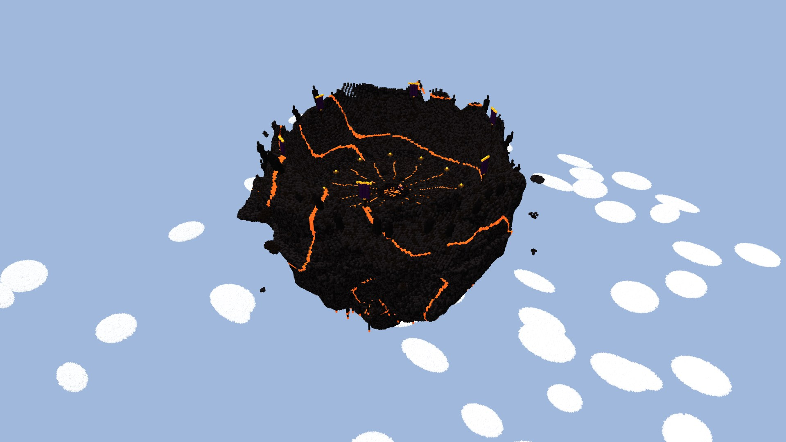

# Arène céleste du Seigneur des bandits : le météore creusé



`warlord_sky_arena.schem` est le modèle réel de l'arène de la seconde phase du
[Seigneur des bandits](../../../docs/mobs/bandit-warlord.md#seconde-phase--larène-dans-le-ciel-maquette-du-1610-à-valider).
C'est la structure à construire. Les images de la fiche du boss (`docs/mobs/images/warlord-sky-arena/`) ne sont que la
maquette qui a servi à la choisir.

Format : WorldEdit Sponge v3, Minecraft Java 1.21.1 (DataVersion 3955), **blocs vanilla seulement**.

- Volume : **195 × 173 × 206** blocs (largeur × hauteur × profondeur).
- **Sol de combat plat : Ø 94** (6 917 cases), dont 6 716 sans rien au-dessus sur 30 blocs. Le reste est occupé par
  12 braseros et 9 rochers bas.
- **Cuvette** : le bord est à 72 blocs du centre, et les parois montent de **26 à 47 blocs** au-dessus du sol selon
  l'endroit (environ 40).
- **Au centre**, la cicatrice de l'atterrissage : obsidienne, obsidienne pleureuse et magma. 14 fissures de magma
  rayonnent sur le sol.
- **Dessous**, un cône de basalte de 116 blocs, veiné de magma, avec des coulées qui pendent. Une vingtaine de rochers
  flottent autour.
- **Décor** :
  - 12 braseros en pierre noire polie et cuivre ciselé, avec un feu éternel sur netherrack ;
  - 6 bannières de laine pourpre et d'or sur des mâts de chêne noir ;
  - 34 pics de pierre noire sur le bord.
- Construction seulement : aucun mob, aucun coffre, aucune entité de bloc.

Le magma des fissures **brûle comme en vanilla** quand on marche dessus sans s'accroupir. C'est voulu pour l'instant :
ce sont des lignes fines. On le remplacera par un bloc Murim si c'est gênant en combat.

## Importation (pour l'essayer)

1. Installer WorldEdit 7.3.8 dans un profil NeoForge 1.21.1.
2. Copier le `.schem` dans `config/worldedit/schematics` du profil.
3. Ouvrir un monde de test avec les commandes autorisées. En mode spectateur, on ne tombe pas avant le collage.

```text
/gamemode spectator
/tp @s 0 250 0
//schem load warlord_sky_arena
//paste -a
```

- **Le point de collage est le milieu du sol de combat**, debout dessus : le sol est à Y − 1 sous le joueur.
- Collé depuis Y = 250, le volume occupe **Y = 134 à 306**. La limite du monde est 320, donc ne pas coller plus haut
  que Y = 263.
- `-a` ne colle pas l'air : rien à creuser dans le ciel, et le collage est beaucoup plus rapide (1 475 855 blocs au
  lieu de 6 949 410 cellules).
- `//undo` annule le collage s'il est la dernière opération WorldEdit.

## Sources et vérification

- **Généré par** `node scripts/worldgen/warlord-sky-arena.cjs`. Même forme que la maquette
  (`scripts/concepts/warlord-sky-arena.js`), mais plein, en vrais blocs, avec un sol de combat parfaitement plat.
- **`render-overview.jpg`, `render-bowl.jpg`, `render-floor.jpg`** : rendus 3D calculés depuis les blocs du `.schem` lui-même
  (`node scripts/concepts/render-sky-arena-schem.cjs --port=<Blockbench isolé>`, puis passés en JPEG). Les personnages
  pour l'échelle (le Seigneur et deux joueurs) sont ajoutés au rendu, ils ne sont pas dans la structure.
- **`plans-de-l-arene.png`** est calculé depuis ses blocs : en haut, vu de dessus ; en bas, une coupe par le milieu.
  La ligne rouge marque la hauteur du sol de combat.
- **`export-stats.json`** : dimensions, palette et nombre de blocs, positions des braseros et des bannières,
  empreinte SHA-256.
- **`verification.json`** : les contrôles statiques (format, palette vanilla, sol dégagé, hauteur des parois). Le fichier
  a été relu par un décodeur NBT séparé : 6 949 410 cellules décodées, autant qu'attendu.
- **Pas encore collé dans un vrai monde** : à vérifier en jeu, avec WorldEdit ou par le code du mod.
