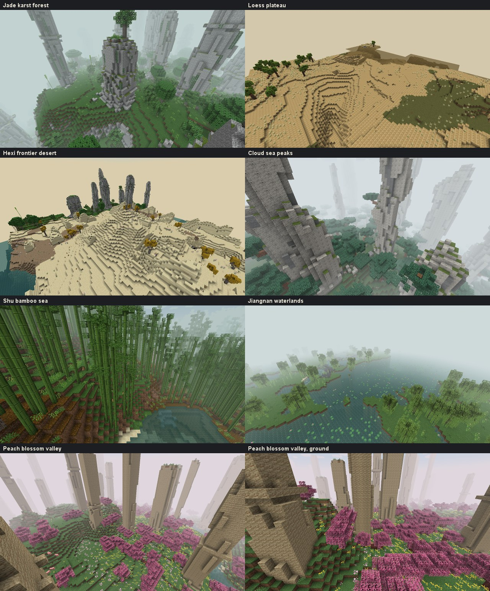
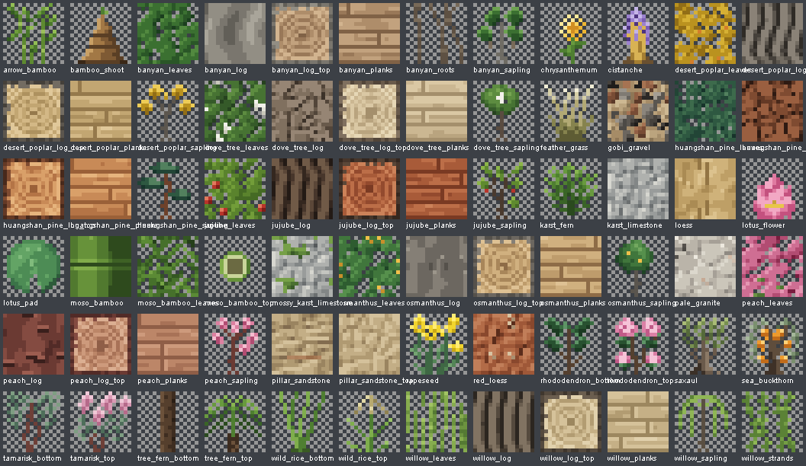
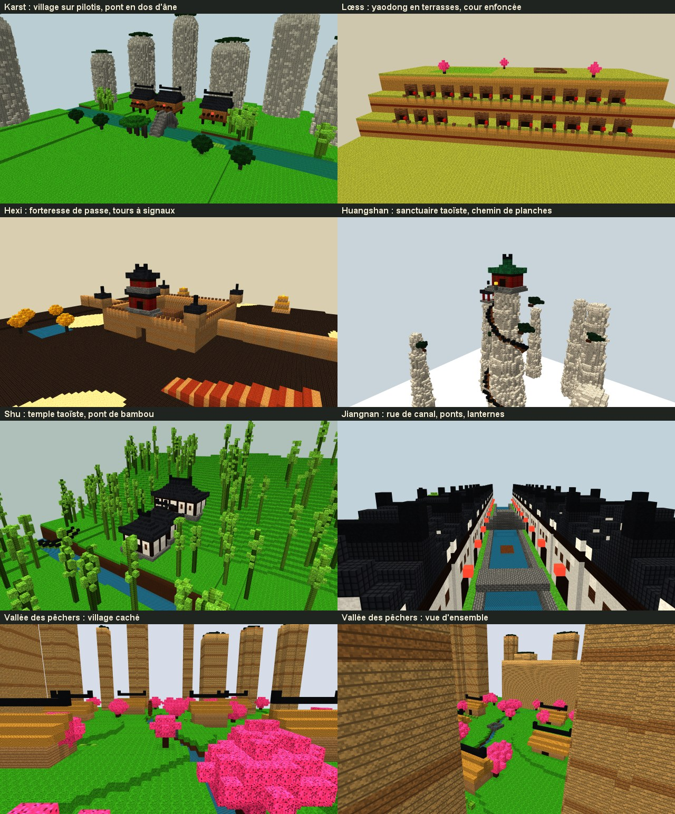

# Biomes Murim : la Chine féodale

Sept biomes inspirés des vrais paysages chinois tels qu'ils étaient à l'époque impériale (des Tang aux Ming), avant les déforestations, les barrages et les villes modernes. Trois sont grands, quatre sont moyens.

Ils sont livrés **sans structures**. Chaque fiche décrit et illustre, en maquettes voxel, les structures prévues pour la suite.





## Refonte du 14 octobre : le rendu « comme Minecraft »

À la demande d'Enzo, les biomes et tous les blocs ont été repris pour retirer leur aspect « goofy » (aplats criards, bandes régulières, plantes en pâtés), en gardant leur inspiration chinoise.

- **Textures, à la manière vanilla, sans en copier aucune :**
  - palettes courtes avec dérive de teinte (ombres froides, lumières chaudes) ;
  - relief peint à partir d'un champ de hauteur éclairé en haut à gauche ;
  - bruit tuilable et cellules de Voronoï pour les pierres, les graviers et les plaques de grès ;
  - feuilles découpées en touffes avec des trous, aiguilles pour le pin, chaînes pour le saule ;
  - plantes et pousses dessinées à la main, pixel par pixel, dans `NatureTextures.java`.
- **Reliefs.** Les tours karstiques sont cannelées, avec des corniches, un pied évasé et un dôme. Les aiguilles du Huangshan sont des faisceaux de colonnes. Les piliers de grès sont droits, à peine érodés. La terre n'apparaît que sur les replats, la mousse ailleurs.
- **Pin du Huangshan** (`TieredPineFeature`) : tronc penché, branches étagées, parasol au sommet. Il couronne les aiguilles et les piliers.
- **Jiangnan** (`WaterlandsFeature`) : les terres juste sous le niveau de la mer deviennent des champs à fleur d'eau, des canaux sinueux et des étangs peu profonds à fond de vase, avec çà et là le lac ouvert.
- **Végétation par taches** (`noise_threshold_count`) : bosquets et clairières au lieu d'un semis uniforme.
- **Sols.** Lœss nu sur la plus grande partie du plateau, sable et pavages de gravier du Gobi dans le désert, mousse et terre racinaire sur les pentes de la bambouseraie.



| Biome (id) | Taille | Inspiration réelle | Fiche |
|---|---|---|---|
| Forêt des pics de jade (`jade_karst_forest`) | Grand | Karst à tours de Guilin et Yangshuo, rivière Li | [jade_karst_forest.md](jade_karst_forest.md) |
| Plateau de lœss (`loess_plateau`) | Grand | Plateau de lœss du fleuve Jaune (Shaanxi, Shanxi, Gansu) | [loess_plateau.md](loess_plateau.md) |
| Désert de la frontière du Hexi (`hexi_frontier_desert`) | Grand | Corridor du Hexi, Gobi, Dunhuang, route de la soie | [hexi_frontier_desert.md](hexi_frontier_desert.md) |
| Pics de la mer de nuages (`cloud_sea_peaks`) | Moyen | Huangshan (monts Jaunes) | [cloud_sea_peaks.md](cloud_sea_peaks.md) |
| Mer de bambous de Shu (`shu_bamboo_sea`) | Moyen | Mer de bambous de Shunan, montagnes des pandas (Sichuan) | [shu_bamboo_sea.md](shu_bamboo_sea.md) |
| Pays des eaux du Jiangnan (`jiangnan_waterlands`) | Moyen | Lac Tai, lac de l'Ouest, villes d'eau du bas Yangtsé | [jiangnan_waterlands.md](jiangnan_waterlands.md) |
| Vallée des fleurs de pêcher (`peach_blossom_valley`) | Moyen | La Source aux fleurs de pêcher de Tao Yuanming, piliers de grès de Wulingyuan | [peach_blossom_valley.md](peach_blossom_valley.md) |

## Comment c'est construit

### Placement dans le monde (TerraBlender)

- **Dépendance.** TerraBlender 4.1.0.8 est une dépendance obligatoire depuis le 12/10/2026, à la demande d'Enzo. C'est elle qui place les biomes dans les mondes normaux.
- **La région Murim.** Le mod ajoute une région TerraBlender, `murimblock:overworld`, de poids 7 contre 10 pour la région vanilla.
- **Ce que la région contient.** Dans une région Murim, toutes les terres tempérées et chaudes appartiennent à l'un des sept biomes. C'est ce qui leur donne de grandes étendues cohérentes. Le reste reste vanilla : les climats froids, les océans, les plages et les vallées des rivières.
- **Le terrain.** Dans Minecraft, le relief vient d'un bruit commun à tous les biomes, pas du biome lui-même. Chaque biome prend donc les créneaux de climat dont le relief vanilla ressemble à sa vraie topographie :
  - le Huangshan prend les zones les plus montagneuses (érosion 0) ;
  - le Jiangnan prend les terres plates (érosion 3 à 6) ;
  - Shu prend les collines humides ;
  - le lœss prend les terres sèches tempérées ;
  - le Gobi prend le chaud et sec ;
  - le karst prend le chaud et humide.
- **Les reliefs caractéristiques** sont des générateurs Java ajoutés par-dessus : tours karstiques, aiguilles de granite, piliers de grès, yardangs (crêtes taillées par le vent), ravins du lœss, étangs du Jiangnan, pins de falaise, bambous géants.
- **Le code** est dans [MurimRegion.java](../../src/main/java/com/murimblock/world/MurimRegion.java).

### Le sol propre à chaque biome

- **La surface** est gérée par les règles de surface de [MurimSurfaceRules.java](../../src/main/java/com/murimblock/world/MurimSurfaceRules.java).
- **Le sous-sol** est remplacé par la roche du paysage sur plusieurs dizaines de blocs, grâce à `GroundBodyFeature`. Les falaises, les ravins et les berges montrent ainsi la bonne roche :
  - calcaire dans le karst ;
  - lœss avec des bandes de paléosol rouge sur le plateau ;
  - granite pâle sur le Huangshan ;
  - grès stratifié dans la vallée des pêchers ;
  - grès et terre cuite dans le Gobi.

### La brume (peinture shanshui)

- **Ce qu'elle fait.** Dans les biomes brumeux, la distance du brouillard se raccourcit. Les plans successifs des montagnes s'effacent les uns derrière les autres, comme dans la peinture shanshui.
- **Son intensité :**
  - très dense au Huangshan, pour la mer de nuages ;
  - moyenne dans le karst et la mer de bambous ;
  - légère dans le Jiangnan et la vallée des pêchers ;
  - aucune sur le lœss et dans le désert.
- **La transition** se fait en douceur, sur environ 3 secondes.
- **Le code** est dans [MurimMistClient.java](../../src/main/java/com/murimblock/client/MurimMistClient.java).

### La flore : 57 blocs propres au mod

- **8 arbres complets** (bûche, planches, feuilles, pousse, plus une recette bûche → planches) : osmanthus, banian (géant en 2×2), pin du Huangshan, jujubier, arbre aux pochettes, saule pleureur, pêcher, peuplier du désert.
- **17 plantes :**
  - fougère karstique ;
  - rhododendron du Huangshan ;
  - argousier ;
  - stipe plumeuse ;
  - pousse de bambou ;
  - bambou fléché ;
  - fougère arborescente ;
  - feuille et fleur de lotus ;
  - riz sauvage ;
  - chrysanthème ;
  - colza ;
  - tamaris ;
  - saxaoul ;
  - cistanche ;
  - racines aériennes du banian ;
  - lianes du saule.
- **Bambou géant moso** : tige et feuillage.
- **7 roches et sols :**
  - calcaire karstique, et sa variante moussue ;
  - granite pâle ;
  - grès des piliers ;
  - lœss ;
  - lœss rouge ;
  - gravier du Gobi.
- **L'onglet créatif** « Murimblock: Nature » rassemble tous ces blocs.
- **Les textures** sont du pixel art original, dessiné par programme, et ne copient aucune texture vanilla.

## Refaire et vérifier

```bash
node scripts/worldgen/generate-nature.cjs
```

Ce script régénère tous les JSON : modèles, loot, recettes, tags, arbres, éléments de génération et biomes.

```bash
java scripts/worldgen/NatureTextures.java src/main/resources/assets/murimblock/textures/block
```

Celui-ci redessine les 72 textures.

```bash
gradlew.bat -PgameTests runGameTestServer
```

Ce sont les GameTests de [NatureGameTests.java](../../src/gameTest/java/com/murimblock/NatureGameTests.java). Ils vérifient :
- le chargement des 7 biomes, de leur région et de leurs tags ;
- que chaque bloc a son objet et son loot ;
- que les 8 arbres poussent avec leur propre bois ;
- que les pousses deviennent des arbres ;
- que les tours, aiguilles, piliers et yardangs atteignent leur taille ;
- la bambouseraie, le pin de falaise et l'étang ;
- que chaque plante ne tient que sur son sol.

```bash
gradlew.bat -PgameTests runBiomeTour
```

C'est la visite en vrai client, dans [BiomeTour.java](../../src/gameTest/java/com/murimblock/BiomeTour.java). Elle :
- crée un monde normal (graine 20261012) ;
- trouve chaque biome ;
- vérifie que sa roche et sa flore y sont générées ;
- prend trois photos par biome.

Le rapport est écrit dans `build/biome-tour-run/biome-tour-report.txt`.

```bash
node scripts/concepts/render-concepts.cjs
```

Ce script rend les maquettes voxel des structures dans `images/structures-*.png`. Il faut un Blockbench isolé, lancé avec `--remote-debugging-port=9232`.

## Sources principales

- **Recherche géographique et botanique :**
  - fiches UNESCO du karst de Chine du Sud et du Huangshan (via des pages secondaires, l'accès direct était bloqué) ;
  - Wikipedia : Loess Plateau, Li River, Huangshan, Wulingyuan, Populus euphratica, Haloxylon ;
  - MDPI Sustainability 15(9):7095 sur la couverture forestière historique du plateau de lœss ;
  - Kew POWO et Flora of China pour les espèces.
- **Recherche architecturale :**
  - fiches UNESCO de Wudang, Qingcheng-Dujiangyan, Emei, Xidi-Hongcun, jardins de Suzhou, Mogao et routes de la soie ;
  - Jiayuguan, site de Xuanquanzhi, yaodong et dikengyuan, pont de Chengyang, Yingzao Fashi.
- **Les listes complètes** des sources sont en bas de chaque fiche.
- **Chiffres approximatifs.** Ceux marqués « env. » viennent de sources secondaires. Ils sont à vérifier avant tout usage historique précis.
