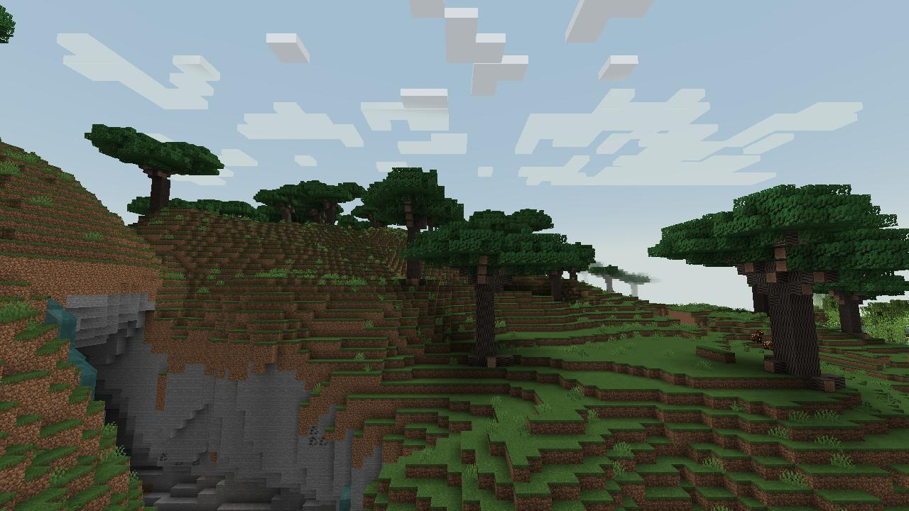
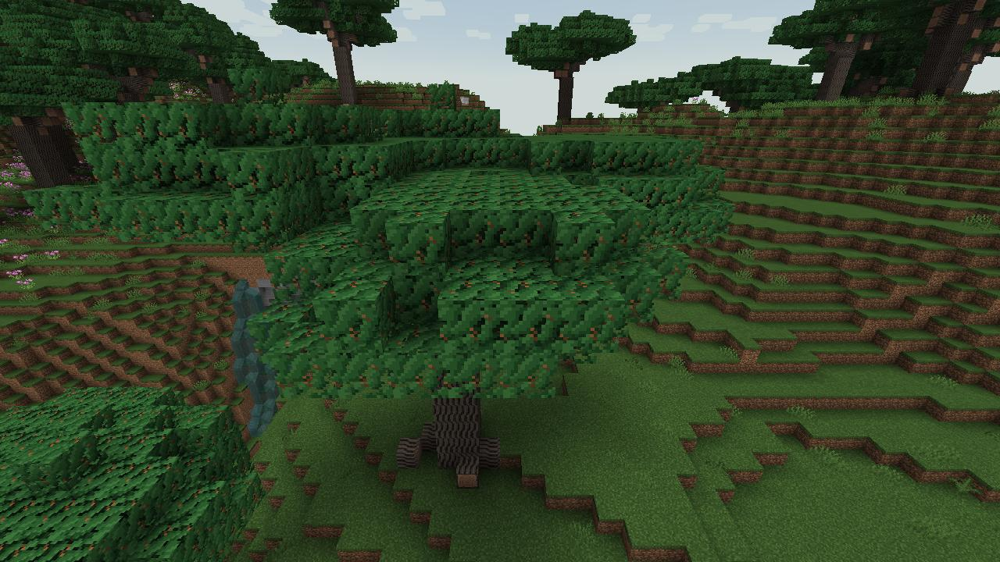

# Collines aux camphriers (`murimblock:camphor_hills`) — grand biome du sud et de l'est

> Demande d'Enzo du 14/10/2026, d'après une capture : « du relief à l'est, avec des lisières », et « le sud peuplé de plaines » : des collines herbeuses, des bois sombres aux bords nets, de la brume dans les vallées.

## Inspiration

**Le paysage réel.** Les collines du Jiangxi, du Hunan et de la Huizhou (Wuyuan) : un pays de collines basses, de rizières et de bosquets, entre le pays des eaux du Yangtsé et les montagnes du sud.
- **Le camphrier** (*Cinnamomum camphora*) est l'arbre de ces villages : un tronc massif, une large couronne ronde de feuilles vernissées vert sombre. Beaucoup de vieux camphriers y sont conservés et vénérés comme arbres sacrés ; certains auraient été plantés il y a 2 000 ans, comme celui du village de Shaojia (Anfu, Jiangxi, environ 6,85 m de diamètre).
- **Les bosquets fengshui** : à l'entrée des villages, des bois gardés pour le fengshui, derniers restes de la forêt subtropicale qui couvrait la région.
- On plantait un camphrier à la naissance d'une fille ; son bois parfumé, qui éloigne les insectes, faisait plus tard les coffres de sa dot.
- **L'astragale de Chine** (*Astragalus sinicus*, 紫云英) : semée dans les rizières entre deux récoltes comme engrais vert, elle couvre les champs de fleurs pourpres au printemps avant d'être enfouie.

## Dans le jeu

- **Où.** Sur la [carte Murim](murim-map.md) : dans le sud, les terres plus douces (ni le karst humide ni les reliefs de la mer de bambous) ; dans l'est, de **longues collines** désormais soulevées (environ 45 blocs, des crêtes de plusieurs kilomètres côte à côte, orientées à 30° de l'est, `MurimMap.hills`), le pays des eaux du Jiangnan restant dans les vallées entre elles.
- **De grands arbres** (`CamphorTreeFeature`, demande d'Enzo : « de beaux arbres aux troncs massifs pour de grandes plaines ») : un tronc nu **de 2 × 2 blocs**, haut de 6 à 8, évasé au pied par des racines-contreforts, qui se divise en 4 à 6 grosses branches montantes (doublées à leur départ), chacune portant un nuage de feuilles aplati ; la couronne est un large dôme irrégulier porté haut, on voit le tronc et l'ombre dessous. Le **camphrier ancien** (arbre fengshui) a un tronc de **3 × 3** blocs, haut de 8 à 10, et une couronne immense.
- **Grandes plaines aux lisières nettes.** Peu d'arbres : de petits bois clairs là où le bruit de végétation dépasse son seuil (rien en dessous, d'où une lisière franche), des camphriers isolés dans les prés, de temps en temps un ancien.
- **Prairies.** Herbe et fougères, champs d'**astragale** violette par taches.
- **Climat et couleurs.** Température 0,8, humidité 0,85. Ciel #9FBBD0, brouillard #D6DDD8, herbe #6FA24C, feuillage #3E7A36. Musique de la forêt.
- **Faune.** Vaches, moutons, chevaux, cochons, poules.

## Flore

| Plante | Bloc du mod | Notes |
|---|---|---|
| Camphrier (*Cinnamomum camphora*) | `camphor_*` | Écorce gris-brun en longues fissures peu profondes, bois rougeâtre parfumé, feuilles vernissées sombres avec quelques jeunes pousses bronze (la poussée de printemps). Tronc à branches basses et couronne ronde ; quatre pousses en carré donnent un camphrier ancien. |
| Astragale de Chine (*Astragalus sinicus*) | `milk_vetch` | Têtes rondes de petites fleurs rose-pourpre sur des tiges fines, feuilles pennées. |

## Plus tard

- Villages aux murs blancs et toits gris de la Huizhou, à l'ombre d'un camphrier ancien ; rizières en terrasses.
- Le bois de camphrier pour les coffres (et un parfum qui éloigne les insectes).

## Sources

- [Fengshui woodland](https://en.wikipedia.org/wiki/Fengshui_woodland) ; [China's fengshui forests (Dialogue Earth)](https://dialogue.earth/en/nature/9935-china-s-fengshui-forests/)
- [Conservation et usages du camphrier (Hunan, Jiangxi, Guizhou)](https://www.proquest.com/scholarly-journals/conservation-applications-camphor-tree-cinnamomum/docview/2259765420/se-2) ; [Ancient camphor trees](https://cccbrussels.be/coming-soon/ancient-camphor-trees.html)
- [*Astragalus sinicus*](https://temperate.theferns.info/plant/Astragalus%20sinicus) ; [rotation riz-riz-astragale (ONU)](https://www.un-ilibrary.org/content/books/9789210473842c005)
