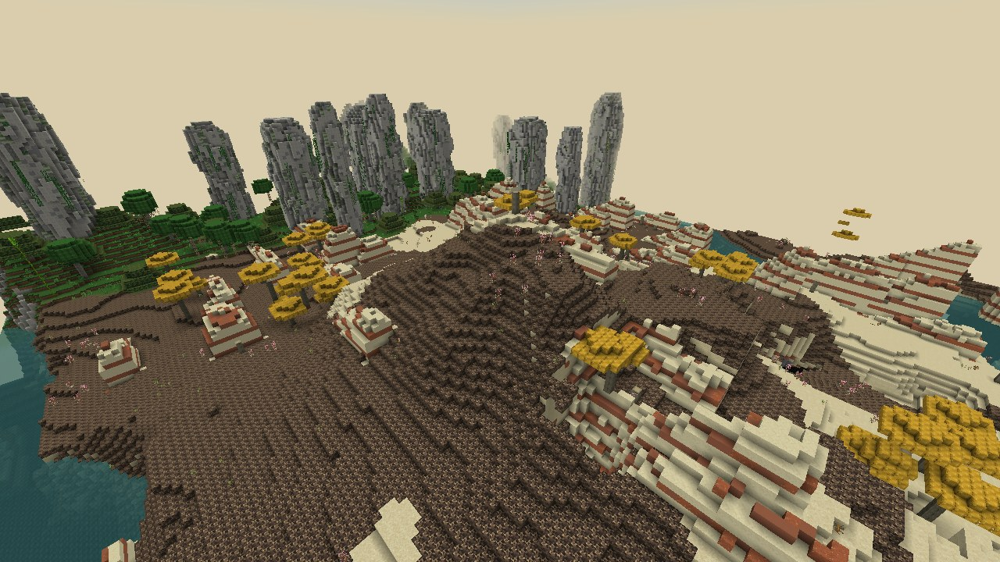
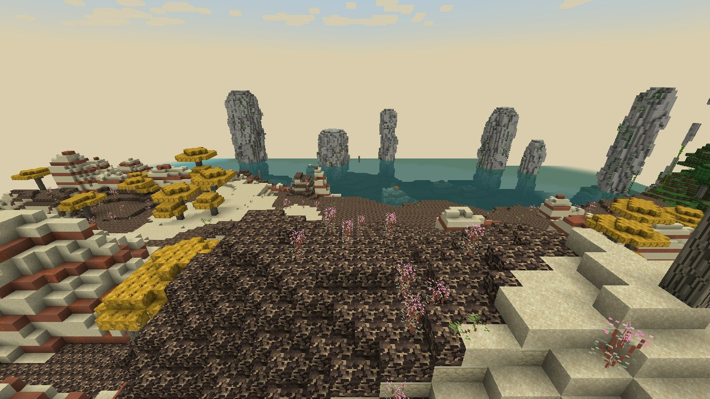
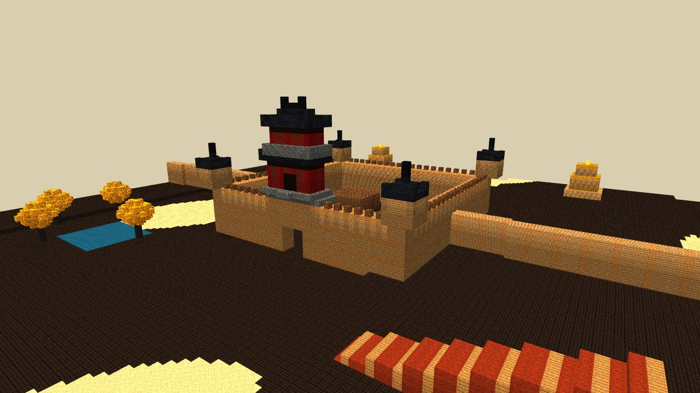
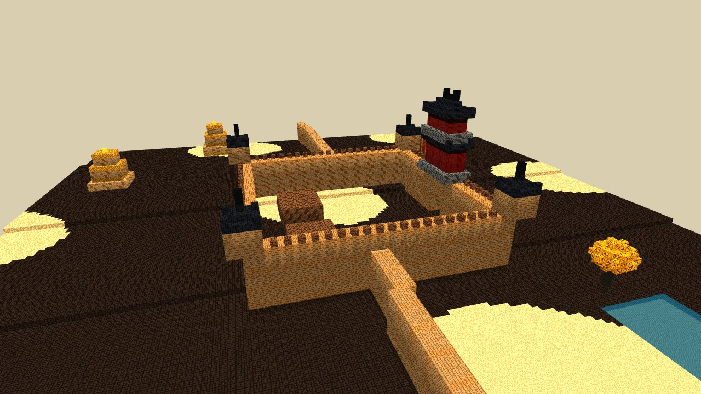

# Désert de la frontière du Hexi (`murimblock:hexi_frontier_desert`) — grand biome

## Inspiration

**Le paysage réel.** Le corridor du Hexi s'étend sur environ 1 000 km, entre les monts Qilian enneigés et le plateau mongol.
- **Le Gobi** : des plaines de gravier sombre, patinées par le vernis du désert.
- **Les dunes** : celles du Mingsha Shan, avec le lac du Croissant à Dunhuang.
- **Les yardangs** : des crêtes de boue lacustre sculptées par le vent, celles de Yadan à Dunhuang.
- **Les oasis** sont alimentées par la fonte des neiges.
- **Le climat** : environ 40 mm de pluie à Dunhuang (chiffre non vérifié), étés chauds, hivers glacés, tempêtes de poussière au printemps.

**À l'époque féodale.**
- C'est la frontière Tang de la route de la soie : passes de Yumen et de Yang, tours à signaux, grottes de Mogao.
- Les forêts riveraines de peupliers du désert étaient bien plus étendues avant les détournements modernes des rivières.
- Poèmes de référence :
  - Wang Wei, « Envoyé à la frontière » : une colonne de fumée solitaire, le soleil couchant sur le long fleuve ;
  - Wang Zhihuan, « Chant de Liangzhou » ;
  - Wang Changling, « Au-delà de la frontière ».

## Dans le jeu

- **Relief.** Le biome occupe toutes les terres chaudes et sèches.
  - Des yardangs sont générés par `YardangFeature` : des crêtes de 14 à 38 blocs de long et de 5 à 13 de haut, en grès lisse strié de terre cuite et de lœss rouge.
  - Ils sont tous orientés selon le même vent dominant : tête abrupte face au vent, queue effilée sous le vent.
- **Sol.**
  - En surface : gravier du Gobi, sombre et patiné, avec des congères de sable.
  - En dessous : du grès sur 10 blocs, rayé de terre cuite tous les 5 blocs.
- **Climat et couleurs.**
  - température 2,0, aucune précipitation ;
  - ciel #9FC4E8, brouillard sable #E3CFA3 ;
  - eau #4C9B9A ;
  - herbe #BFB06A.
- **Brume.** Aucune : le paysage doit paraître vide et immense.
- **Faune.** Lapins, chameaux. Côté monstres, les husks remplacent la plupart des zombies, comme dans le désert vanilla.
- **Musique.** Celle du désert.

## Flore

| Plante | Bloc du mod | Notes |
|---|---|---|
| Peuplier du désert (*Populus euphratica*) | `desert_poplar_*` | Tronc tordu et fourchu, écorce rugueuse, couronne dorée en automne. On le trouve en oasis : rares bosquets sur terre grossière, et sa pousse prend aussi dans le sable. On trouve aussi des troncs morts debout, selon la légende des « mille ans debout mort ». |
| Tamaris (*Tamarix ramosissima*) | `tamarisk` (2 blocs) | Brindilles rouge-brun, feuillage plumeux, plumets roses. |
| Saxaoul (*Haloxylon ammodendron*) | `saxaul` | Branches tordues et rameaux verts articulés. |
| Cistanche (*Cistanche deserticola*), le « ginseng du désert » | `cistanche` | Épi charnu jaune-brun à fleurs violettes. Rare. C'est une herbe médicinale wuxia toute trouvée. |
| Buisson mort | vanilla | |

## Structures prévues

1. **Forteresse de passe** inspirée de Jiayuguan.
   - Le modèle réel a été commencé en 1372, avec des murs en terre damée d'environ 10,7 m.
   - Enceinte carrée en strates de terre damée, créneaux.
   - Tour de porte à 3 étages : murs rouges, double toit gris.
   - Tourelles d'angle et bâtiments à toit plat dans la cour.
   - La Grande Muraille en terre damée part vers l'est et l'ouest.
   - Factions : garnison impériale, contrebandiers, dernière halte avant le jianghu sans loi de l'Ouest.
2. **Tours à signaux** (fengsui).
   - Modèle réel : les tours Han de Dunhuang et Yumenguan, en terre damée avec des lits de roseaux et de tamaris.
   - Tours effilées de 8×8 à 5×5 blocs sur 10 de haut, avec une bande de paille tous les 3 blocs.
   - Feu de signal au sommet.
   - Posées en chaîne, à portée de vue l'une de l'autre, pour qu'en allumer une ait un sens en jeu.
3. **Relais de poste et caravansérail** (yi).
   - Modèle réel : le site de Xuanquanzhi, environ 22 500 m², l'un des quelque 80 relais entre Chang'an et Dunhuang.
   - Cour carrée murée, écuries, puits, cargaisons et chameaux.
4. **Grottes-temples à façade de bois.**
   - Modèle réel : Mogao (UNESCO), avec sa façade à neuf étages.
   - Falaise de grès percée de grottes sur 3 niveaux, reliées par des galeries.
   - Factions : sectes bouddhistes de l'Ouest (style Kunlun ou Tianshan), cultes du feu inspirés des manichéens et des zoroastriens de la route de la soie.

## À ajouter plus tard

- **Relief :** dunes (sous-biome à bruit dédié), lacs salés, et sommets enneigés des Qilian en bordure.
- **Mobs :**
  - chameau de Bactriane sauvage ;
  - gazelle à goitre ;
  - âne sauvage (khulan) ;
  - aigle royal ;
  - pillards du désert.
- **Climat :** tempêtes de sable qui réduisent la vue.
- **Objets :** cistanche (herbe de qi), réglisse, pierres de jade de Hotan, marchandises de la route de la soie.

## Sources

- https://en.wikipedia.org/wiki/Populus_euphratica
- https://www.iplant.cn/foc/pdf/Populus.pdf (Flora of China)
- https://en.wikipedia.org/wiki/Haloxylon_ammodendron
- https://wiki.bugwood.org/Tamarix_ramosissima
- https://www.frontiersin.org/articles/10.3389/feart.2021.728202/pdf (dunes du Hexi)
- https://whc.unesco.org/en/list/1442 (routes de la soie)
- https://www.chinahighlights.com/greatwall/section/jiayuguan-pass.htm
- https://chinaservicesinfo.com/s/202206/10/WS62a2f3f6498ea2749279a666/xuanquanzhi-site-a-postal-station-on-the-ancient-silk-road.html
- https://en.wikipedia.org/wiki/Mogao_Caves
