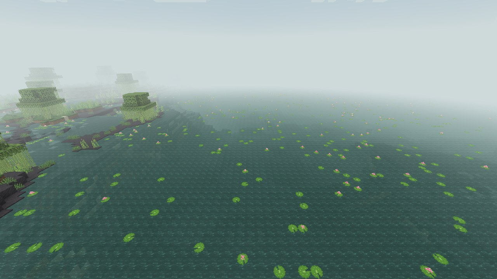
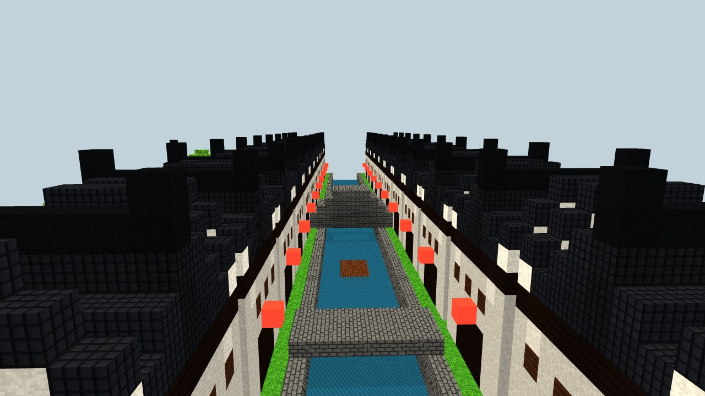
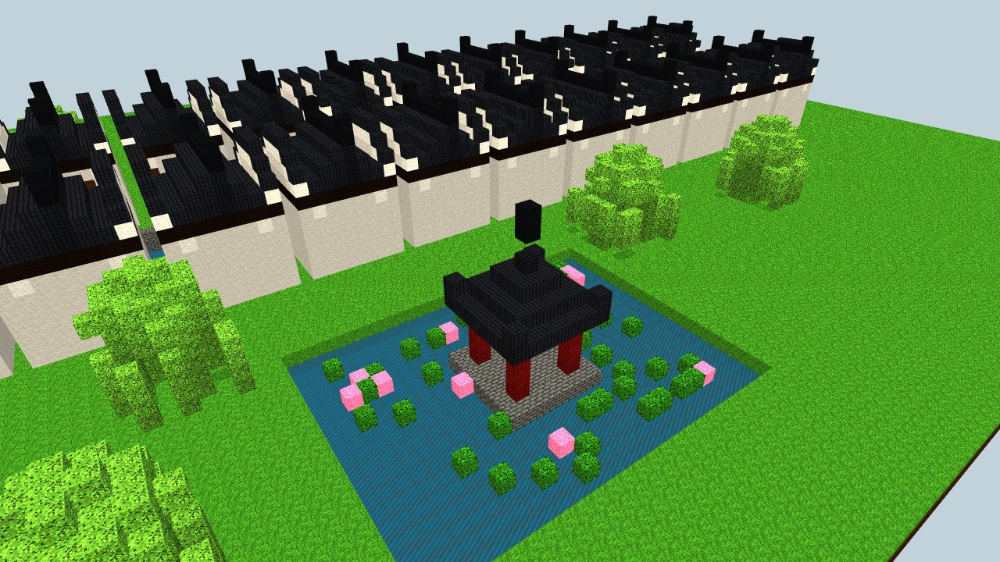

# Pays des eaux du Jiangnan (`murimblock:jiangnan_waterlands`) — biome moyen

## Inspiration

**Le paysage réel.** C'est le delta plat du bas Yangtsé, à quelques mètres au-dessus de la mer.
- Le lac Tai fait environ 2 250 km² pour environ 2 m de profondeur.
- Le lac de l'Ouest (Hangzhou) fait environ 6,5 km². Sa digue Su, construite par Su Shi vers 1090, est bordée de saules et de pêchers.
- Le pays est quadrillé de canaux, de ruisseaux, d'étangs et de polders.
- Le climat est pluvieux : de 1 100 à 1 400 mm par an, avec la pluie des prunes (meiyu) en juin et juillet, de la bruine et de la brume.

**À l'époque féodale.**
- Le pays était plus humide et plus lacustre qu'aujourd'hui.
- Les polders à canaux et digues datent des Tang, et les petits polders des Song et des Yuan.
- Les étangs à poissons bordés de mûriers et la soie étaient partout.
- Peintures de référence :
  - Huang Gongwang, *Séjour dans les monts Fuchun* (1350) ;
  - Wang Ximeng, *Mille li de fleuves et de montagnes* (1113).
- Poèmes : Bai Juyi, « Souvenir du Jiangnan » ; Su Shi, sur le lac de l'Ouest.

## Dans le jeu

- **Relief.** Le biome occupe les terres plates et basses, humides, tempérées à chaudes (érosion 3 à 6), à l'intérieur des terres et pas sur la côte.
  - Des étangs peu profonds sont générés par `ShallowPondFeature` : de 1 à 2 blocs de fond, aux contours irréguliers, sur fond de boue et d'argile.
  - Ils ne se forment que sur un terrain presque plat, pour se lire comme des étangs de polder.
  - Ils se couvrent de feuilles et de fleurs de lotus.
- **Sol.**
  - Boue et argile sous l'eau et le long des berges.
  - Boue sur les rives basses, sous l'altitude 64.
- **Climat et couleurs.**
  - température 0,8, humidité 0,95 ;
  - ciel #AEC3CF, brouillard #D3DDDC ;
  - eau #5E9E92 ;
  - herbe #7AB55A, feuillage #5CA046.
- **Brume.** Légère : le brouillard est ramené à 65 % de sa distance normale, comme les jours de pluie des prunes.
- **Faune.** Vaches, poules, cochons, grenouilles, saumons. Les crabes cuirassés y vivent aussi.
- **Musique.** Celle du marais.

## Flore

| Plante | Bloc du mod | Notes |
|---|---|---|
| Lotus (*Nelumbo nucifera*) | `lotus_pad`, `lotus_blossom` | Grande feuille ronde vert bleuté aux nervures claires. Fleur rose aux pointes blanches, cœur jaune. Flotte sur l'eau comme un nénuphar. |
| Saule pleureur (*Salix babylonica*) | `willow_*`, `willow_strands` | Couronne ronde et longues lianes de feuilles qui pendent jusqu'à l'eau. Sa pousse prend aussi dans la boue et l'argile. |
| Riz sauvage (*Zizania latifolia*, jiaobai) | `wild_rice` (2 blocs) | Grandes tiges et panicule de graines. Pousse dans la boue des berges. |
| Canne à sucre | vanilla | Roseaux des berges. |

## Structures prévues

1. **Rue d'une ville d'eau, le long d'un canal.**
   - Modèles réels : Zhouzhuang (les ponts jumeaux) et Tongli.
   - Maisons-boutiques à 2 étages : murs blanchis, bois sombre, étage en encorbellement, marches de pierre vers l'eau.
   - Pont en dos d'âne et pont plat de dalles, barques, lanternes rouges.
   - Factions : branche du Sud de la secte des Mendiants, pirates du lac Tai, guilde des marchands d'épées.
2. **Demeure de style Huizhou à murs en tête de cheval.**
   - Modèles réels : Xidi et Hongcun (UNESCO).
   - Hauts murs blancs aveugles, pignons étagés coiffés de tuiles noires.
   - Puits de ciel intérieur (tianjing), bassin en demi-lune.
3. **Jardin de lettré, académie ou villa de secte.**
   - Modèle réel : les jardins de Suzhou (UNESCO).
   - Étang central, pont en zigzag, rocailles de pierres du lac Tai, porte de lune, galerie couverte, pavillon au bord de l'eau.
   - Faction : « clan de la cithare et de l'épée ».
4. **Pagode au bord du lac.**
   - Modèles réels : pagodes Leifeng et Liuhe, pagode de Huqiu.

## À ajouter plus tard

- **Plantes :**
  - grand nénuphar épineux (*Euryale*) ;
  - châtaigne d'eau ;
  - rizières inondées (culture) ;
  - mûriers taillés sur les digues.
- **Relief :** digues reliant des îlots, réseau de canaux en polders.
- **Mobs :**
  - canard mandarin ;
  - aigrette ;
  - crabe chinois ;
  - tortue molle ;
  - dauphin du Yangtsé ;
  - pirates du lac.
- **Objets :** soie, graines de lotus, racine de lotus, thé Longjing.
- **Climat :** pluie fine fréquente.

## Sources

- https://en.wikipedia.org/wiki/Taihu
- https://www.chinatravel.com/hangzhou/attraction/west-lake
- https://bluepapers.nl/index.php/bp/article/view/136 (polders weitian)
- https://www.xjtlu.edu.cn/en/news/2023/02/why-is-the-polder-landscape-an-important-water-heritage-of-china
- https://whc.unesco.org/en/tentativelists/5328/ (villes d'eau du Jiangnan)
- https://whc.unesco.org/en/list/813 (jardins de Suzhou)
- https://en.wikipedia.org/wiki/Xidi
