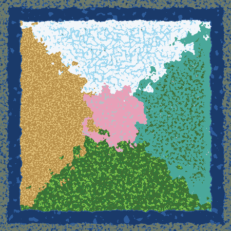

# La carte Murim

> Demande d'Enzo du 14/10/2026 : que le monde soit vraiment le Murim, une « bulle de l'art martial » où tout le monde s'affronte, avec des régions connues d'avance (glace, désert, montagnes…) et des structures placées au hasard. Base des futures capitales et factions. Sur `test`, en attente de validation en jeu.

*Un pixel = 400 blocs. Blanc : neiges du Tianshan ; bleu glacier : chaînes du Kunlun ; vert sombre : collines aux camphriers ; ocre et brun : désert du Hexi et plateau de lœss ; vert vif et vert sombre : mer de bambous et karst ; turquoise : pays des eaux ; rose : vallée des pêchers ; gris clair : pics de la mer de nuages ; bleu nuit : l'océan ; au-delà, le monde vanilla.*

## Les grandes lignes

| Zone | Où | Ce qu'il y a |
|---|---|---|
| **La bulle Murim** | Un carré de **150 000 × 150 000 blocs** centré sur l'origine (de −75 000 à +75 000 sur chaque axe), au littoral irrégulier | Uniquement des biomes Murim sur la terre ferme ; ni mer ni océan à l'intérieur (les rivières restent) |
| **L'océan** | Un anneau de **10 000 blocs** autour de la bulle | Océan profond (gelé au nord, tiède au sud : c'est vanilla qui le colore selon le climat) |
| **Le monde vanilla** | Au-delà | Minecraft normal, sans biome Murim |

## Les régions, fixes dans chaque monde

La disposition est **la même dans tous les mondes** : on sait où est chaque type de biome. La graine change seulement les taches de biomes à l'intérieur d'une région, le relief et l'emplacement des structures.

| Région | Où | Biomes (selon le relief et l'humidité) |
|---|---|---|
| **Centre** : montagnes et vallées sacrées | Un disque d'environ 22 000 blocs de rayon autour de l'origine | Pics de la mer de nuages sur les montagnes, vallée des fleurs de pêcher ailleurs |
| **Nord** : les neiges | Vers −z | Glaciers du Kunlun sur les montagnes, champs de neige du Tianshan ailleurs |
| **Ouest** : les terres sèches | Vers −x | Désert du Hexi là où c'est sec, plateau de lœss ailleurs |
| **Sud** : les terres humides et les plaines | Vers +z | Karst de jade là où c'est humide, collines aux camphriers sur les terres douces, mer de bambous sur les reliefs ; de basses collines |
| **Est** : collines et pays des eaux | Vers +x | Collines aux camphriers sur les collines (environ 45 blocs, `MurimMap.hills`), pays des eaux du Jiangnan dans les creux, pics de la mer de nuages sur les plus hauts sommets |

Les frontières entre régions ondulent sur des milliers de blocs (un bruit à graine fixe) : pas de ligne droite.

## Les montagnes de glace du nord

Demande d'Enzo : « de vrais biomes avec d'immenses montagnes de glace cachant de grands mystères ».
- **Tout le nord est soulevé** (`MurimMap.uplift`, branché dans `overworld/depth`) : un haut plateau d'environ 45 blocs, comme le plateau tibétain au pied du Kunlun, et dessus de longues chaînes sinueuses (bruit en crêtes, large puis fin) qui montent de 150 blocs de plus.
- **Les crêtes sont déchirées** (`MurimMap.jaggedness`, ajoutée à la dentelure de vanilla dans `overworld/sloped_cheese`) : aiguilles et arêtes de roche et de glace, comme les pics déchiquetés de vanilla, mais sur des chaînes entières.
- Relevé sur tout le nord (un point tous les 1 000 blocs) : altitude moyenne 127, des centaines de sommets au-dessus de 200, les plus hauts au plafond naturel du relief (vers 256, au-dessus des nuages), jamais au plafond du monde (`MurimMapGameTests`).
- Les chaînes sont les **glaciers du Kunlun** ; le plateau et les vallées entre elles, les **champs de neige du Tianshan**.
- Les « grands mystères » qu'elles cachent seront des structures (à concevoir avec Enzo).

## Comment c'est fait

- **`MurimMap`** : la géométrie (la bulle, l'anneau, les régions, les ondulations). Aucune graine : la même carte partout.
- **`MurimBiomeSource`** (`murimblock:murim_world`) : la source de biomes du monde. Elle demande d'abord son biome à vanilla ; dans la bulle, sur la terre, elle le remplace par le biome Murim de la région, choisi avec le même bruit de climat que vanilla (l'érosion pour les montagnes, l'humidité pour le sec et l'humide), si bien que les taches suivent le relief. Les grottes (de concrétions, luxuriantes, sombres), les plages et la mer restent vanilla.
- **`MurimContinents`** remplace la « continentalité » de vanilla (`data/minecraft/worldgen/density_function/overworld/continents.json`) : de la terre partout dans la bulle, une côte au bord, l'océan profond dans l'anneau, puis le relief vanilla. Le relief et le choix des biomes de vanilla voient donc la même carte.
- **Le préréglage de monde « normal »** (`data/minecraft/worldgen/world_preset/normal.json`) met cette source sur l'Overworld. Il ne s'applique qu'aux **nouveaux mondes** (un monde existant garde sa génération). Les mondes plats et les « grands biomes » ne sont pas concernés ; le mode « amplifié » garde ses biomes vanilla mais reçoit la bulle de terre et l'anneau d'océan.
- **TerraBlender** ne place plus les biomes Murim (sa région Murim est retirée) ; il applique encore leurs règles de surface (choisies selon l'espace de noms du biome), qu'il n'allume que pour ses propres sources de biomes : `MurimSurface` les allume pour la carte Murim au démarrage du serveur.
- **Le point d'apparition** (`MurimSpawn`) : tiré au hasard à la création du monde, à moins de 60 000 blocs du centre, sur la terre d'un biome Murim, ni dans l'eau ni au-dessus de y = 140. Plus tard, il dépendra de la famille du joueur.
- **Les structures** (les sites Murim, le sanctuaire) gardent leurs règles : chacune dans son biome, à un endroit tiré au hasard.

## Vérifications

- `MurimMapTest` (tests unitaires) : régions aux bons endroits, même disposition partout, terre dans la bulle, océan profond dans l'anneau, vanilla au-delà, côte irrégulière, biome choisi par région.
- `MurimMapGameTests` : le préréglage « normal » charge bien la carte ; sur toute la carte (un point tous les 400 blocs, deux graines), chaque terre de la bulle a un biome de sa région, l'anneau n'a pas de terre, aucun biome terrestre vanilla dans la bulle ; la carte est dessinée en PNG (`build/game-test-run/murim-map-<graine>.png`).
- `runBiomeTour` (vrai client, monde neuf) : le point d'apparition, chaque biome visité au cœur de sa région (avec une vue lointaine ; le Kunlun vu d'en bas), la côte et l'anneau.

## Plus tard

- Les capitales (4 ou 5 mégapoles, une par faction) et leurs factions, quand le lore sera écrit.
- Le point d'apparition selon la famille.
- D'autres biomes pour varier les grandes régions (l'est n'a qu'un biome principal).
