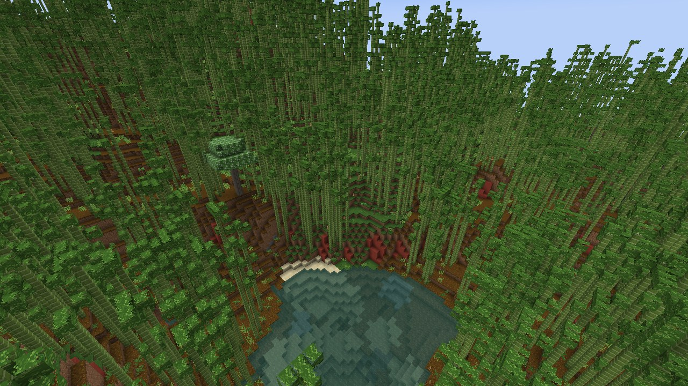
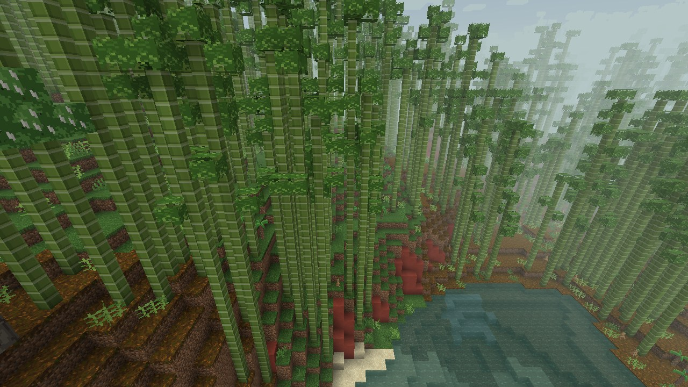
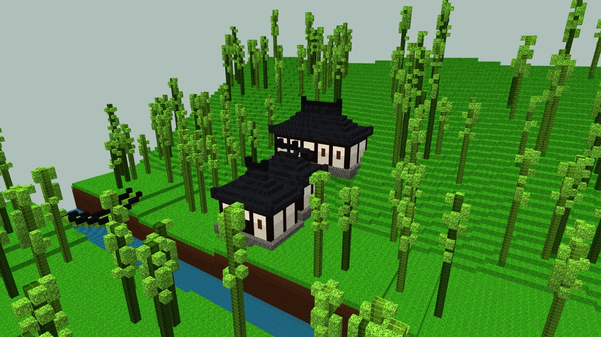
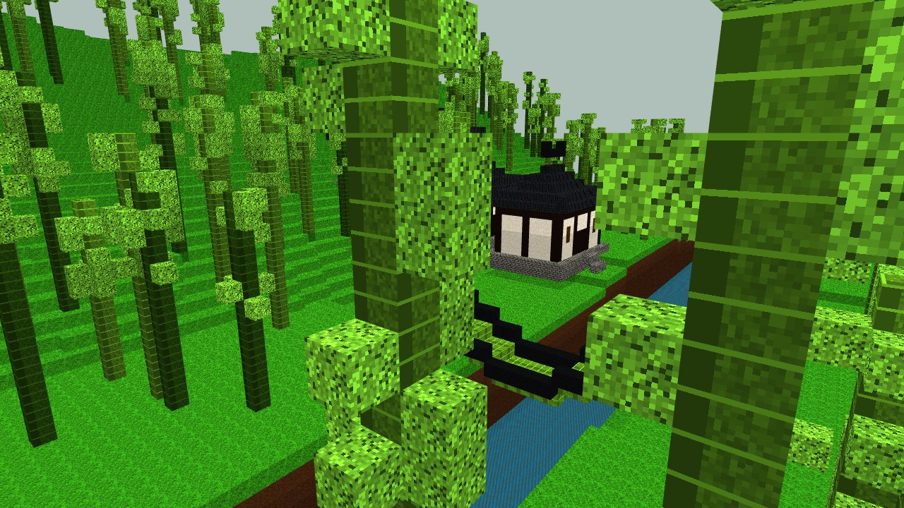

# Mer de bambous de Shu (`murimblock:shu_bamboo_sea`) — biome moyen

## Inspiration

**Le paysage réel.**
- **La mer de bambous de Shunan** (Yibin, Sichuan) couvre environ 120 km², entre 400 et 1 000 m d'altitude. Ses crêtes sont couvertes de bambou moso, coupé de falaises de grès rouge, de cascades et de lacs.
- **Les montagnes des pandas** (Wolong, Qionglai) montent de 1 200 à plus de 4 000 m. Les bambous de sous-bois s'étagent ainsi :
  - *Fargesia* entre 1 700 et 2 600 m ;
  - bambou fléché entre 2 600 et 3 500 m ;
  - le tout sous une forêt mixte.
- **Le sol** est fait des couches rouges du bassin du Sichuan (le « sol pourpre »).
- **Le climat** est humide et célèbre pour son ciel couvert : un dicton dit que les chiens de Shu aboient au soleil tant il est rare.

**À l'époque féodale.**
- Les montagnes étaient bien plus boisées.
- Li Bai, dans « Difficiles routes de Shu », décrit les routes de falaise et les gibbons.
- Wen Tong, ami de Su Shi, fonde la peinture du bambou à l'encre.

## Dans le jeu

- **Relief.** Le biome occupe les collines humides tempérées à chaudes (érosion 1 et 2).
  - Les bambouseraies de moso sont générées par `MosoBambooFeature` : de 8 à 16 tiges épaisses de 12 à 22 blocs de haut.
  - Des touffes de feuilles plumeuses garnissent le tiers supérieur. Elles restent clairsemées pour que les tiges vertes restent visibles.
  - Des pousses de bambou apparaissent au pied.
- **Sol.**
  - Falaises en terre cuite rouge, pour les couches rouges du Sichuan.
  - Litière de podzol par plaques sous les bambous.
- **Climat et couleurs.**
  - température 0,75, humidité 0,9 ;
  - ciel couvert #A4B2B5, brouillard #B7C7B8 ;
  - eau #3D7A6A ;
  - herbe #6FAF4A, feuillage #5E9E3C.
- **Brume.** Moyenne : le brouillard est ramené à 50 % de sa distance normale.
- **Faune.** Pandas (fréquents), poules, cochons, perroquets.
- **Musique.** Celle de la jungle de bambous.

## Flore

| Plante | Bloc du mod | Notes |
|---|---|---|
| Bambou moso (*Phyllostachys edulis*) | `moso_bamboo`, `moso_bamboo_leaves` | Tige de 8 pixels, bien plus épaisse que le bambou vanilla. Nœuds clairs et pruine blanche. Se convertit en planches de bambou (1 tige → 2). |
| Pousse de bambou | `bamboo_shoot` | Cône brun engainé à pointe verte. |
| Bambou fléché (*Bashania*, le bambou des pandas) | `arrow_bamboo` | Fourrés bas et denses. |
| Fougère arborescente (*Alsophila spinulosa*) | `tree_fern` (2 blocs) | Fossile vivant des gorges de grès rouge. |
| Arbre aux pochettes (*Davidia involucrata*) | `dove_tree_*` | Grand arbre rond aux bractées blanches pendantes, les « colombes ». |
| Herbe et champignons | vanilla | |

## Structures prévues

1. **Temple taoïste de montagne.**
   - Modèles réels : le Tianshi Dong et le Shangqing Gong du Qingcheng (UNESCO, l'un des berceaux du taoïsme).
   - Charpente chuandou du Sichuan : cadre de bois sombre et remplissage blanc.
   - Toits gris aux angles très relevés.
   - Salles étagées dans la pente, reliées par un escalier couvert.
   - Factions : école d'épée style Qingcheng, ordre style Emei.
2. **Domaine fortifié d'un clan d'armes cachées et de poisons.**
   - Inspiré du cliché wuxia du « clan Tang du Sichuan ».
   - Enceinte de 35×35 blocs aux murs blancs, deux tours de guet, jardin d'herbes, atelier, laboratoire de poisons.
3. **Pont de câbles de bambou.**
   - Modèle réel : le pont Anlan de Dujiangyan.
   - Tablier qui s'affaisse au centre, pylônes et petits pavillons de porte.
4. **Hameau de papetiers en bambou.**
   - Modèle réel : le papier de Jiajiang, tel que le montre le *Tiangong Kaiwu* (1637).

## À ajouter plus tard

- **Sous-biome d'altitude :** sapins d'Emei, bambou des pandas et brume dense.
- **Falaises de grès rouge avec cascades.**
- **Mobs :**
  - panda roux ;
  - singe doré ;
  - takin ;
  - faisan doré ;
  - rat des bambous.
- **Objets wuxia :**
  - pousses de bambou (cuisine) ;
  - aiguilles et fléchettes en bambou (armes cachées) ;
  - poisons des montagnes.
- **Arbres :** sapin de Chine (*Cunninghamia*), katsura doré en automne.

## Sources

- https://en.wikipedia.org/wiki/Phyllostachys_edulis
- https://chinadailyhk.com/hk/article/368304 (mer de bambous de Shunan)
- https://zoologicalstudies.springeropen.com/articles/10.1186/1810-522X-52-23 (étagement des bambous à Wolong)
- https://powo.science.kew.org/taxon/urn:lsid:ipni.org:names:430593-1/general-information (*Davidia*)
- https://whc.unesco.org/en/list/1001 (Qingcheng et Dujiangyan)
- https://whc.unesco.org/en/list/779 (Emei)
