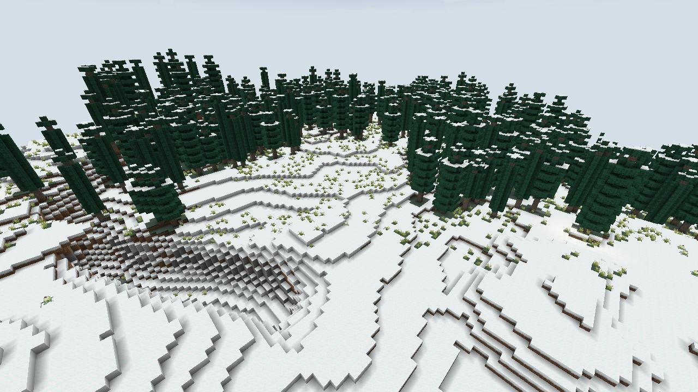
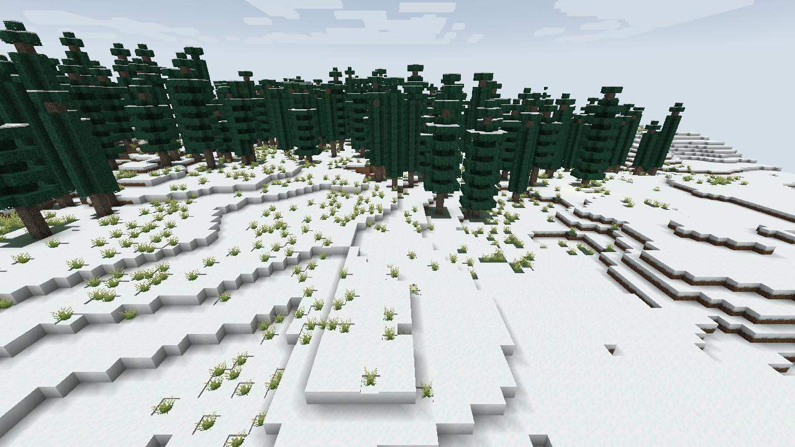

# Champs de neige du Tianshan (`murimblock:tianshan_snowfields`) — grand biome du nord

## Inspiration

**Le paysage réel.** Le Tianshan, les « monts Célestes », barre le Xinjiang d'ouest en est. Le Xinjiang Tianshan est inscrit au patrimoine mondial de l'UNESCO depuis 2013 (quatre zones : Tomur, Kalajun-Kuerdening, Bayinbukuke, Bogda ; 606 833 ha).
- Du pic Tomur (7 443 m) au Bogda (5 445 m), sur plus de 6 000 m de dénivelé : glaciers, forêts, prairies, lacs, au milieu des déserts d'Asie centrale.
- **L'épicéa de Schrenk** (*Picea schrenkiana*) forme une ceinture continue d'environ **1 000 km** sur le versant nord, presque toujours sur les pentes à l'ombre, entre environ 1 600 et 2 900 m. C'est un épicéa étroit et sombre, en flèche.
- Au-dessus de la forêt, des **prairies alpines** de laîches ; dans les bassins, de grands pâturages comme Bayanbulak (vers 2 500 m, marais et lac des Cygnes).
- Plus haut encore, au-dessus de 3 000 m, parmi la roche et la neige : le **lotus des neiges** (*Saussurea involucrata*, 雪莲), une plante médicinale célèbre, aujourd'hui menacée.
- Le **lac Céleste** (Tianchi, vers 1 907 m) au pied du Bogda, que la tradition identifie au **bassin de Jade** de la Reine Mère de l'Ouest.

**Dans le wuxia.** La **secte du Mont Céleste** (Tianshan pai) est l'une des grandes sectes des romans (le cycle du Tianshan de Liang Yusheng ; une autre du même nom chez Jin Yong), et le lotus des neiges y est l'herbe légendaire qui guérit et renforce le Qi.

## Dans le jeu

- **Où.** Le haut plateau et les vallées de la région nord de la carte Murim, entre les chaînes du Kunlun.
- **Climat et couleurs.** Température −0,5 (il neige, l'eau gèle, une couche de neige couvre tout), humidité 0,4. Ciel #9FB4CC, brouillard #DDE5EC, eau #3D6E8C, herbe #80A08A, feuillage #4F7A63. Musique des pentes enneigées.
- **Forêts d'épicéas du Tianshan** (`tianshan_spruce`) : tronc droit de 11 à 19 blocs, couronne en flèche étroite d'aiguilles bleu-noir ; en peuplements serrés là où le bruit de végétation est fort, des clairières de neige entre eux.
- **Sol.** Herbe sous la neige, grandes plaques de neige tassée, roche nue sur les pentes raides.
- **Plantes.** Touffes de **laîche** (`kunlun_sedge`) sur les prairies ; **lotus des neiges** (`snow_lotus`), rare, seul ou par deux.
- **Faune.** Lapins (blancs), renards (polaires), loups, moutons ; strays plutôt que squelettes la nuit.

## Flore

| Plante | Bloc du mod | Notes |
|---|---|---|
| Épicéa de Schrenk (*Picea schrenkiana*) | `tianshan_spruce_*` | Écorce gris-brun en fines écailles rondes, bois presque blanc, aiguilles courtes et raides très sombres. Pousse en flèche. |
| Lotus des neiges (*Saussurea involucrata*) | `snow_lotus` | Un cône de bractées vert pâle et crème qui se chevauchent, les fleurons violets à peine visibles au sommet, des feuilles laineuses gris-vert. Pousse sur la roche, le gravier, la neige ou la terre maigre. |
| Laîche alpine (*Carex*) | `kunlun_sedge` | Touffe serrée de brins fins, jaunis et secs à la pointe. |

## Plus tard

- Le **lotus des neiges comme ingrédient** : un élixir de Qi rare (il guérit et renforce dans les romans).
- Le **lac Céleste** comme lieu de pouvoir, et la **secte du Mont Céleste**.
- Mobs : léopard des neiges, bouquetin de Sibérie, argali.
- Prairies d'altitude fleuries (edelweiss), yourtes de bergers kazakhs.

## Sources

- [UNESCO — Xinjiang Tianshan](https://whc.unesco.org/en/list/1414/) et [UICN, World Heritage Outlook](https://worldheritageoutlook.iucn.org/node/1178)
- [Soil properties at the tree limits of the coniferous forest… (Tianshan)](https://www.springerprofessional.de/en/soil-properties-at-the-tree-limits-of-the-coniferous-forest-in-r/11834156) ; [forêts de *Picea schrenkiana*, versants nord](https://bg.copernicus.org/articles/12/2893/2015/) ; [MDPI Forests 15/12/2052](https://www.mdpi.com/1999-4907/15/12/2052)
- [Conservation et histoire de *Saussurea involucrata* dans le Tianshan et l'Altaï](https://www.ncbi.nlm.nih.gov/pmc/articles/PMC10672382/) ; [génome du lotus des neiges](https://www.ncbi.nlm.nih.gov/pmc/articles/PMC10599237/)
- [Lac Céleste du Tianshan](https://en.wikipedia.org/wiki/Heavenly_Lake_of_Tian_Shan) ; [Bayanbulak](https://en.wikipedia.org/wiki/Bayanbulak_Grassland_National_Nature_Reserve) ; [Reine Mère de l'Ouest](https://en.wikipedia.org/wiki/Queen_Mother_of_the_West)
- [Secte du Mont Céleste (wuxia)](https://en.wikipedia.org/wiki/Mount_Heaven_Sect)
