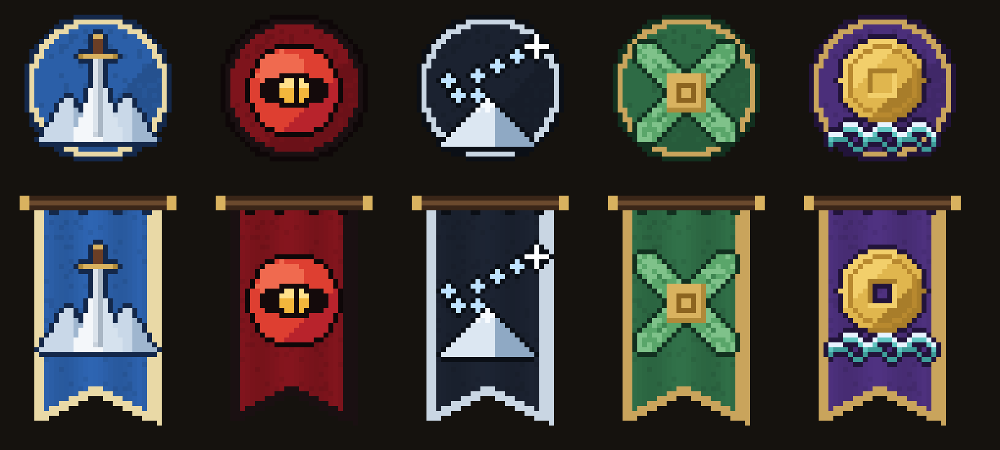

# Le lore du Murim — bible du monde (proposition à valider par Enzo)

> **Statut : proposition, rien n'est en jeu.** Rédigée le 15/10/2026. Décisions d'Enzo :
> - **le joueur n'a aucun lore** : pas d'élu, pas de passé, pas de destin ;
> - **le plus important, c'est le world-building** : le monde a son histoire, et le joueur y entre ;
> - **pour la bêta, on met le monde en place** ; plus tard, les actions des joueurs auront un impact sur lui.
>
> Les noms propres sont des propositions. Les textes en jeu restent en anglais. Ce document est la référence : un
> PNJ, une structure, un livre ou une page du wiki ne doit pas le contredire.

## 1. Le principe

- **Le monde existe sans le joueur.** Les sectes, le Culte, les bandits et la maladie des crabes ont une histoire et des raisons d'être là, que quelqu'un vienne ou non.
- **Le joueur est un anonyme** qui arrive quelque part dans le Murim, sans nom ni maître. Il apprend le monde comme un voyageur : en le parcourant, en écoutant, en lisant. Personne ne l'attend.
- **Le lore se découvre, il ne se récite pas.** Aucun long texte d'introduction. Il passe par :
  - les **lieux** : ruines, stèles, tombes, champs de bataille ;
  - les **PNJ** : quelques phrases chacun ;
  - les **écrits** trouvés : stèles, rouleaux, lettres ;
  - les **ennemis** : qui ils sont, pourquoi ils sont là.
- **Plus tard, le joueur pèse** : rejoindre une faction, abattre un chef, rouvrir un lieu scellé. Le monde réagira. Pour la bêta, on pose seulement le décor.

## 2. Le Murim (武林, « la forêt des arts martiaux »)

- **Le Murim** est une terre close de 150 000 blocs de côté : c'est la carte Murim. Ses habitants l'appellent simplement « le Murim » ou « le monde sous le Ciel » (天下).
- **La Mer sans fin** (无尽海) l'entoure. Selon la légende, les Immortels l'ont tracée pour que les guerres des hommes du Murim ne débordent jamais sur le reste du monde.
- **Au-delà de la mer**, il y aurait des terres sans Qi, les **Terres stériles** : le monde vanilla. Les gens du Murim n'y croient qu'à moitié. Aucun cultivateur qui y est parti n'en est revenu.
- **Le Qi du Ciel et de la Terre** (天地之气) coule dans le sol le long des **veines du dragon** (龙脉).
  - Il est plus dense sur les hauts sommets et dans les lieux saints. C'est pour cela que la méditation y est plus rapide.
  - Il se raréfie sur les Terres stériles, au-delà de la mer.

### La cultivation (déjà en jeu)

| Royaume | Nom de rang que lui donne le monde |
|---|---|
| Qi Sensing | Awakened Human |
| Qi Guiding | Martial Apprentice |
| Qi Condensation | Established Disciple |
| Qi Liquidation | Martial Expert |
| Qi Crystallization | Martial Master |
| Foundation Establishment | Grandmaster |
| Core Formation | Legendary Master |
| Nascent Soul | Transcendent |
| Void Enlightenment | Beyond the Mortal World |

- **Dans le monde d'aujourd'hui**, un Martial Master est respecté dans toute une province. Un Grandmaster est le chef d'une grande secte. On ne compte que **trois ou quatre Legendary Masters** vivants : le Chef de l'Alliance, le Démon céleste, et peut-être un ou deux ermites.
- **Personne n'a atteint Nascent Soul depuis l'Ère des Immortels.** Les derniers à avoir franchi ce seuil sont les Immortels eux-mêmes. C'est la grande question du Murim : le chemin vers le Ciel s'est-il refermé ?

### Les démons du cœur et les âmes résiduelles

- **Le démon du cœur** : à chaque grande porte, tout cultivateur affronte son démon du cœur. C'est connu de tous et redouté.
- **Une âme résiduelle** (残魂) naît quand un maître échoue à cette porte et que son corps est déchiré par son propre Qi : il arrive qu'un fragment de lui survive.
  - Ce fragment erre dans le Qi de la terre et, parfois, s'attache au dantian d'un jeune cultivateur qui vient de s'éveiller.
  - Les sectes appellent ces fragments des **âmes invitées** (客魂). Le phénomène est rare, mais connu : ce n'est pas une élection.
- **Pour le joueur**, le vieux maître de son monde intérieur est l'une de ces âmes. Il a perdu son nom et une partie de sa mémoire. C'est un hôte du monde, pas un destin.

## 3. L'histoire

### L'Ère des Immortels (il y a plus de 3 000 ans)

- Les premiers cultivateurs franchissent tous les royaumes et **montent au Ciel**.
- Avant de partir, ils tracent la Mer sans fin et laissent derrière eux leurs **palais du Kunlun**, scellés dans la glace.
- Leurs textes sont la source de tous les arts martiaux.
- Après eux, plus personne ne monte au Ciel.

### L'Ère des Cent Sectes (de −3 000 à −320 ans)

- Les héritiers des Immortels fondent des centaines de sectes et se disputent les veines du dragon.
- Un **Empire** unifie les terres basses mais ne règne jamais vraiment sur les sectes.
- C'est l'âge d'or des arts. La **secte du Nuage Azur** (青云派) est l'une des grandes sectes d'épée.

### La Guerre du Démon céleste (il y a 320 à 300 ans)

- **Le premier Démon céleste** est un génie sans secte. Il découvre dans une tombe du désert les **arts du sang** : un Qi nourri par le sang des autres.
  - Il fonde le **Culte du Démon céleste** et soumet les sectes hétérodoxes.
  - Il marche sur le centre du Murim.
- **Les sectes droites s'unissent** pour la première fois de l'histoire : c'est la naissance de l'**Alliance orthodoxe**.
- **La bataille finale** a lieu dans la **Vallée des pêchers**. Le sang y coule tant que les pêchers, dit-on, fleurissent rose depuis.
- **Le Démon céleste disparaît.** Mort ? Scellé ? Monté au Kunlun ? Personne ne le sait.
- **Le Culte vaincu se retire** dans le désert du Hexi, derrière la Passe de Jade.

### La Longue Trêve (il y a 300 ans à aujourd'hui)

- **L'Alliance s'installe** dans les montagnes sacrées du centre et bâtit la **Citadelle du Pic céleste**.
- **Le Culte se reconstruit** dans les grottes du désert, autour de la **Forteresse des Sables pourpres**.
- **L'Empire s'effondre** il y a 80 ans, sans héritier. Il n'y a plus d'armée impériale, seulement des forts abandonnés sur les routes, et les **bandits** prolifèrent.
- **La secte du Nuage Azur décline.** Sensei Yun est l'un des derniers maîtres de l'art ; il s'est retiré dans un temple de la mer de bambous.

### Aujourd'hui : l'An 300 de la Trêve

- **L'Alliance vieillit.** Les grandes sectes se jalousent, et son Chef ne quitte plus la Citadelle.
- **Le sang revient.** Des pratiquants de l'**Art Sanguin** sortent du désert et sont vus sur les routes de l'ouest. On dit que le nouveau Démon céleste prépare la revanche du tricentenaire.
- **Une maladie** transforme les pêcheurs du sud et de l'est en **hommes-crabes**. Le Hameau de la Source des pêchers est tombé.
- **Les bandits du Fleuve Jaune** n'ont jamais été aussi nombreux ni aussi audacieux.
- Dans le Kunlun, **la glace craque**.

C'est dans ce monde-là que le joueur arrive.

## 4. Les régions

| Région | Biomes | Ce qu'elle est dans le monde |
|---|---|---|
| **Centre** | Pics de la mer de nuages, Vallée des pêchers | Les **montagnes sacrées**, siège de l'Alliance (Citadelle du Pic céleste). Le sanctuaire de la Falaise des Nuages est un ancien ermitage de secte. La Vallée des pêchers est le champ de bataille de la grande guerre ; ses pêchers sont roses de sang. |
| **Nord** | Champs de neige du Tianshan, Glaciers du Kunlun | Les **terres interdites**. Dans le Tianshan, les ruines du **Palais du Nord Obscur**, brûlé par l'Alliance il y a vingt ans, et des clans de chasseurs qui ne reconnaissent ni l'Alliance ni le Culte. Dans le Kunlun dorment les **palais scellés des Immortels**. On y trouve le jade blanc, et personne n'en revient. |
| **Ouest** | Plateau de lœss, Désert du Hexi | Les **terres sèches de la route de la soie**. Le lœss est le royaume des bandits du Fleuve Jaune. Au-delà de la **Passe de Jade** (le poste de signaux), le désert appartient au Culte. |
| **Sud** | Forêt des pics de jade, Mer de bambous de Shu, Collines aux camphriers | Les **terres vertes et anciennes**. Villages sous les camphriers sacrés, ermitages taoïstes, sectes isolées comme celle du Nuage Azur dans la mer de bambous. Le pays des **Quatre Grandes Familles**, piliers de l'Alliance. |
| **Est** | Pays des eaux du Jiangnan, Collines aux camphriers | Les **terres riches** : rizières, canaux, villes d'eau et marchands. Le domaine du **Pavillon des Mille Canaux**. C'est là que la maladie des crabes a commencé, au bord des eaux. |

## 5. Les puissances

### Les cinq factions — le passage

> *Récit du monde, inspiré de l'ambiance de* The Legend of the Northern Blade *(une secte qui sauve le Murim puis
> se fait trahir par ceux qu'elle a sauvés), sans en reprendre les noms ni l'intrigue.*

Cinq puissances se partagent le Murim, une par terre.

**Au centre**, sur les montagnes sacrées, siège l'**Alliance orthodoxe**. Elle se dit la gardienne du Murim. **À l'ouest**, derrière la Passe de Jade, le **Culte du Démon céleste** n'a jamais oublié sa défaite. Entre les deux, la trêve est morte : le sang coule de nouveau sur les routes du lœss.

**Au nord**, dans les neiges du Tianshan, vivait le **Palais du Nord Obscur** (北冥宫). Il y a trois cents ans, c'est son maître qui a porté le coup décisif au premier Démon céleste. Il y a vingt ans, l'Alliance, qui craignait cette force qu'elle ne contrôlait pas, l'a accusé de pratiquer les arts du sang. Elle est montée au nord avec ses sectes, et le Palais a brûlé en une nuit. Ses survivants se cachent dans les glaces du Kunlun. Ils haïssent l'Alliance qui les a trahis autant que le Culte qu'ils ont combattu.

**Au sud**, les **Quatre Grandes Familles** gardent leurs terres anciennes sous les camphriers. Ce sont les plus vieux sangs du Murim. Elles sont les piliers de l'Alliance et lui donnent ses meilleurs guerriers… et chacune rêve d'en prendre la tête.

**À l'est**, le **Pavillon des Mille Canaux** (千渠阁) règne sur les eaux du Jiangnan. Il ne tire jamais l'épée : il vend du riz, des remèdes et des secrets à quiconque paie. On murmure que l'or du Culte passe par ses canaux.

Le Murim a donc **deux armées en guerre**, **une alliance fissurée de l'intérieur**, **un marchand qui sert tout le monde** et **des fantômes du nord qui attendent leur heure**.

| | Alliance | Culte | Palais du Nord | Quatre Familles | Mille Canaux |
|---|---|---|---|---|---|
| **Alliance orthodoxe** | — | guerre | l'a détruit | alliées (rivales) | client |
| **Culte du Démon céleste** | guerre | — | ennemi ancien | ennemi | client secret |
| **Palais du Nord Obscur** | vengeance | ennemi ancien | — | méfiance | inconnu |
| **Quatre Grandes Familles** | alliées (rivales) | ennemi | complices du massacre | — | partenaire |
| **Pavillon des Mille Canaux** | vend | vend en secret | ? | partenaire | — |

### Couleurs, drapeaux et logos

| Faction | Couleurs | Emblème | Sens |
|---|---|---|---|
| Alliance orthodoxe | azur `#2B5FA8`, or pâle `#E9D9A6` | une épée plantée dans les trois pics sacrés | l'Alliance qui garde le centre |
| Culte du Démon céleste | pourpre `#7E141C`, noir `#1A1012` | la lune rouge de Hong Yue, l'œil du Démon ouvert dedans | le sang et la renaissance du Culte |
| Palais du Nord Obscur | nuit `#1B2230`, givre `#C9D6E3` | les sept étoiles du Boisseau du Nord au-dessus d'un pic de neige | le nord brûlé qui veille encore |
| Quatre Grandes Familles | jade `#2E6B45`, or `#C9A45C` | quatre feuilles de camphrier autour d'un sceau | quatre lignées liées à une terre |
| Pavillon des Mille Canaux | violet `#4B2F7A`, or `#C9A45C` | une pièce à trou carré sur les eaux des canaux | tout a un prix sur les eaux de l'est |

Les logos (32 × 32) et les drapeaux (32 × 48, en queue d'aronde) sont du pixel-art dessiné par code :
`node scripts/art/factions.cjs` les régénère dans `art/factions/`, avec `factions.json` (couleurs et sens). Ils
serviront aux bannières des capitales, aux écrans de faction, au wiki et aux PNJ.

> Pour la bêta, seules l'Alliance et le Culte ont leur capitale jouable ; les trois autres existent dans le récit, les
> PNJ et les ruines (le Palais brûlé du nord, par exemple), et prendront forme plus tard.

### Alliance orthodoxe (正派武林盟)

- Une alliance des sectes « droites », née de la guerre, qui siège dans la Citadelle du Pic céleste.
- **Chef de l'Alliance : Bai Wuji (白无极)**, Legendary Master à l'épée. C'est un héros de jeunesse devenu un vieil homme prudent.
- **Ses membres :**
  - la secte du Nuage Azur (épée) ;
  - le monastère de la Cloche d'or (paumes, moines) ;
  - le clan des Pins du Vent (bâton) ;
  - la famille du Pic céleste (lance) ;
  - le pavillon du Lotus de Lune (éventail, femmes cultivatrices, soins).
- **Ses failles :** les grandes familles se disputent sa succession ; l'Alliance parle de justice, mais protège surtout ses veines du dragon.

### Culte du Démon céleste (天魔神教)

- Le Culte du premier Démon céleste. Sa règle : la force fait le rang.
- **Le Démon céleste actuel : Hong Yue (红月, « Lune rouge »)**, la neuvième à porter le titre. Elle a réunifié les écoles du Culte en dix ans.
- **Ses écoles :**
  - le Bassin de sang (Art Sanguin) ;
  - les Sabres du Démon ;
  - la Chaîne flétrissante ;
  - les Cent Venins (poisons, aiguilles) ;
  - les Pas d'ombre (assassins).
- **Ce qu'il veut :** retrouver ce qu'a trouvé le premier Démon céleste, et peut-être le premier Démon céleste lui-même, dans le Kunlun.

### Les autres

- **Les bandits du Fleuve Jaune.** Ce ne sont pas des démons : ce sont des paysans ruinés, d'anciens soldats de l'Empire et des déserteurs de sectes. Le **Chef Bandit** était capitaine de la garde impériale. Leur repaire est le Repaire du Fleuve Jaune.
- **Les cultivateurs errants** (散修) : sans secte ni faction. C'est ce qu'est le joueur au départ, comme la plupart des gens qui tiennent une arme. Le Poing Long, l'art le plus répandu du Murim, est leur art.
- **Les clans du Tianshan** : chasseurs, archers, éleveurs. Ils ont abrité des survivants du Palais du Nord Obscur et ne pardonnent pas à l'Alliance. C'est la source future des Flèches qui chassent le vent.

## 6. Les mystères (amorcés dans la bêta, résolus plus tard)

1. **Les palais du Kunlun** : que gardent les Immortels sous la glace ? Pourquoi la glace craque-t-elle ?
2. **Le premier Démon céleste** : mort, scellé, ou monté au Kunlun ?
3. **La maladie des crabes** : un fléau naturel, ou une expérience des Cent Venins menée sur les villages de pêcheurs ?
4. **Le Ciel fermé** : pourquoi personne n'atteint plus Nascent Soul ?
5. **La nuit du Palais du Nord** : le Palais pratiquait-il vraiment les arts du sang, ou l'Alliance a-t-elle menti ?
6. **Les âmes invitées** : qui était le vieux maître de chaque joueur ? Peut-être un jour une quête pour retrouver son nom.

## 7. Comment le lore apparaît dans la bêta

Il ne faut rien de lourd : de petites touches cohérentes.

- **Les PNJ existants :**
  - **Sensei Yun** : deux ou trois phrases sur le déclin du Nuage Azur et sur l'Alliance qui l'a oublié.
  - **Le vieux maître** : une réponse sur les âmes invitées et sur l'Ère des Immortels.
- **Les stèles et les rouleaux** dans les structures. Chacun est un objet lisible de quelques lignes : une épitaphe dans la Vallée des pêchers, l'ordre de patrouille d'un fort impérial abandonné, une lettre de pêcheur sur la maladie.
- **Les noms des lieux** dans le texte d'arrivée (« Jade Gate », « Yellow River ») et dans les descriptions d'objets, comme le Jeton de la Secte.
- **Les capitales**, quand elles seront construites : leurs salles racontent leur camp (fresques de la guerre, salle des tablettes des anciens chefs).
- **Le wiki** : une liste « Lore » avec une page par chapitre de ce document, sans spoiler les mystères.

## 8. Questions ouvertes pour Enzo

- Les noms : Bai Wuji, Hong Yue, la Trêve de l'an 300, la Mer sans fin… On garde, ou tu préfères d'autres ?
- Le Démon céleste actuel est une femme : ça te va ?
- Le Chef Bandit en ancien capitaine impérial : ça te va ?
- La maladie des crabes vient-elle du Culte, ou reste-t-elle un vrai mystère ?
- Le sanctuaire de la Falaise des Nuages : ancien ermitage abandonné, ou avant-poste vivant de l'Alliance ?
