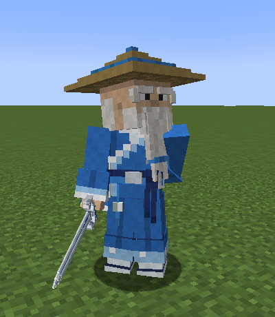
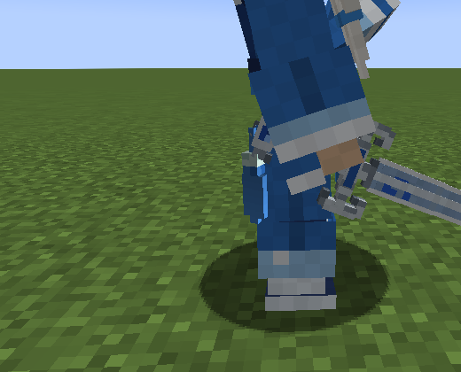

# Sensei Yun (云师父)

Maître de la Secte du Nuage Azur, inspiré de Sensei Wu : un vieux maître d'épée en nuances de bleu. Il garde le Temple
taoïste de la Mer de Bambous brumeuse (`misty_bamboo_temple`, fiche `docs/structures`) : la structure le place dans le
Hall des Trois Purs, entre l'autel et les coussins, face aux portes. Aussi par œuf (`Sensei Yun Spawn Egg`) ou
`/summon murimblock:azure_sensei`.

## Allure

Modèle 3D sur le squelette biped d'Epic Fight (`scripts/animation/sensei-3d.cjs`, 63 pièces) :

- chapeau de paille en cinq gradins, bande et bouton azur ; crâne chauve sous le chapeau, couronne de cheveux blancs
  derrière, sourcils broussailleux, moustache et longue barbe blanche à anneau azur ;
- robe azur croisée, col et revers bordés de blanc et de bleu ciel sur une sous-robe blanche, nuage blanc brodé dans
  le dos ; larges manches à revers bleu ciel tombant sur les mains, le dos de chaque manche plus bas ;
- ceinture indigo à liseré azur, fermoir nuage d'argent, nœud et pans à gauche, pendentif de jade blanc et sa houppe à
  droite ; jupe de robe fendue sur chaque jambe, ourlet bleu ciel à nuages blancs ; pantalon indigo, chaussettes
  blanches, chaussons de toile ; le fourreau laqué vide de son épée en travers du dos.
- Visage vivant (`MobFaces`, 10 atlas) : clignements, regards, marmonnement ; en combat les sourcils se nouent, il crie
  quand il frappe.

Son épée, **Azure Cloud** (蒼雲劍) : un jian droit à double tranchant, nuage gravé et incrusté de bleu à la racine
des plats, garde d'argent en volutes de nuage à émail bleu, poignée de soie azur entre deux bagues d'argent, pommeau
en tête de nuage (ruyi) à saphir, longue houppe azur à perle de jade blanc. Images `images/azure-cloud-sword-*.png`.

## Comportement

- **Neutre** : il se promène dans son hall (6 blocs autour de sa place, une promenade toutes les 12 s en moyenne),
  regarde qui entre, n'attaque que qui le frappe. Ne disparaît jamais, garde sa place dans sa sauvegarde (`Home`).
- **Clic droit** : il donne à chaque joueur son exemplaire du **Azure Cloud Sword Manual**, une fois (le même que la
  bibliothèque du sanctuaire : un joueur en reçoit un, de l'un ou de l'autre). Pas à quelqu'un qu'il combat.
- **Boss difficile** : 300 PV, armure 12 (robustesse 4), recul résisté à 90 %, armure de stun 20 (les coups ne
  l'interrompent presque pas), monte les marches d'un bloc. 10 par coup (4 à lui, 6 de l'Azure Cloud), avant les
  multiplicateurs de l'art.
- **Il se bat avec l'Art de l'Épée du Nuage Azur lui-même** (`AzureSenseiPatch`), tout parable (garde Murim) :
  - les M1 enchaînés : Drifting Cut, Returning Cut, Piercing Mist (perce l'armure) ;
  - Rising Cloud puis Falling Rain (met à terre) ; Swallow Returns (tournoiement) ; Thousand Drizzle (rafale d'estocs) ;
  - Wind Step (2,5 à 5 blocs) et Cloud Step Slash (3,5 à 7,5 blocs) : il fond sur qui garde ses distances.
  - Joués par lui, ce sont des coups simples : pas de soulèvement, de portage ni de coupes retardées (réservés aux
    joueurs, `MartialCombat`).
- **Seconde phase**, sous la moitié de ses PV : « Enough courtesy. Now, see the Azure Cloud. » ; il va 50 % plus vite
  et ajoute Heaven Splitting Crescent et la plongée Cloud Step Dive. Elle dure jusqu'à ce qu'il soit entier.
- **Récupération** : quand personne ne le combat, il regagne 2 PV par seconde (le harceler puis fuir ne marche pas).
- **Barre de boss** bleue « Sensei Yun » (10 crans) pour les joueurs proches de lui, encadrée de petits nuages en pixel
  art : un nuage à chaque bout de la barre, un petit de chaque côté de son nom (`client/SenseiBossBarClouds`).
- **Butin**, tué par un joueur : son épée **Azure Cloud** une fois sur 200 (0,5 %, Looting : 0,75 % puis +0,25 point par
  niveau) et le **Azure Cloud Sword Manual** une fois sur quatre (25 %, Looting : 30 % puis +5 points par niveau) (`loot_table/entities/azure_sensei.json`).
  Rien s'il meurt autrement. 100 XP.
- Les manuels sont consommés à la lecture : un livre, une lecture (un joueur qui connaît déjà l'art garde le sien).

## Mouvements

`scripts/animation/sensei-motions.cjs` → `animations/biped/murim/sensei_idle.json`, `sensei_walk.json` :

- **idle** (5 s en boucle) : un peu voûté, main gauche dans le dos (avant-bras en travers des reins), l'épée tenue
  basse à droite, pointe vers le sol devant ; respirations lentes, regard de côté ; il porte la main à sa barbe et la
  caresse deux fois, la remet dans son dos, regarde de l'autre côté, hoche la tête. Chaque sensei commence son idle à
  son propre moment (`IdlePhase`).
- **marche** (une foulée en 1,2 s, calée par Epic Fight sur son allure) : petits pas mesurés, genoux souples, léger
  balancement des épaules, main toujours dans le dos, épée basse qui balance un peu.
- L'épée est tenue 40° sous l'horizontale et décalée dans le poing (`HOLD`) : Epic Fight tient la poignée d'une épée
  1,5 pixel au-dessus du joint de la main, sous sa large manche ; abaissée ainsi, le pommeau s'enfoncerait dans
  l'avant-bras et la houppe avec. Décalée, la poignée est dans le poing, le pommeau dépasse derrière la manche et la
  houppe pend librement (`checkHold()` l'affiche à chaque génération). En combat, les coups M1 reprennent la tenue
  standard : la poignée y est sous la manche.

## Fichiers

- Modèle : `scripts/animation/sensei-3d.cjs` (avec `mesh-kit.cjs`) → `animmodels/entity/azure_sensei.json`,
  `textures/entity/azure_sensei.png` et ses 9 visages, `art/blockbench/azure_sensei.bbmodel`.
- Épée : `scripts/animation/azure-cloud-sword-model.cjs` → `models/item/azure_cloud_sword(_body|_tassel|_held).json`,
  `textures/item/azure_cloud_sword(_3d).png`, `art/blockbench/azure_cloud_sword.bbmodel` ; icône dessinée d'après le
  modèle. En main, `client/TasselSwordRenderer` dessine la lame puis la houppe balancée par `TasselPendulum` (comme le
  Dao de bandit). Images de présentation : `scripts/concepts/sensei-preview.cjs`.
- Code : `AzureSenseiEntity`, `AzureSenseiPatch`, `AzureSenseiRenderer`, `SenseiBossBarClouds`,
  `MurimAnimations.buildAzureSensei`, `SectLibrary.give`, `BambooTemple` (sa place dans le hall), `MartialManualItem`
  (manuel consommé).
- Tests : `AzureSenseiGameTests` (épée et sa catégorie, idle et marche, maison sauvegardée, neutralité, manuel donné une
  fois, barre de boss, seconde phase et récupération, butin, ses coups), `SiteGameTests` (le temple compte 1 sensei) ; en vrai client
  `gradlew -PgameTests runSenseiTour` (idle de face et de côté, tour de caméra autour de la garde, marche de profil,
  combat contre un zombie d'entraînement puis en seconde phase avec la liste de ses coups, barre de boss et ses nuages ;
  rapport `build/sensei-tour-run/sensei-tour-report.txt`).

## Limites connues

- Ses techniques n'ont pas les effets qu'elles ont pour un joueur (soulèvement, portage, coupes retardées, lames de Qi).
- Sa difficulté est réglée en solo contre un zombie d'entraînement : à ajuster après un vrai combat.
- Les projets Blockbench d'aperçu placent l'épée approximativement dans sa main ; la vraie place est celle du jeu
  (`checkHold()`, `runSenseiTour`).
- Vérifié en solo (GameTests serveur, vrai client) ; à valider à deux clients.
