# Le Seigneur des bandits (Bandit Warlord)

> Demande d'Enzo du 16/10/2026 : le boss du grand camp de bandits ([bandit-camp.md](../structures/bandit-camp.md)),
> « inspiré de Nappa, une montagne de muscles qui se bat avec ses poings » ; un nouveau boss ; il lâche le coffre du
> chef, un art martial et du Qi max ; une maquette d'abord.
>
> **Statut : en jeu depuis le 16/10/2026** (voir « En jeu » ci-dessous). Un seigneur des bandits à nous, dans l'esprit Murim, pas une copie du
> personnage. Nom provisoire : **Bandit Warlord** (Seigneur des bandits), à choisir par Enzo.
>
> Fichiers : `node scripts/animation/bandit-warlord-3d.cjs` (Blockbench isolé, `--port=`) écrit le projet
> `art/blockbench/bandit_warlord.bbmodel` (modèle et mouvements, à ouvrir dans Blockbench, onglet Animer) et filme les
> images et GIF de cette fiche (`docs/mobs/images/warlord-*`). Il est fait sur le squelette humain d'Epic Fight, comme le
> Bandit Chief : la maquette passera telle quelle dans le jeu.

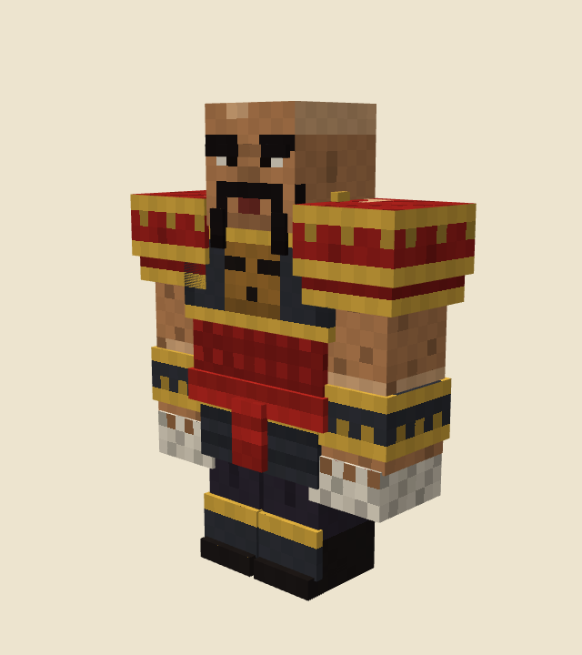 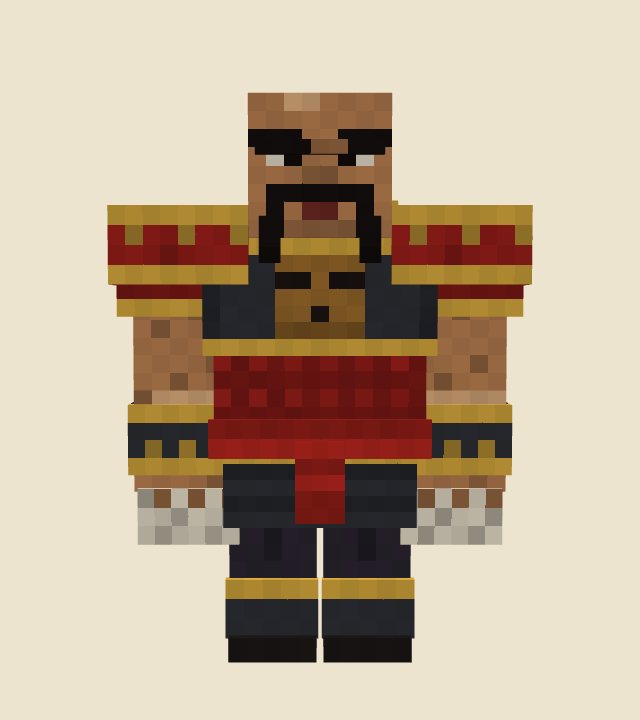

## L'allure

- **Une montagne de muscles**, dessinée **deux fois la taille d'un homme** en jeu (environ 3,6 blocs de haut) : un
  bandit ordinaire lui arrive à la taille.
- **La tête** : crâne rasé et luisant, une épaisse **moustache noire en fer à cheval** qui tombe jusqu'au menton,
  des sourcils lourds sur de petits yeux durs, un anneau d'or à l'oreille. Un cou aussi large que la tête.
- **L'armure** : une **cuirasse de fer noir** bordée d'or, une **tête d'ours en bronze** sur la poitrine, un ventre de
  lamelles pourpres, d'immenses **épaulières évasées de laque pourpre** bordées d'or.
- **Les bras** : énormes et nus, des brassards de fer, **les poings bandés de tissu blanc**. Il n'a pas d'arme.
- Une **ceinture d'étoffe rouge** nouée devant, un pantalon sombre et ample, des bottes ferrées.

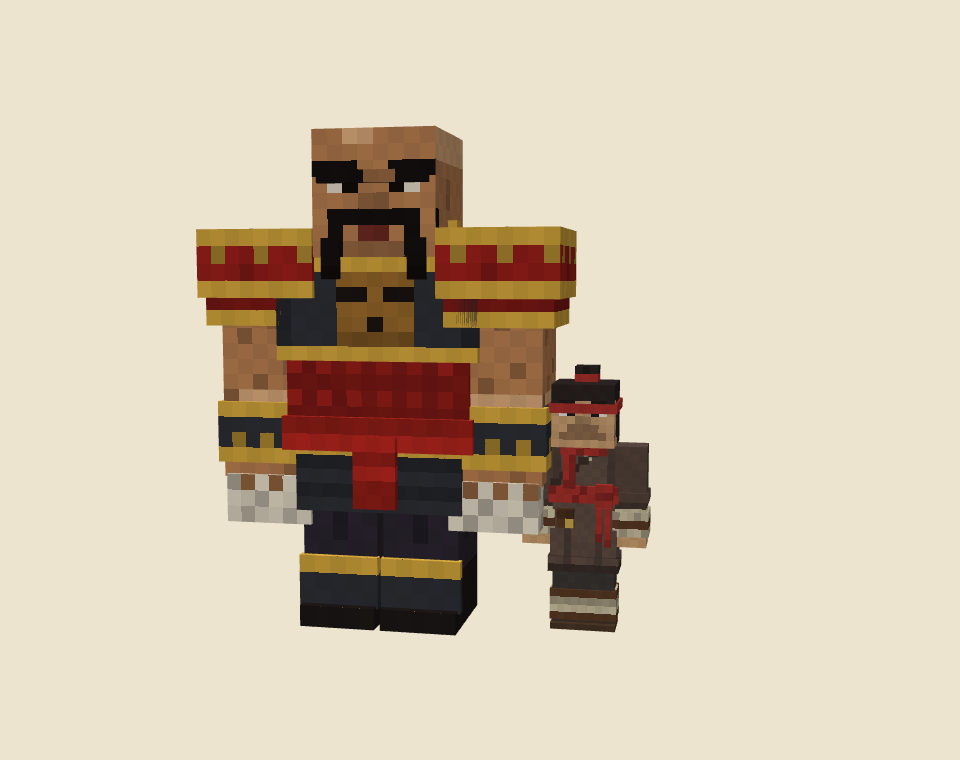

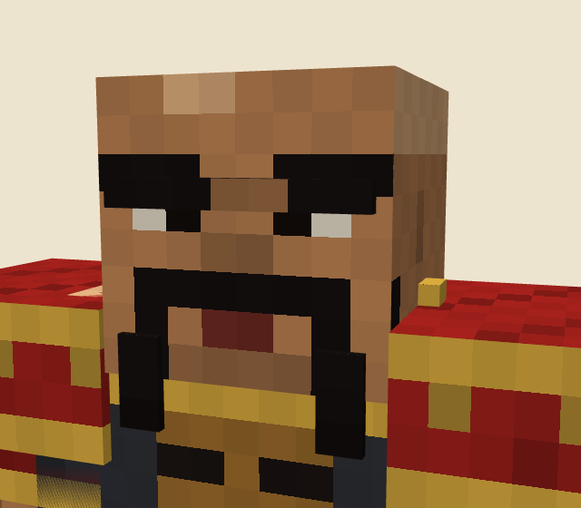 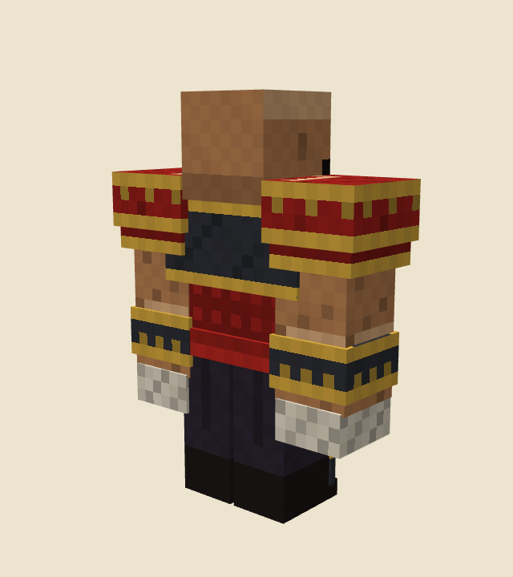

## Ses mouvements

| Mouvement | Durée | Ce qu'il fait | Proposition en jeu |
|---|---|---|---|
| **Repos** | 3 s | Il respire, roule des épaules, tourne la tête | — |
| **Marche** | 1,2 s | Lourde, le tronc qui roule, les bras qui balancent | — |
| **La chute** (`sky_fall`) | 3,3 s | Il tombe du ciel en météore, genoux remontés, atterrit poing au sol un genou à terre, se relève et rugit | Son entrée, en cinématique, une fois les 30 bandits morts, et l'ultime de son art : l'impact creuse le camp en cratère |
| **Le rugissement** (`roar`) | 2,6 s | Accroupi, il se lève, frappe ses poings l'un contre l'autre et rugit, les bras levés | En seconde phase |
| **Poing écrase-montagne** (`mountain_crusher`) | 1,1 s | Un direct du droit : il arme, fait un pas et enfonce le poing | Attaque de base, gros recul |
| **Brise-terre** (`earth_breaker`) | 1,7 s | Les deux poings levés au-dessus de la tête, abattus au sol | Onde de choc autour de lui (comme le saut du Bandit Chief) |
| **Charge du taureau** (`bull_charge`) | 1,6 s | L'épaule baissée, une course de quatre blocs, l'impact | Pour rattraper un joueur qui recule ; renverse |
| **Brise-ciel** (`sky_breaker`) | 1,15 s | Accroupi bas, un uppercut qui monte en se dressant sur la pointe des pieds | Projette la cible en l'air |

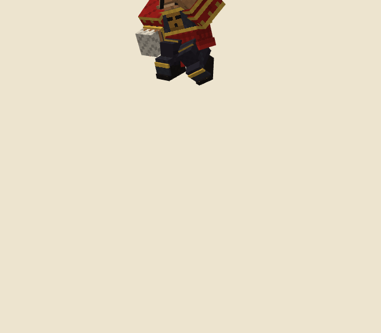 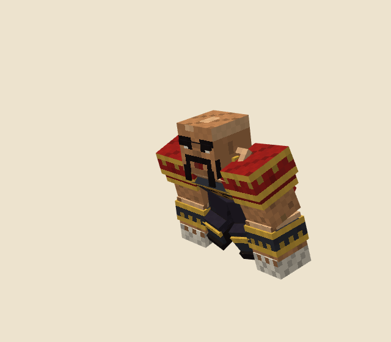 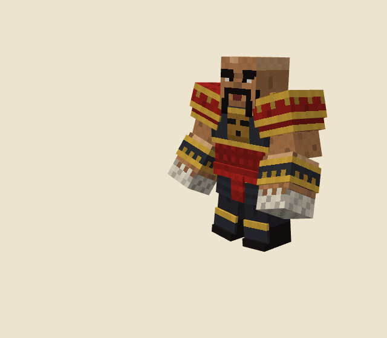

 

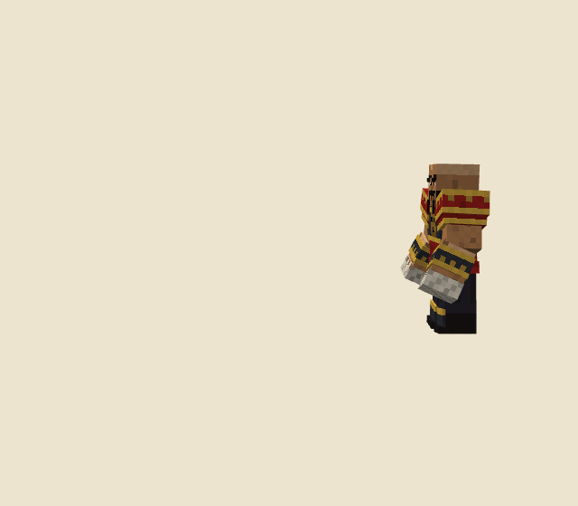  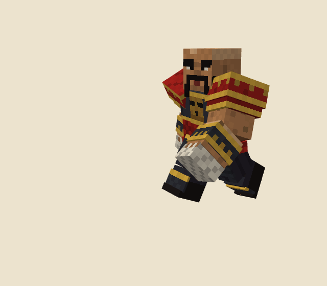

Profils : [poing](images/warlord-mountain_crusher-side.gif), [brise-terre](images/warlord-earth_breaker-side.gif),
[brise-ciel](images/warlord-sky_breaker-side.gif).

## En jeu (16/10/2026, « reprends le boss »)

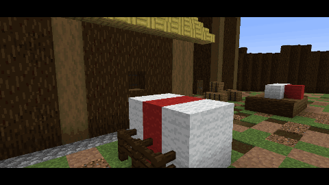

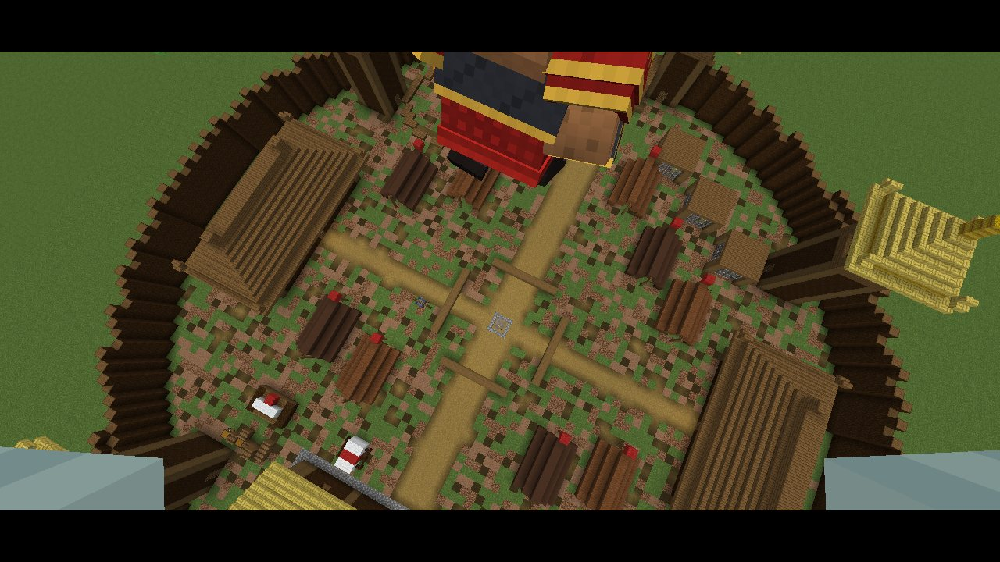 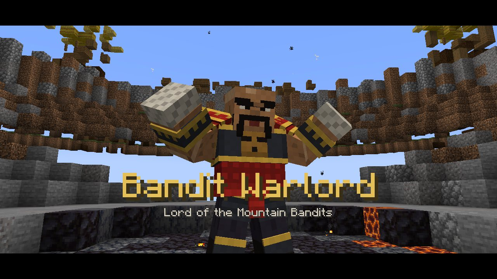

- **`murimblock:bandit_warlord`** (`BanditWarlordEntity`, `BanditWarlordPatch`, `BanditWarlordAnimations`,
  `client/BanditWarlordRenderer`) : son modèle 3D et ses mouvements sortent de `bandit-warlord-3d.cjs` (maillage
  `entity/bandit_warlord`, animations `biped/murim/warlord_*`), dessiné deux fois la taille d'un homme (3,9 blocs).
  Œuf « Bandit Warlord Spawn Egg » et `/summon` (pas de cratère alors).
- **Force** : 400 PV, armure 12 (ténacité 4), attaque 12, presque pas de recul, ne brûle pas, ne disparaît jamais.
  Barre de boss **pourpre**. Sous la moitié de sa vie, une fois : il rugit et va 25 % plus vite.
- **Ses coups**, tous parables, ceux du Poing Brise-Montagne : Poing écrase-montagne (×1,0, renvoie, jusqu'à 4 blocs),
  Brise-terre (×1,3 et une onde de choc de 5,5 blocs autour de lui, ×0,7, qui projette en l'air ; recharge 8 s), Charge du
  taureau (×1,1, renverse, de 4 à 10 blocs ; recharge 10 s), Brise-ciel (×1,4, la cible projetée à sept blocs de haut ;
  recharge 12 s).
- **Son entrée** (`WarlordEntrance`) : au 35e mort du camp, le tambour bat trois fois (0,5 s, 1,1 s, 1,7 s), puis il
  tombe de 70 blocs au-dessus de la place (2,5 s), en **météore** : du feu autour de lui, une traînée de flammes et de
  fumée ; il tombe environ 3 s. Intouchable pendant la chute et l'atterrissage. À l'impact : explosion, flammes, poussière,
  tonnerre ; tout ce qui est à 10 blocs est **projeté** (sans dégâts : on ne pouvait pas l'éviter) ; il atterrit poing au
  sol, se relève et rugit (2,8 s), puis le combat commence. Le **cratère** se creuse à l'impact.
- **La cinématique** (`client/WarlordCinematic`, protocole réseau 21), pour les joueurs du camp, environ 9 s, sans
  bouger ni être touchés (Résistance V et Chute lente) : le tambour de près, la caméra qui monte vers le ciel, un point
  rouge qui grossit, puis **la caméra descend avec lui, juste au-dessus de son épaule, le camp qui fonce vers lui**
  (Enzo : « un vrai gros plan, vu d'en haut, comme la météorite de One Punch Man »), le flash blanc et la secousse de
  l'impact vus du bord, puis lui en contre-plongée qui se relève et rugit, son nom en grand : « Bandit Warlord — Lord of
  the Mountain Bandits ».
- **Butin** : 2 à 4 yuanbao d'or, 12 à 20 taels d'argent, une pilule de percée (tué par un joueur), de la viande ; le
  coffre du chef reste dans la grande salle (le cratère ne casse aucun coffre). **+40 Qi Max** à la première victoire
  (récompense de Qi de boss, 150). Le rouleau du Poing Brise-Montagne viendra avec l'art (pas encore fait).
- **Vérifié** : GameTests `BanditWarlordGameTests` (boss à lui, chute intouchable et impact qui projette, onde de choc,
  cratère qui garde les coffres, chute d'un camp notée une fois) et `BanditCampCountGameTests` ; visite en vrai client
  `gradlew -PgameTests runWarlordTour` (camp construit sur un plateau, entrée filmée, cratère, chaque mouvement :
  `build/warlord-tour-run/screenshots`). **Pas encore vu** : un vrai combat à la main, ni à deux joueurs.

## Proposition pour le jeu (la maquette)

- **Apparition** (16/10, demandes d'Enzo) : le camp compte ses 30 bandits ; au dernier mort, le tambour de guerre
  résonne trois fois et **il tombe du ciel comme un météore de feu**, **en cinématique** pour les joueurs du camp :
  l'impact **change le camp en cratère** pour de bon, une arène de PvP ensuite
  ([la chute et le cratère](../structures/bandit-camp.md#la-chute-et-le-cratère-maquette-du-1610-à-valider)).
  C'est l'ultime de son art. Il ne revient pas : un camp libéré le reste.

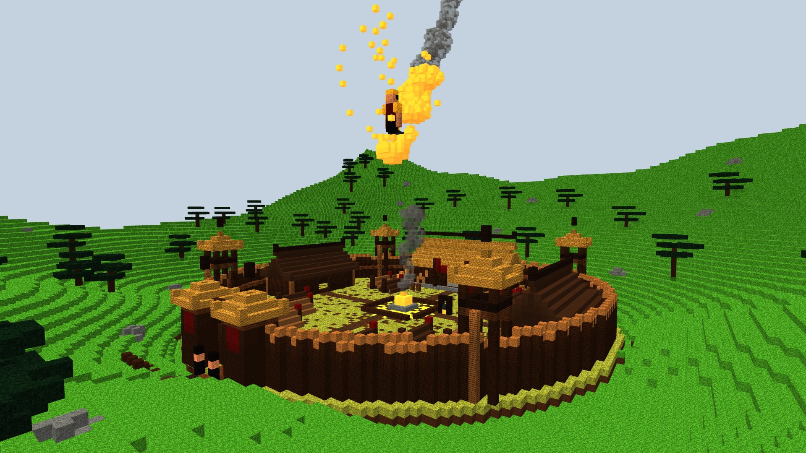
- **Force** : un boss au-dessus du Bandit Chief et de Sensei Yun, par exemple **400 PV**, des coups à 10-16 dégâts,
  **tous parables** ; une seconde phase sous la moitié de sa vie (plus rapide, la charge plus souvent). Barre de boss
  pourpre et or.
- **Butin** (choix d'Enzo) : **le coffre du chef** de la grande salle s'ouvre à sa mort ; **un art martial**, le [Poing Brise-Montagne](../combat/styles/mountain-shattering-fist.md) (zone et destruction, ses propres mouvements ; lâché à coup sûr comme le manuel de Sensei Yun) ;
  **du Qi max** à la première victoire (par exemple +40, plus que Sensei Yun).

## Seconde phase : l'arène dans le ciel (maquette du 16/10, à valider)

> Demandes d'Enzo : « une arène dans le ciel, une espèce de météore creusé » ; « fais plus grand, le fight aura de gros
> dégâts de zone, il faut vraiment une grosse zone » ; « et même en profondeur ».
>
> `node scripts/concepts/render-warlord-sky-arena.cjs --port=<Blockbench isolé>` (voxels : `warlord-sky-arena.js`) rend
> les vues en PNG dans `images/warlord-sky-arena/` ; celles de cette fiche sont passées en JPEG.
>
> **Ces images sont la maquette.** Le modèle réel à construire, en vrais blocs, est
> [`art/structures/warlord-sky-arena/warlord_sky_arena.schem`](../../art/structures/warlord-sky-arena/README.md)
> (WorldEdit Sponge v3, blocs vanilla), généré par `node scripts/worldgen/warlord-sky-arena.cjs`.

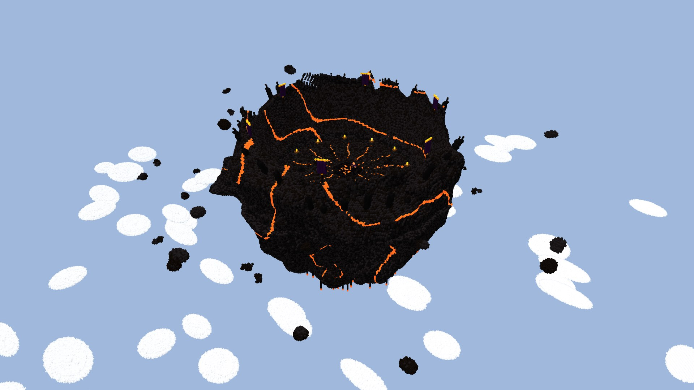

- **Un météore flottant** d'environ **170 blocs de large** et 150 de haut, en basalte noir et roche brûlée, veiné de
  lave qui rougeoie ; dessous, un cône rugueux d'où pendent des coulées de roche en fusion. Des blocs arrachés par la
  chute dérivent autour. Très loin dessous, une mer de nuages.
- **Creusé en cuvette** : un **sol de combat plat de près de 100 blocs de large** (rayon 48), pour ses gros coups de
  zone, puis des **parois qui montent d'environ 40 blocs** (26 à 47 selon l'endroit) jusqu'au bord (rayon 72). On voit tout le combat depuis le fond, et
  personne ne peut se cacher derrière quoi que ce soit : seuls quelques rochers bas sont épars sur le sol.
- **Au centre, la cicatrice de son atterrissage** : obsidienne et lave, et **14 fissures rougeoyantes** qui en
  rayonnent sur le sol.
- **Autour du sol**, 12 braseros de bronze. **Sur le bord**, 34 pics de roche, certains penchés vers l'extérieur, et
  6 grandes bannières pourpre et or du Seigneur.

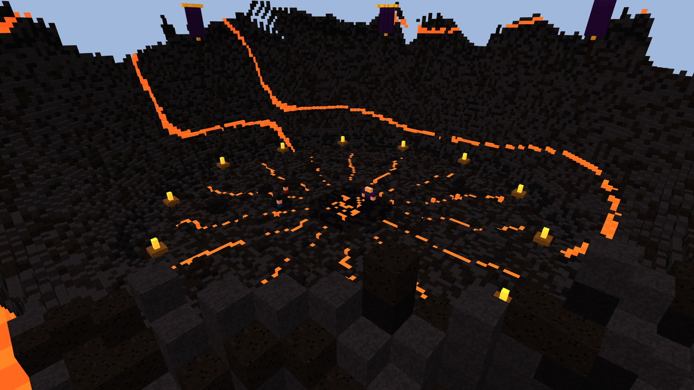
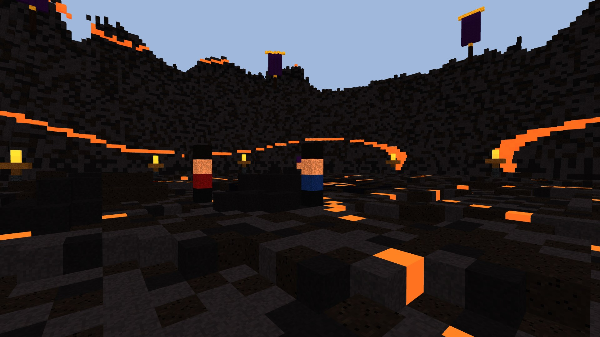

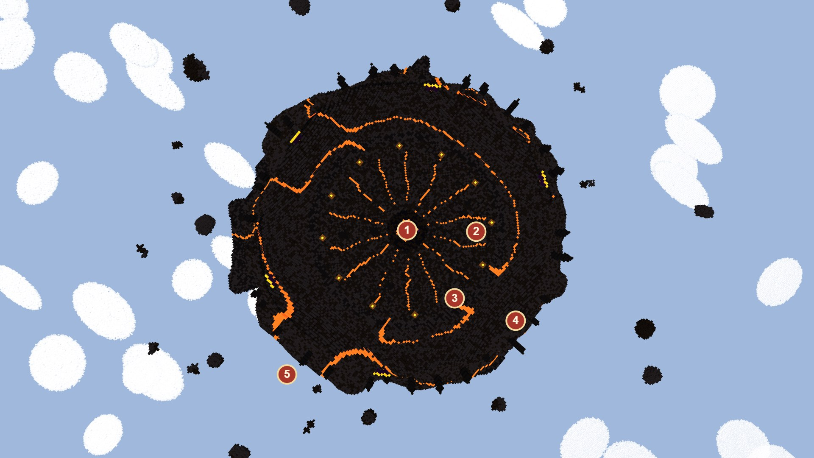
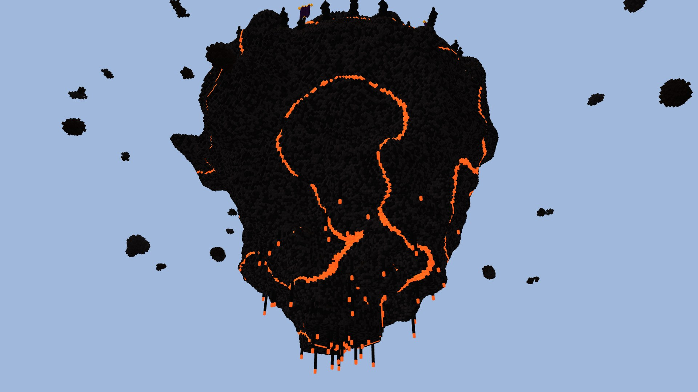

**Propositions pour le jeu (à décider)** :
- **Comment on y monte** : sous la moitié de sa vie, il rugit, frappe le fond du cratère d'un Brise-ciel, et la
  cinématique emporte tous les joueurs du combat avec lui dans le ciel ; ils retombent dans la cuvette du météore.
- **Où il est** : construit dans le ciel au-dessus du camp, vers y 200 à 300 (la limite est 320), le temps du combat. Il
  disparaît après, ou il reste comme une curiosité visible de loin.
- **Tomber du bord** : on retombe dans le cratère du camp, avec une chute amortie ou une vraie mort, à choisir.
- **Le sol de combat** pourrait se fissurer de plus en plus à chaque Brise-terre (les fissures s'élargissent), jusqu'à
  la fin du combat.

## Seconde phase : le Fils du Démon (maquette du 16/10, à valider)

> Demandes d'Enzo : « une deuxième phase : on coupe tout le haut, il n'y a que ses jambes, et à la place, ça » (un géant
> doré dressé derrière un gardien) ; des cheveux « plus Super Saiyan » ; « le double de son ancien corps, sans que les bras
> touchent le sol » ; « vraiment un mec musclé, pas juste des gros blocs » (sa référence : de grands volumes, les muscles
> peints) ; « fais son propre squelette ». Son art en seconde phase : le **Poing du Majin**, attaque par attaque.

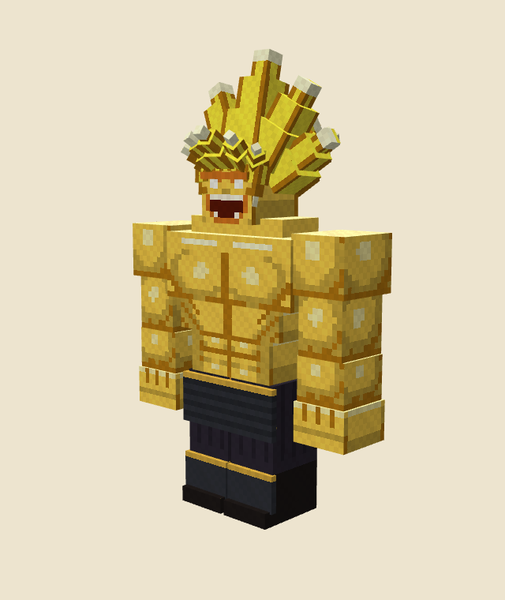 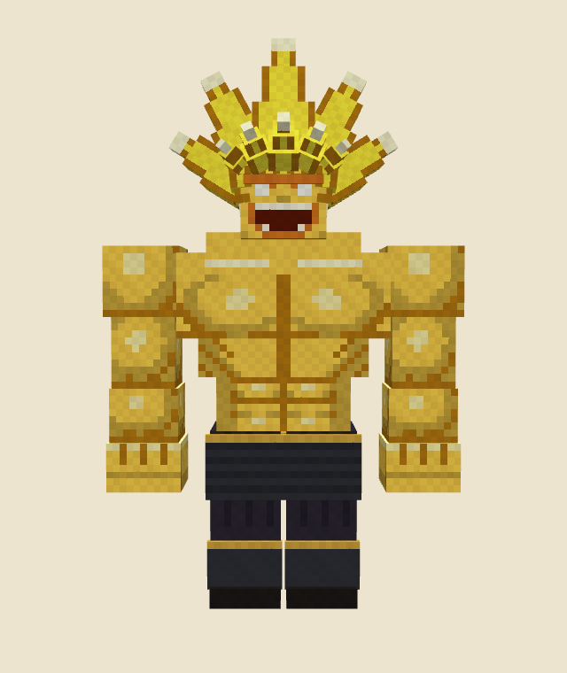
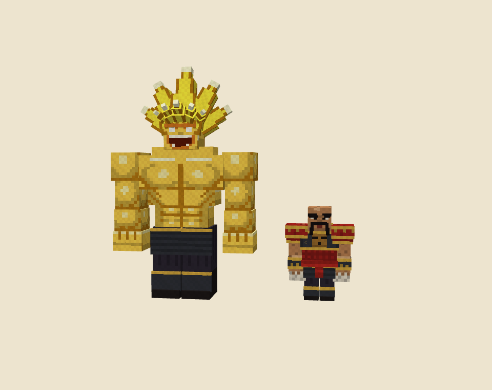

- **Le colosse** : ses jambes à lui (pantalon sombre, bottes ferrées), doublées, et à la place du haut un colosse de Qi
  doré jailli de sa ceinture : le double de son haut du corps, les muscles peints en dégradés d'or (pectoraux, abdominaux,
  côtes, dos), une petite tête enfoncée entre les trapèzes, la gueule ouverte sur ses crocs, les cheveux d'un Super
  Saiyan ; les poings pendent à ses hanches. Environ **7 blocs** de haut en jeu (la première phase : 3,9).
- **Son propre squelette** : les articulations du squelette humain, déplacées à ses proportions (hanches, genoux au
  milieu des jambes, poitrine, cou sur les trapèzes, épaules dans les deltoïdes, coudes, poings) ; les noms et les axes ne
  changent pas, ses poses se lisent comme celles du Seigneur. `scripts/animation/warlord-avatar-3d.cjs`.

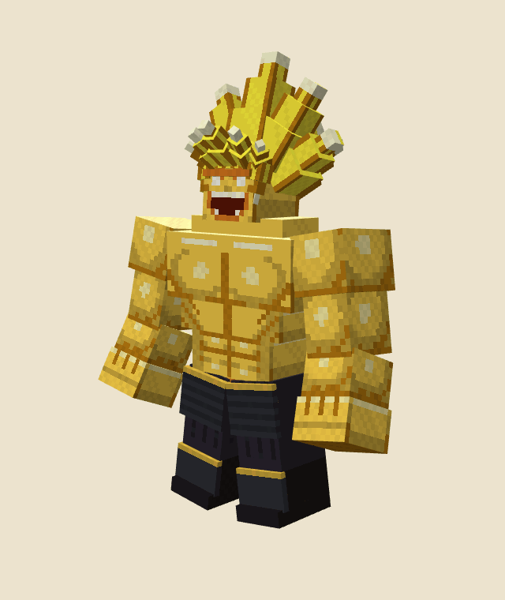 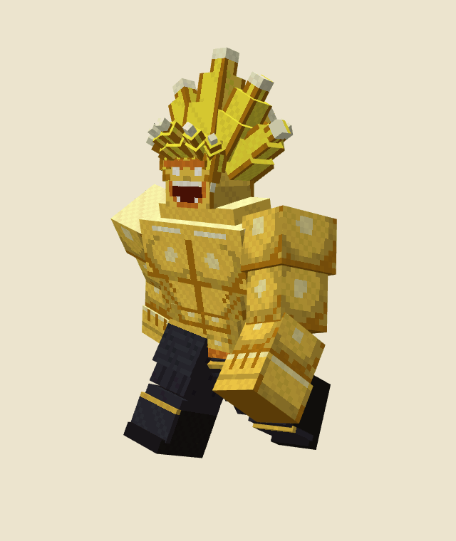 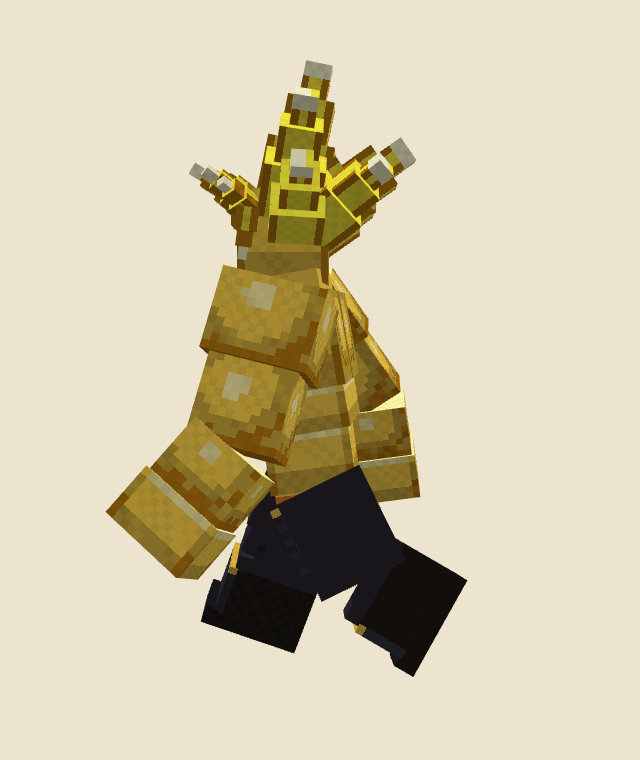

### La cinématique de transformation (30 s)

> « Quand il va mourir, tout le monde va être stun, et d'un seul coup il va frapper le sol avant de se frapper la tête et
> se transformer de la même façon que Hulk ; une cinématique de 30 secondes. Une fois transformé il va se mettre à crier
> et se frapper le torse comme un gorille, puis il aura une aura dorée, et le sol va se soulever et donner l'arène. Un
> gros plan de l'île qui monte et qui arrive au-dessus des nuages, puis le combat commence, avec marqué en gros *le fils
> du démon*, au-dessus de sa barre de vie : c'est son titre de la phase deux. »

| Plan | Temps | Ce qu'on voit | Maquette |
|---|---|---|---|
| 1 | 0 – 2 s | Sa vie tombe à zéro : **tout le monde est figé** (le temps ralentit, les couleurs pâlissent). Lui, à genoux, vaincu, la tête basse. Caméra basse. | [transformation](images/warlord-transform.gif) |
| 2 | 2 – 4 s | D'un coup, il lève le poing et **frappe le sol** : onde de choc, fissures dorées dans le fond du cratère, la caméra tremble. | idem |
| 3 | 4 – 6 s | Debout, il **se frappe la tête** de ses deux poings, trois fois ; gros plan sur son visage, un éclair à chaque coup, des battements de cœur. | idem |
| 4 | 6 – 10 s | **Comme Hulk** : il se cambre en hurlant, les bras jetés en arrière, son corps **gonfle**, sa cuirasse éclate (des plaques volent), une lumière dorée fuit des fissures de sa peau ; la caméra tourne autour de lui. | idem |
| 5 | 10 – 12 s | **Éclair blanc et or** : le colosse jaillit de lui (le modèle change). | — |
| 6 | 12 – 16 s | Le colosse **rugit**, les bras écartés, puis **se frappe le torse comme un gorille**, huit coups, un anneau de choc à chacun. | [éveil](images/warlord-avatar-awaken.gif), [torse](images/warlord-avatar-chest_beat.gif) |
| 7 | 16 – 19 s | **L'aura dorée** s'allume : des colonnes de lumière d'or montent autour de lui, ses cheveux flambent ; **le sol tremble**, les fissures courent dans tout le cratère. | — |
| 8 | 19 – 23 s | **Le sol se soulève** : plan large depuis l'extérieur du camp, le cratère s'arrache de la terre avec tout le monde dessus, des rochers en tombent. | — |
| 9 | 23 – 27 s | **Gros plan sur l'île qui monte** : la caméra la suit de près dans la montée, à travers les nuages ; elle devient le **météore** de basalte veiné de lave et perce au-dessus de la mer de nuages. | 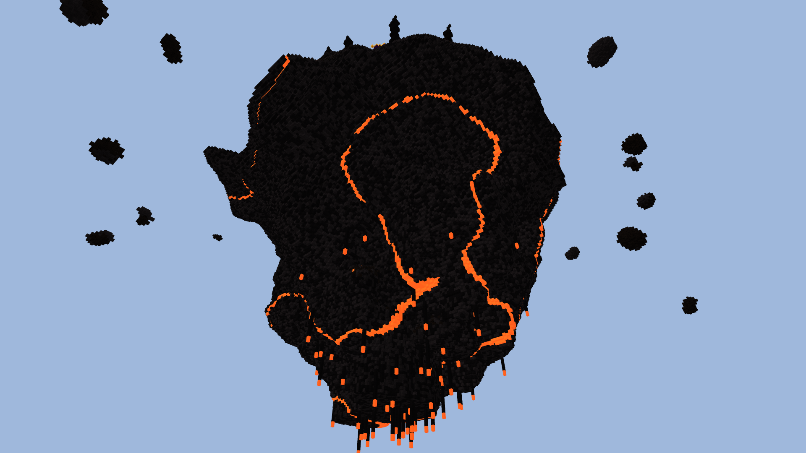 |
| 10 | 27 – 30 s | Vue d'en haut sur la cuvette du météore, le colosse au centre ; **« SON OF THE DEMON »** s'écrit en grand au-dessus de sa barre de vie ; le combat commence. | 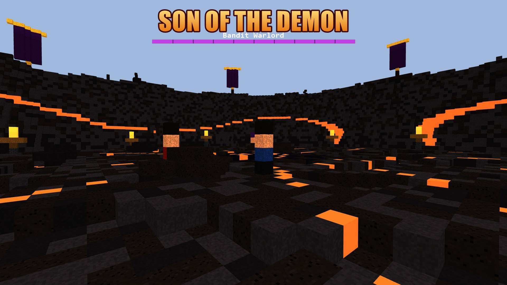 |

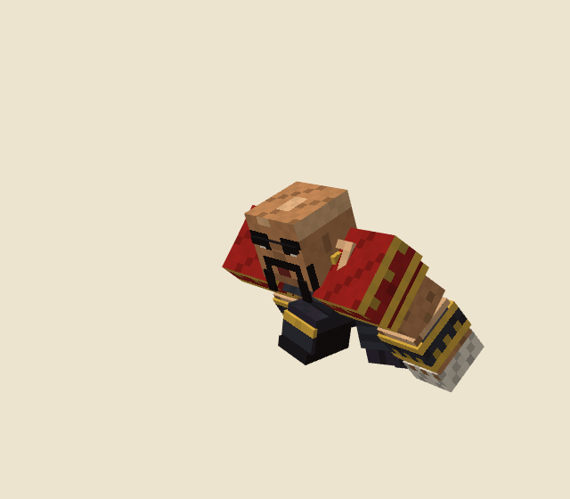 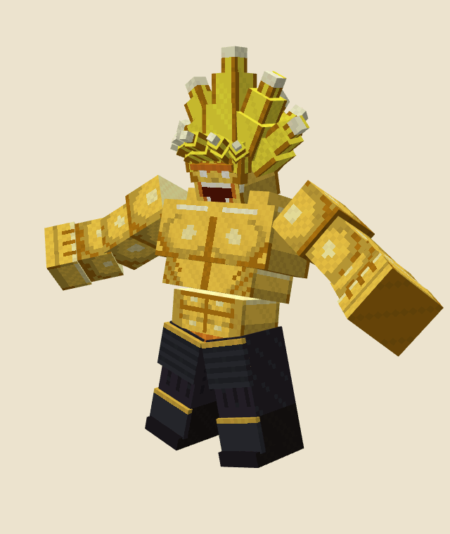

**En jeu (proposition)** : la montée est une illusion de caméra. Le météore est construit dans le ciel au-dessus du camp
(vers y 230) pendant les plans 1 à 7 (réparti sur les ticks, comme le cratère) ; pendant le plan 9, quand la caméra
traverse les nuages, les joueurs et le colosse sont portés dans sa cuvette ; le cratère du camp, en bas, reste tel quel.
Pendant les 30 s, personne ne bouge ni ne prend de coups. Le titre « Son of the Demon », petit, remplace son nom au-dessus
de la barre de boss pour toute la seconde phase (Enzo : sans « Bandit Warlord », bien plus petit).

## Questions pour Enzo

- Son nom (Bandit Warlord ? un nom chinois ?) et ses couleurs (pourpre et or, ou plus sombre) ?
- Sa vie et ses dégâts : plus dur que Sensei Yun ?
