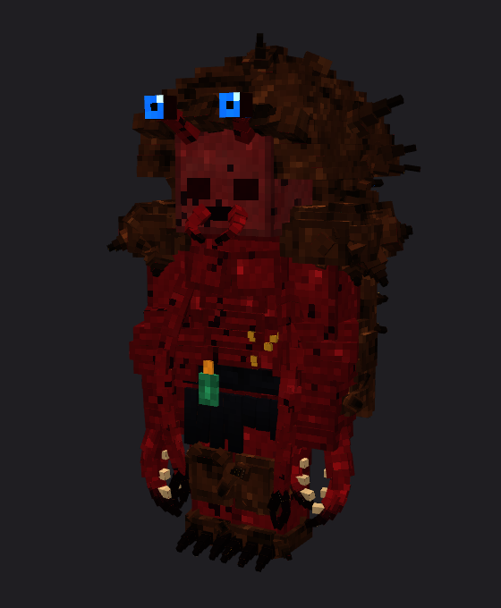
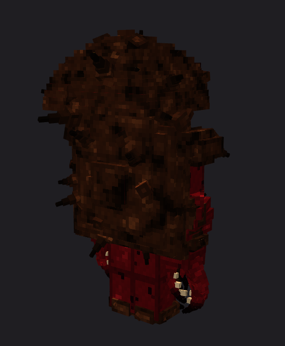

# Crab King (蟹王)

Boss de l'art du crabe (15/10/2026, demande d'Enzo) : un artiste martial que la maladie des hommes-crabes a pris tout
entier. Il gardera une structure qu'Enzo construira ; en attendant, pas d'apparition dans le monde : œuf
(`Crab King Spawn Egg`) ou `/summon murimblock:crab_king`. Il ne disparaît jamais.

Il lâchera le rouleau de l'art du crabe, et se battra avec ses techniques, quand l'art sera fait (les techniques sont
à choisir avec Enzo). Son allure suit le concept retenu, stade 3 « Roi crabe »
(`scripts/concepts/crab-art-pixel.cjs`, `docs/combat/styles/images/crab-pixel-*`).

 

## Allure

Deux fois plus grand qu'un homme (15/10, demande d'Enzo) : 4 blocs de haut pour le corps, la carapace et ses pointes
au-dessus (boîte 1,2 × 3,9). Modèle 3D sur le squelette biped d'Epic Fight : 557 cubes peints texel
par texel (deux texels par pixel), tournés dans tous les sens pour que rien ne fasse gros bloc.

- chair à vif rouge sombre, veines noires, plaques striées sur le torse et le ventre, pustules ocre ;
- carapace de croûte brune en dôme à paliers sur le dos et sur la tête comme une capuche, bosselée et hérissée, son
  rebord déchiqueté au-dessus du visage ;
- yeux bleus sur pédoncules sous le rebord ; le visage creusé et sombre, mandibules à la bouche ;
- épaules prises dans la croûte ; avant-bras enflés et longues pinces courbes jusqu'au sol, la droite plus grosse. Le
  doigt extérieur est sur l'avant-bras (`Hand_*`), le doigt intérieur sur la main (`Tool_*`) : tourner la main ouvre la pince ;
- une seconde paire de bras fins à petites pinces ; genoux croûtés, pieds griffus ;
- ce qui reste de sa robe : une ceinture sombre et son pendentif de jade, un ourlet déchiré sur les cuisses.

## Combat

- 260 PV, armure 14 (robustesse 4), recul résisté à 90 %, armure de stun 14, attaque 11 (ses pinces). Lent (0,23).
- Toutes ses attaques sont lentes à venir et **parables** :
  - **Fauchage** (`crab_king_sweep`, ×1,0, plusieurs cibles) : la grosse pince droite, ouverte, armée à droite puis
    balayée à plat devant lui, en claquant (≤ 5 blocs) ;
  - **Claquement** (`crab_king_snap`, ×1,3, étourdit) : les deux pinces levées grandes ouvertes, puis une fente, les deux
    lancées en avant et refermées (2 à 5,8 blocs) ;
  - **Écrasement** (`crab_king_slam`, ×1,5, met à terre) : les deux pinces levées très haut, puis abattues au sol devant
    lui ; à 0,74 s, onde de choc de 4,6 blocs autour du point d'impact (0,6 × l'attaque, projette, épargne ses crabes).
    Un seul coup : qui vient de prendre ou de parer les pinces n'est pas touché par l'onde. Recharge 8 s.
- **Prise dans la grosse pince** (15 et 16/10, demandes d'Enzo ; `crab_king_grab` puis `crab_king_grab_hold`, 1,5 à 5
  blocs, recharge 11 s) : il arme la pince droite grande ouverte et se fend ; à 0,55 s elle se referme sur ce qui est
  devant lui (0,3 × l'attaque). Une garde normale ne l'arrête pas ; une **parade parfaite** au moment où la pince se
  ferme la fait rater ; on peut l'esquiver. Ce qu'elle attrape est tenu **entre les mâchoires** : son milieu suit, image
  par image, le point à mi-chemin des milieux des deux doigts, calculé depuis les poses mêmes de l'animation
  (`crab-king-moves.cjs` écrit `CrabKingGrip.java`), tourné vers lui. Sur l'horloge de la prise :
  - 0 à 0,5 s : soulevé devant son visage ;
  - jusqu'à 0,8 s : ramené près de son visage, les mâchoires desserrées un peu ;
  - 0,85, 1,25 et 1,6 s : serré (0,25 × l'attaque chaque fois), le dernier le plus long ;
  - à partir de 1,85 s : le bras armé par-dessus son épaule ; à 2,45 s, **jeté au loin** (0,5 × l'attaque), à huit
    blocs environ ;
  - à l'atterrissage : 0,4 × l'attaque, mis à terre, et un **impact comme une explosion** (poussière, souffle, fumée,
    bruit d'explosion). **Contre un mur, un cratère** de 1,7 bloc de rayon, au bord irrégulier, sans butin (ni les blocs
    incassables, ni si la règle `mobGriefing` est coupée).
  La victime a ses animations (`crab_king_victim` sur la même horloge : se débat en montant, se fige, écrasée à chaque
  serrage, molle entre, fouettée par l'armé ; `crab_king_thrown` en vol : bat des bras et des jambes).
  **Attrapé, un joueur ne peut rien faire jusqu'à l'atterrissage** (16/10) : ni bouger, ni tourner, ni attaquer, parer,
  rouler, utiliser une compétence, un objet ou une technique Murim, ni méditer, ni changer d'objet en main.
  **Il le vit comme un film** (`client/GrabCinematic`, sans message réseau : il suit l'animation de la victime) : la
  caméra juste à côté de sa tête, du côté opposé au bras du roi ; soulevé, il regarde ses pieds, le sol qui s'éloigne et
  les mâchoires, puis le visage du roi ; une lente poussée sur ce visage, l'angle qui se resserre, des battements de
  cœur ; les mâchoires qui se ferment sur lui avant le serrage ; chaque serrage secoue l'image, la resserre et rougit les
  bords ; plan large qui bascule à l'armé ; en vol, derrière lui, en tournoyant, le roi qui s'éloigne ; l'impact secoue
  l'image, puis il retrouve sa vue. Bandes de cinéma, pas d'interface.
  Interrompu (étourdi, tué, déchargé), le roi lâche ce qu'il tient : sa victime est libérée par un court étourdissement.
  Pas de boîte d'Epic Fight : la prise est celle de `CrabKingEntity`.
- **Pinces des profondeurs** (16/10, demandes d'Enzo ; `crab_king_burrow`, 4 à 14 blocs, recharge 15 s) : il lève
  ses deux pinces et les plante dans le sol devant lui (0,62 s), puis **les y garde, tremblant, pendant toute l'attaque**
  (5,9 s en tout) : c'est le moment de le frapper. **Deux pinces géantes** (`CrabPincerEntity`, modèle Blockbench
  `art/blockbench/crab_pincer.bbmodel` rendu par GeckoLib 2,2 fois plus grand, environ 7 blocs) sortent **devant sa
  cible, une de chaque côté**, là où leur pincement l'atteint, la seconde 0,3 s après. Chacune, sur son animation
  `attack` (4,6 s) :
  - 0,6 s d'alerte : le sol se fissure et gronde où elle va sortir ; **la caméra des joueurs proches tremble**
    (`client/CrabPincerShake`, plus fort près d'elle), puis elle jaillit grande ouverte ;
  - **balayage** (1,4 à 2,2 s) : couchée presque à plat, elle balaie tout autour de son pied au ras du sol (6,2 blocs) :
    qui est au sol est touché une fois (0,6 × l'attaque du roi) et repoussé ; **on l'évite en sautant** ;
  - **coup sur le côté** (2,85 s) : redressée, elle s'abat sur sa droite, une bande de 6 blocs (1,0 ×, mis à terre) ;
  - **pincement** (3,7 s) : elle se penche vers la cible, mâchoires grandes ouvertes, et se referme (0,9 ×, projeté en
    l'air, étourdi) ;
  - elle replonge et disparaît.
  **Ses articulations** (16/10) : le bras est une chaîne d'os (pied, deux segments, paume, mâchoires), un anneau de peau
  sombre à chaque jointure ; chaque mouvement se répartit sur les jointures, chacune un peu en retard sur celle d'en
  dessous, si bien que le bras se courbe en se couchant, en frappant, et la paume s'enroule en pinçant.
  Ses coups sont ceux du roi : une garde levée à temps les pare ; ni le roi, ni ses crabes ne sont touchés.
- **Rage** : sous la moitié de sa vie, une seule fois (sauvegardé), il rugit (`crab_king_roar`) et deux crabes cuirassés
  sortent du sol à ses côtés, sur sa cible.
- Un crabe : il respire sous l'eau (tag `minecraft:can_breathe_under_water`) et va plus vite dans l'eau.
- Touché, il appelle les crabes et hommes-crabes autour de lui. Barre de boss rouge pour les joueurs proches.
- Au repos, son idle (`crab_king_idle`) : voûté, pieds écartés, les pinces basses en avant ; respiration lente, regards
  à gauche et à droite, deux claquements de pinces.
- Sa marche à lui, lourde (`crab_king_walk`, deux pas en 1,6 s, aussi pour la poursuite) : chaque pied planté, le corps
  qui s'enfonce dessus, le poids qui passe d'un côté à l'autre, les épaules qui tournent contre les hanches, les pinces
  basses qui se balancent. Chaque pas s'entend (pas de ravageur, grave) et soulève un peu le sol.
- Butin (provisoire, avant le rouleau) : 2 à 4 morues ; tué par un joueur, 4 à 8 taels d'argent et un trident une fois
  sur dix. 60 XP, 30 Qi (+100 à la première victoire, +30 Qi Max). Le sens du Qi lit en lui Condensation du Qi, stade tardif.

## Fichiers

- `scripts/animation/crab-king-3d.cjs` : le modèle (mesh `animmodels/entity/crab_king.json`, atlas
  `textures/entity/crab_king.png`, projet `art/blockbench/crab_king.bbmodel`, ses cubes tournés y sont droits) ;
- `scripts/animation/crab-pincer-geo.cjs` : la pince géante (géométrie, animation et texture GeckoLib) ;
  `scripts/animation/geo-to-bbmodel.cjs crab_pincer [--pose=attack@1.8]` l'ouvre dans Blockbench, la rend
  (`images/crab_pincer-*.png`) et enregistre le projet `art/blockbench/crab_pincer.bbmodel` ;
- `scripts/animation/crab-king-moves.cjs` : ses animations (`animations/biped/murim/crab_king_*.json`, projet
  `art/blockbench/crab_king_moves.bbmodel`) ;
- `scripts/animation/mesh-preview.cjs crab_king` : rendu du mesh tel qu'écrit, au repos (`images/crab_king-*.png`) ;
- Java : `mob/CrabKingEntity`, `integration/epicfight/CrabKingPatch`, `CrabKingAnimations`, `client/CrabKingRenderer` ;
  butin `loot_table/entities/crab_king.json`.

## Vérification

- `CrabKingGameTests` : boss à lui (patch, idle, marche lourde, 4 blocs de haut, 260 PV, armure, ne disparaît pas,
  respire sous l'eau, barre de boss) ; rage (deux crabes, rugissement, une fois) ; onde de choc ; la prise (attrape entre
  les mâchoires, soulève, jette, la victime atterrit blessée), le cratère dans un mur de pierre, la prise dans le vide,
  un joueur tenu qui ne peut rien faire (entravé, verrous d'Epic Fight, technique refusée, attaque annulée) jusqu'à
  l'atterrissage, et libéré à la mort du boss ; les deux pinces des profondeurs (de part et d'autre de la cible, la
  seconde après la première, toutes deux la pinçant) ; les trois coups d'une pince géante, chacun sur son zombie ; il se bat avec ses pinces et touche.
- En vrai client : `MURIM_TOUR_ONLY=king gradlew -PgameTests runWeaponTour` (debout de chaque côté, idle, marche, ses trois
  attaques, sa prise sur un zombie du désert jeté dans un mur (cratère), ses pinces des profondeurs sur un zombie du désert (plan large), la même vue par le joueur attrapé (`king-grab-pov` :
  le joueur de la caméra lui-même, en survie, protégé des dégâts), son rugissement, sa mort).
