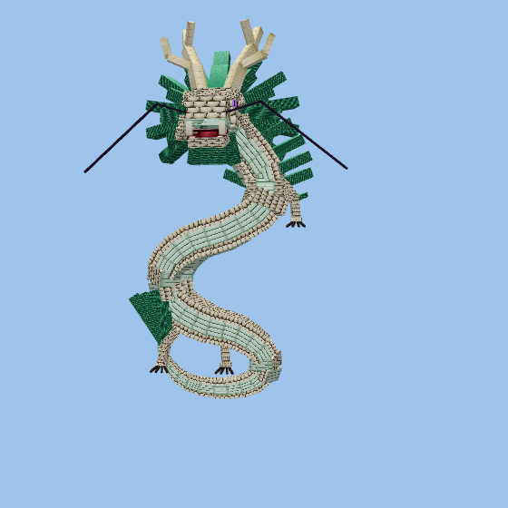
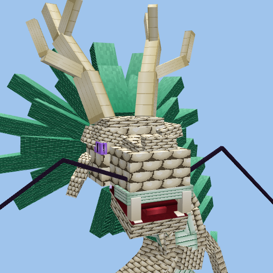
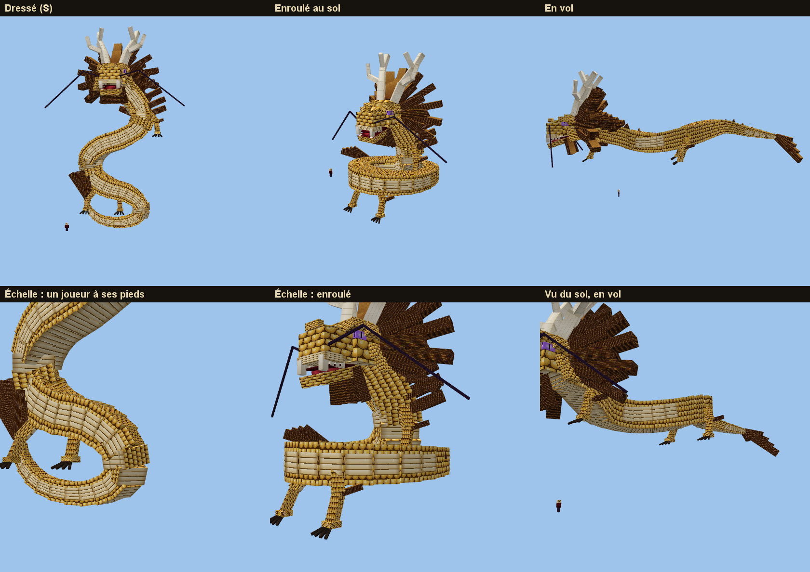

# Le Dragon d'Or (concept)

> Demande d'Enzo du 16/10/2026 : « un modèle de dragon géant doré, un mob légendaire unique, comme un dieu qui se
> baladerait sur la carte » ; « il doit être majestueux, le mob ultime », et une forme humaine qui soit « l'entité
> au-dessus de tout ». **Pas encore en jeu** : seulement le modèle validé en maquette.

## Ce qui est décidé

- **Construction** : de gros cubes (environ 230), les détails peints dans la texture (carreaux de 64 × 64), pas des
  milliers de petits blocs. Enzo a écarté une version en voxels (trop chargée), des lames en soleil autour de la tête
  (« trop goofy ») et des écailles qui faisaient des briques.
- **Silhouette** : un grand S vertical (tête en haut, corps qui serpente, queue recourbée en touffe), tête massive en
  plaques superposées, gueule ouverte et crocs, grands bois ivoire à trois ramifications, crinière épaisse en grosses
  mèches, longues moustaches fines, quatre pattes griffues avec un bracelet de crinière, écailles de poisson arrondies
  vers le bas, larges plaques de ventre sur le devant.
- **Couleurs : or blanc et jade** (choisies parmi or impérial, or blanc et jade, noir et or, rouge et or) : écailles
  blanc-doré, ventre vert d'eau, crinière jade, bois ivoire. Yeux violets pour l'instant.
- **Taille** : environ 40 blocs de haut dressé, 50 de long en vol (un joueur fait 1,8 bloc).
- **Poses étudiées** : dressé en S, enroulé au sol la tête levée, en vol à l'horizontale.

- **Le modèle** : `scripts/concepts/golden-dragon.cjs` (géométrie Bedrock et atlas 512 × 512). C'est notre propre
  dessin, construit à la manière des dragons en gros cubes qu'Enzo a montrés ; on ne copie aucun modèle trouvé en ligne
  (ni un personnage d'une autre œuvre), pour les droits.

## À décider

- Sa **forme humaine** (références d'Enzo : un vieux maître aux longs cheveux et à la barbe blancs, yeux violets
  lumineux, robe violette et noire brodée de dragons d'or, aura violette).
- Son **comportement** : vol lent au-dessus de la carte, repos enroulé sur un sommet, unique par monde, neutre sauf
  attaqué, combat de boss, récompense, réapparition.
- Les **animations** (ondulation en vol), l'**intégration** en jeu (GeckoLib ou Epic Fight, segments du corps animés),
  les yeux (violets ou or blanc).

## Note technique

Blockbench affiche la géométrie Bedrock en miroir sur x : la rotation qui couche l'axe z d'un cube le long d'une
direction d est `[asin(dy/|d|), atan2(dx, dz), 0]` (`along` dans le script, vérifiée sur un modèle de test).
