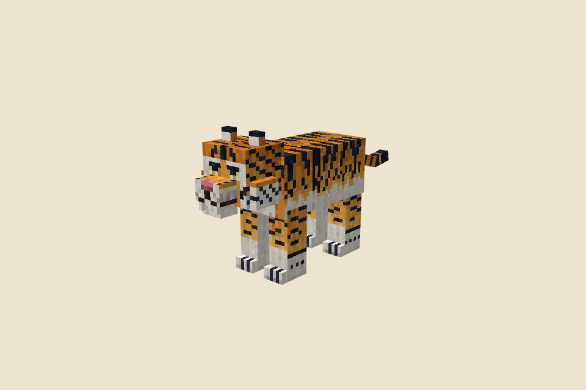
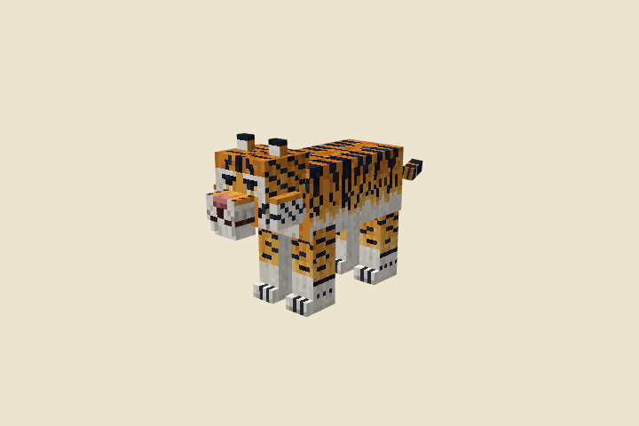
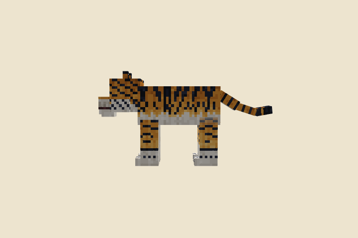

# Tigre (proposition, pas encore en jeu)

> Demandes d'Enzo du 15/10/2026 : un modèle de tigre (style « Tiger Variations » en référence de style, notre modèle et
> notre texture), ses animations, puis « des animations d'attaque pour un tigre ; ça équivaut à un loup mais deux fois
> plus fort au niveau des stats ».
>
> **Statut : modèle Blockbench et animations seulement** (`art/blockbench/tiger.bbmodel`). Rien n'est encore dans le
> jeu : il faudra une entité, son patch Epic Fight, son IA, son butin et ses lieux d'apparition.
>
> Scripts : `node scripts/animation/tiger-model.cjs` (modèle et texture), `node scripts/animation/tiger-animations.cjs`
> (animations et GIF, Blockbench isolé), `node scripts/concepts/tiger-preview.cjs` (images fixes).

## Le modèle

25 cubes à un texel par pixel, comme les mobs de Minecraft ; environ 4,4 blocs du museau au bout de la queue, le dos à
2 blocs du sol. Os : `body`, `head`, `jaw`, `front_leg_l/r` → `front_foot_l/r`, `hind_leg_l/r` → `hind_foot_l/r`,
`tail0` → `tail1` → `tail2`. Pelage peint par position 3D : rampes de 5 à 7 nuances avec grain de fourrure, rayures
serrées en escalier qui se fourchent, pattes baguées, ventre, poitrail, museau et pattes blancs.

## Les statistiques (le loup × 2)

| Statistique | Loup (Minecraft 1.21) | Tigre | Note |
|---|---|---|---|
| Points de vie | 8 (4 cœurs) | **16** (8 cœurs) | × 2 |
| Dégâts d'attaque | 4 | **8** | × 2, la base des attaques ci-dessous |
| Vitesse | 0,3 | **0,3** | gardée : × 2 (0,6) le rendrait plus rapide qu'un cheval |
| Portée de poursuite | 16 blocs | **32 blocs** | × 2 |
| Armure | 0 | 0 | rien à doubler |

À valider par Enzo : 16 PV, c'est peu pour une bête de cette taille (un joueur en a 20) ; doubler aussi la vitesse,
ou donner un peu d'armure, le rendrait plus menaçant.

## Les attaques

Toutes parables avec la garde Murim, comme celles des bandits. Dégâts proposés à partir des 8 de base.

| Attaque | Durée | Ce qu'il fait | Dégâts proposés | Quand |
|---|---|---|---|---|
| **Coup de griffe** (`swipe`) | 0,8 s | La patte droite armée haut et en dehors, puis ratissée en travers | 8 | Attaque de base, au contact |
| **Morsure** (`bite`) | 0,9 s | Il recule gueule ouverte, se détend, claque des mâchoires et secoue la tête | 8 | Au contact, en alternance |
| **Double griffe** (`double_swipe`) | 1,2 s | Droite puis gauche, la seconde plus lourde | 6 + 6 | Au contact, de temps en temps |
| **Bond** (`pounce`) | 1,6 s | Il s'accroupit, bondit en avant pattes tendues et gueule ouverte, retombe sur les pattes avant | 10 | De 4 à 7 blocs, pour fondre sur sa cible ; recharge 8 s |
| **Déchirement** (`maul`) | 1,8 s | Il se ramasse, se cabre en rugissant, la patte haute, et l'abat | 12 et recul | Rare ; lent, donc facile à voir venir et à parer |

 

 

Aussi : repos ([GIF](images/tiger-idle.gif)) et marche ([GIF](images/tiger-walk.gif), [profil](images/tiger-walk-side.gif)).

## Questions pour Enzo

- Neutre comme le loup (n'attaque que si on le frappe) ou agressif ?
- Où vit-il (forêts, bambous, montagnes du sud) et que lâche-t-il (peau, griffes, os pour élixirs) ?
- Une variante blanche ou dorée plus forte, en mini-boss ?
