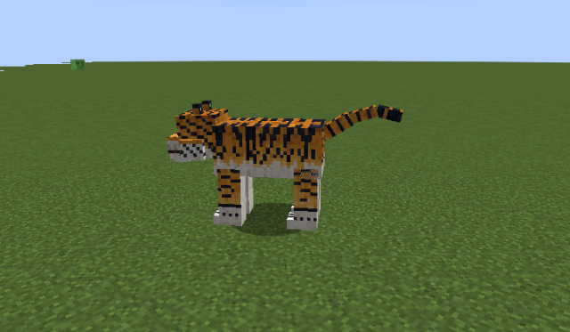
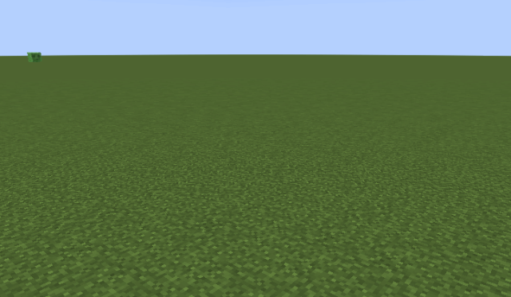
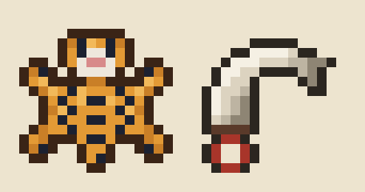

# Tigre (`murimblock:tiger`)

> Demandes d'Enzo du 15/10/2026 : un modèle de tigre (style « Tiger Variations » en référence de style, notre modèle et
> notre texture), ses animations, puis « des animations d'attaque pour un tigre ; ça équivaut à un loup mais deux fois
> plus fort au niveau des stats ».
>
> Puis : « il spawn au centre, il est agressif et il drop sa peau et ses griffes, 20 % chacun ; je te laisse créer les
> splash arts de ces items ».
>
> **Statut : en jeu** (sur `test`, en attente de validation d'Enzo). `TigerEntity`, `TigerPatch`, `TigerEpicFight`,
> `TigerRenderer` ; maillage, squelette et animations Epic Fight exportés par `scripts/animation/tiger-epicfight.cjs`.
>
> Scripts : `node scripts/animation/tiger-model.cjs` (modèle et texture), `node scripts/animation/tiger-animations.cjs`
> (animations et GIF, Blockbench isolé), `node scripts/concepts/tiger-preview.cjs` (images fixes).

## Le modèle

25 cubes à un texel par pixel, comme les mobs de Minecraft ; environ 4,4 blocs du museau au bout de la queue, le dos à
2 blocs du sol. Os : `body`, `head`, `jaw`, `front_leg_l/r` → `front_foot_l/r`, `hind_leg_l/r` → `hind_foot_l/r`,
`tail0` → `tail1` → `tail2`. Pelage peint par position 3D : rampes de 5 à 7 nuances avec grain de fourrure, rayures
serrées en escalier qui se fourchent, pattes baguées, ventre, poitrail, museau et pattes blancs.

## En jeu

 

- **Où** : uniquement dans la **région du centre** de la carte Murim (n'importe quel biome Murim), au sol à ciel
  ouvert, **de jour comme de nuit** ; par un ou deux ; jamais en Paisible (`TigerEntity.checkTigerSpawnRules`,
  `neoforge/biome_modifier/tiger_spawns.json`, poids 25). Un œuf d'apparition dans l'onglet Murimblock.
- **Agressif** : il chasse les joueurs qu'il voit (32 blocs), et riposte à qui le frappe.
- **Combat** (Epic Fight) : au contact, coup de griffe et morsure, parfois la double griffe, rarement le déchirement ;
  de 3,5 à 7 blocs, s'il voit sa proie, le **bond** (il est vraiment projeté en avant, recharge 8 s). Coups parables.
- **Butin** : **sa peau** (Tiger Pelt) et **ses griffes** (Tiger Claw), **20 % chacune**, indépendamment
  (`loot_table/entities/tiger.json`) ; 5 points d'expérience.

Les icônes (16 × 16, `scripts/animation/tiger-item-icons.cjs`) : la peau étalée comme un tapis vue de dessus (tête au
museau blanc et nez rose, pattes écartées, dos rayé, queue) ; une grande griffe d'ivoire recourbée, sa racine sombre,
pendue à un cordon rouge.

- **Vérifié** : GameTests `TigerGameTests` (statistiques, squelette et 9 animations, butin à 20 % sur 4 000 tirages,
  centre seulement, chaque attaque frappe dans sa fenêtre et pas avant, la double griffe deux fois, le bond projette le
  tigre, l'IA touche un joueur) ; film en vrai client `gradlew -PgameTests runTigerTour` (repos, marche, cinq
  attaques, mort : `images/tiger-ingame-*.gif`). Pas encore vu par Enzo en jeu.

## Les statistiques (le loup × 2)

| Statistique | Loup (Minecraft 1.21) | Tigre | Note |
|---|---|---|---|
| Points de vie | 8 (4 cœurs) | **16** (8 cœurs) | × 2 |
| Dégâts d'attaque | 4 | **8** | × 2, la base des attaques ci-dessous |
| Vitesse | 0,3 | **0,3** | gardée : × 2 (0,6) le rendrait plus rapide qu'un cheval |
| Portée de poursuite | 16 blocs | **32 blocs** | × 2 |
| Armure | 0 | 0 | rien à doubler |

Gardé à 16 PV comme demandé ; c'est moins qu'un joueur (20) : à relever si Enzo le veut plus menaçant.

## Les attaques

Toutes parables avec la garde Murim, comme celles des bandits. Dégâts à partir des 8 de base (TigerEpicFight).

| Attaque | Durée | Ce qu'il fait | Dégâts | Quand |
|---|---|---|---|---|
| **Coup de griffe** (`swipe`) | 0,8 s | La patte droite armée haut et en dehors, puis ratissée en travers | 8 | Attaque de base, au contact |
| **Morsure** (`bite`) | 0,9 s | Il recule gueule ouverte, se détend, claque des mâchoires et secoue la tête | 8 | Au contact, en alternance |
| **Double griffe** (`double_swipe`) | 1,2 s | Droite puis gauche, la seconde plus lourde | 6 + 6 | Au contact, de temps en temps |
| **Bond** (`pounce`) | 1,6 s | Il s'accroupit, bondit en avant pattes tendues et gueule ouverte, retombe sur les pattes avant | 10 | De 4 à 7 blocs, pour fondre sur sa cible ; recharge 8 s |
| **Déchirement** (`maul`) | 1,8 s | Il se ramasse, se cabre en rugissant, la patte haute, et l'abat | 12 et recul | Rare ; lent, donc facile à voir venir et à parer |

 

 

Aussi : repos ([GIF](images/tiger-idle.gif)) et marche ([GIF](images/tiger-walk.gif), [profil](images/tiger-walk-side.gif)).

## Questions pour Enzo

- À quoi serviront la peau et les griffes (armure, élixirs, échange avec le marchand) ?
- Une variante blanche ou dorée plus forte, en mini-boss ?
