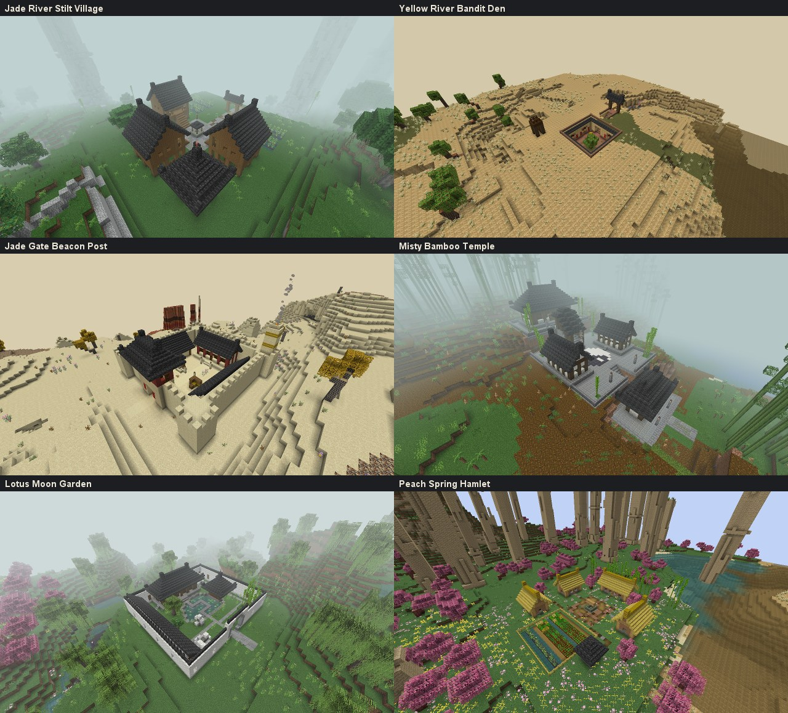
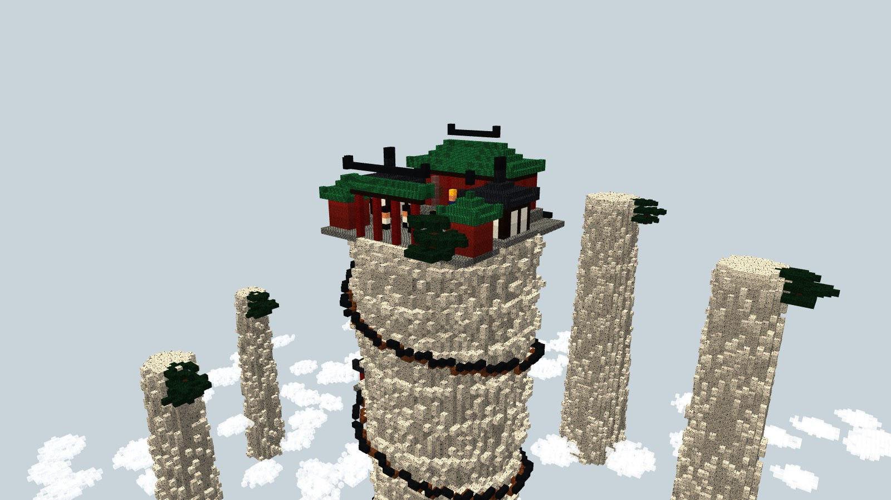
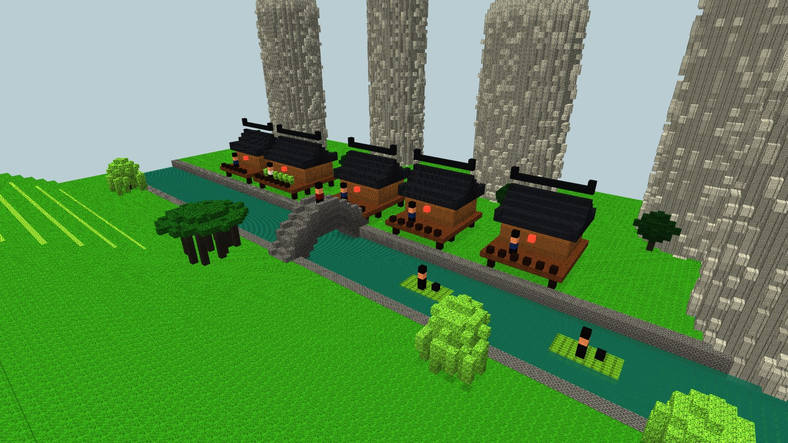
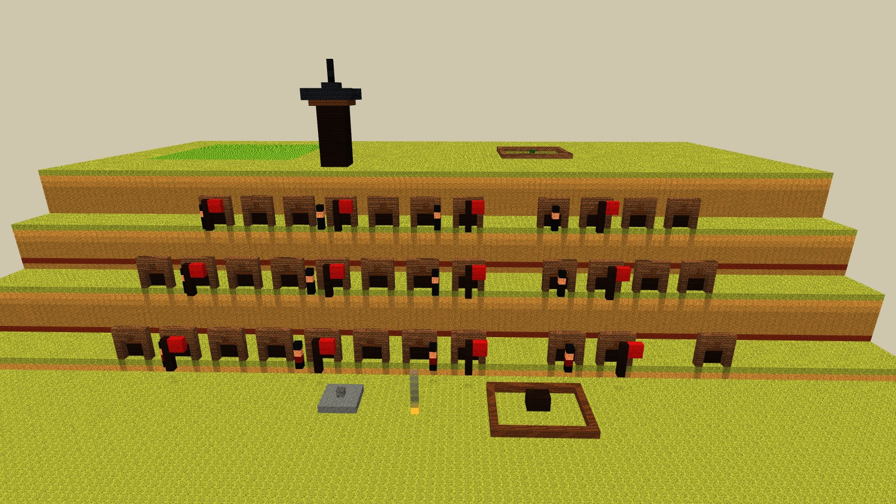
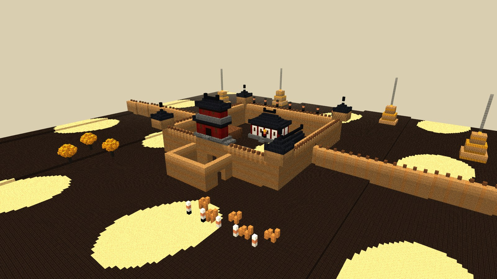
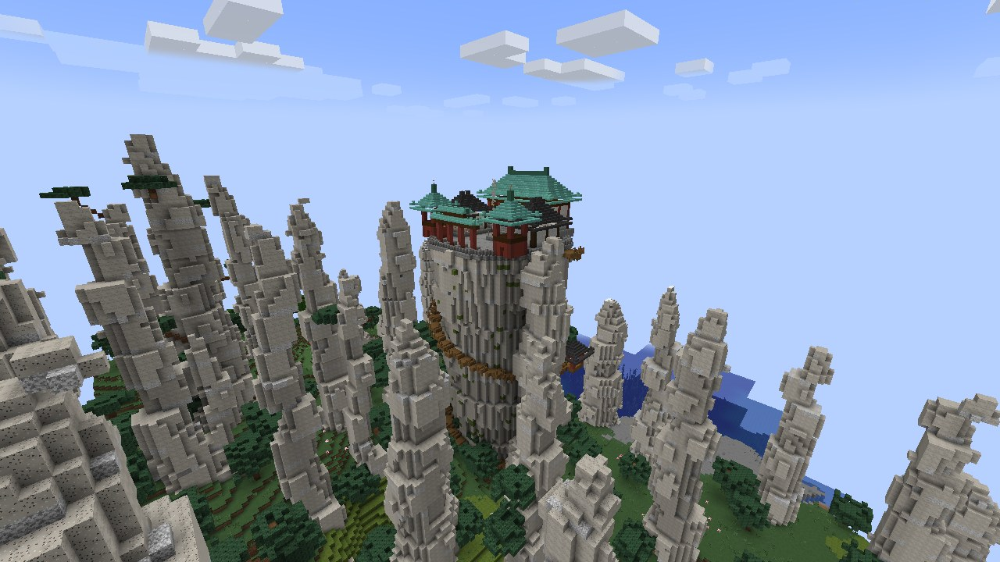
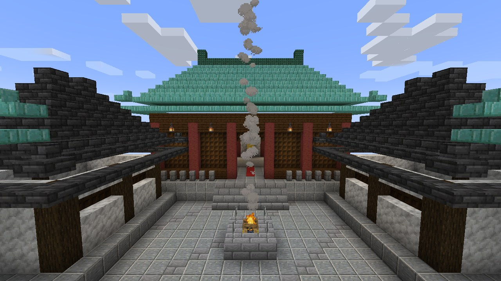
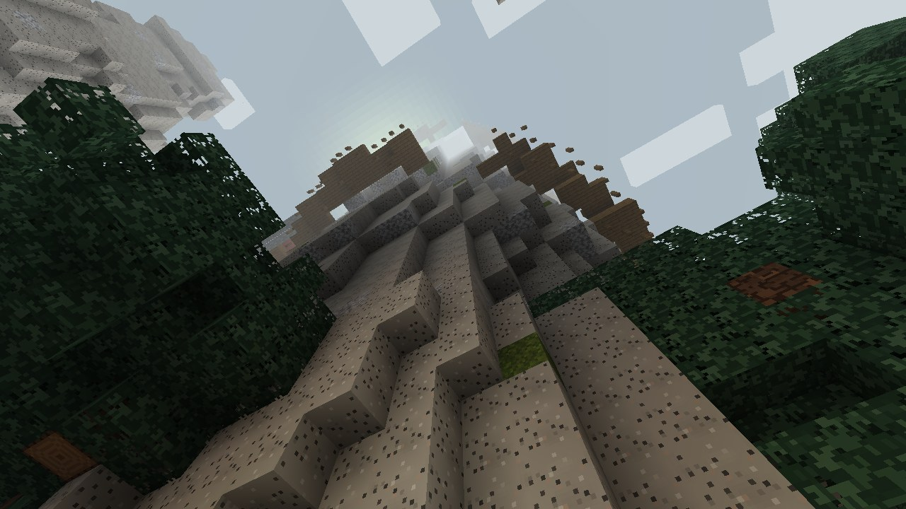
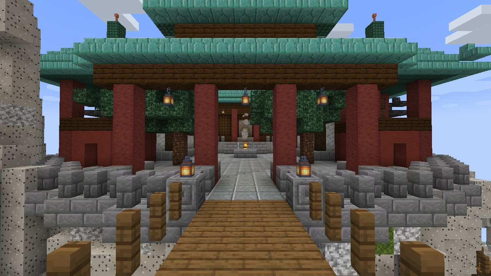
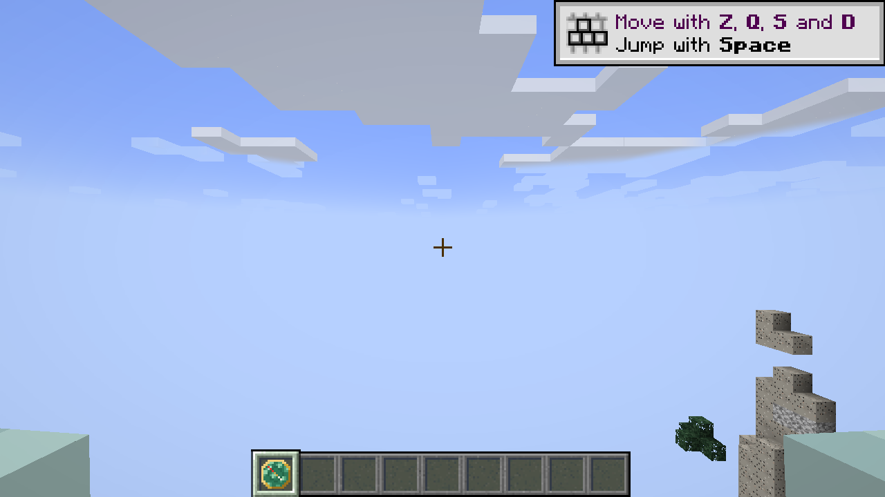

# Structures Murim

## Les six sites du 14/10/2026

Six structures de plus, une par biome Murim (le Huangshan a déjà le sanctuaire). Ce sont de vraies structures Minecraft : elles apparaissent toutes seules dans les mondes neufs et `/locate structure murimblock:<id>` les trouve. Chacune a sa fiche technique, avec des conseils sur ce qu'on devrait y mettre.

| Structure (id) | Biome | Ce que c'est | Fiche |
|---|---|---|---|
| Village sur pilotis de la rivière de Jade (`jade_river_stilt_village`) | Forêt des pics de jade | Hameau zhuang : 3 maisons ganlan, grenier, banian sacré, rizières, porte | [fiche](jade_river_stilt_village.md) |
| Repaire des Bandits du Fleuve Jaune (`yellow_river_bandit_den`) | Plateau de lœss | Cour enfoncée et 7 grottes voûtées, rampe, vigie | [fiche](yellow_river_bandit_den.md) |
| Relais de la Tour à Signaux de la Porte de Jade (`jade_gate_beacon_post`) | Désert du Hexi | Relais fortifié de la route de la soie, tour à signaux fumante | [fiche](jade_gate_beacon_post.md) |
| Temple taoïste de la Mer de Bambous brumeuse (`misty_bamboo_temple`) | Mer de bambous de Shu | Trois terrasses, taiji, escalier couvert, salle des Trois Purs | [fiche](misty_bamboo_temple.md) |
| Jardin de la Lune et des Lotus (`lotus_moon_garden`) | Pays des eaux du Jiangnan | Jardin de lettré : porte de lune, étang, pont en zigzag, galerie | [fiche](lotus_moon_garden.md) |
| Hameau de la Source aux Fleurs de Pêcher (`peach_spring_hamlet`) | Vallée des fleurs de pêcher | Maisons de terre et de chaume, champs, temple du dieu du sol | [fiche](peach_spring_hamlet.md) |

### Comment elles sont faites

- **Une structure par site** (`SiteStructure`, type `murimblock:site`), avec sa propre structure set (`random_spread`) et son tag de biome `has_structure/<id>`. Le JSON est écrit par `scripts/worldgen/generate-nature.cjs`.
- **Où elle se pose** : au centre de son chunk, l'entrée tournée vers le côté le plus bas du terrain, et seulement si la place convient (dénivelé limité, pas d'eau sauf pour le jardin, toute l'emprise dans le biome). Sinon Minecraft essaie la case suivante de la grille.
- **Le terrain** est modelé par Minecraft lui-même autour de chaque partie (`terrain_adaptation: beard_thin`, comme les villages vanilla) : le sol monte ou descend en pente douce jusqu'au site, sans falaise ni trou.
- **Jamais de vide en dessous** : chaque sol, chaque mur et chaque poteau est fondé jusqu'au terrain naturel, à travers l'air ou l'eau (`Canvas.footing`).
- **Jamais d'entrée sur le vide** : devant chaque porte, un abord sur sol plein (route, chemin, débarcadère), même si un ravin du lœss ou une rivière passe juste à côté.
- **Jamais de trou dans un toit** : les toits du kit (`BuildKit.roof`, `gableRoof`, `shedRoof`) posent un plafond plein sous les tuiles.
- **Rien ne pousse dedans** : un filtre de placement (`murimblock:away_from_sites`) écarte des sites les arbres, les bambous géants, les tours karstiques, les aiguilles, les piliers, les yardangs et les étangs.
- **Construites en code**, morceau par morceau (`SitePiece`), chunk par chunk comme toute structure ; le hasard est tiré de la position (jamais d'une suite), donc chaque chunk voit les mêmes choix. Le cadre `Canvas` tourne le plan, le découpe au chunk et note ce qu'il faut vérifier.
- **Code** : [world/structure/site](../../src/main/java/com/murimblock/world/structure/site/), un fichier par site.

### Vérification

- **GameTests** (`SiteGameTests`, un par site, dans `gradlew -PgameTests runGameTestServer`) : le site construit sur un sol de pierre passe toutes ses vérifications (chaque pièce couverte sur chaque colonne, rien de naturel dedans, chaque sol et chaque fondation portés) ; construit chunk par chunk comme en génération, il est identique bloc pour bloc au site construit d'un coup ; la structure et sa structure set sont enregistrées.
- **Visite en vrai client** (`gradlew -PgameTests runSiteTour`) : un monde neuf (graine 20261012, génération des structures activée) ; pour chaque site, la vraie commande `/locate structure`, puis le site trouvé est généré et vérifié de la même façon, dans le bon biome, et photographié. Rapport : `build/site-tour-run/site-tour-report.txt`.
- **Résultat du 14/10/2026** : les six `/locate` répondent en moins d'une seconde, de 487 blocs (le temple) à 7 058 blocs (le relais, le Hexi étant loin du départ sur cette graine) ; les six sites générés sont dans leur biome et passent toutes leurs vérifications.
- **Fréquence** : une tentative par carré de 22 à 26 chunks de côté, refusée si la place ne convient pas ; sur la graine de test, d'une place sur cinq à une sur deux est acceptée là où le biome est le bon, selon le relief du biome. Pour en voir plus souvent, il suffit de baisser `spacing` dans `generate-nature.cjs`.

## Les propositions du 12/10/2026

Les quatre propositions du 12/10/2026, avec leur maquette voxel :

| Structure | Biome | État | Maquette |
|---|---|---|---|
| Sanctuaire de la Falaise des Nuages | Pics de la mer de nuages | **Construit** (unique, près du spawn) |  |
| Village sur pilotis de la rivière de Jade | Forêt des pics de jade | **Construit** le 14/10 (`jade_river_stilt_village`) |  |
| Repaire des Bandits du Fleuve Jaune | Plateau de lœss | **Construit** le 14/10 (`yellow_river_bandit_den`) |  |
| Forteresse de la Passe de Jade | Désert de la frontière du Hexi | Devenue le relais `jade_gate_beacon_post` (14/10) |  |

Les plans et les intentions de jeu de chaque proposition ont été donnés à Enzo le 12/10/2026. Les maquettes se régénèrent avec `node scripts/concepts/render-proposals.cjs`, qui demande un Blockbench isolé lancé sur le port 9232.

## Sanctuaire de la Falaise des Nuages (construit)

**Le début de chaque aventure.** Le sanctuaire est le siège de « la » secte du serveur.

- **Il est unique** : un seul par monde. Il est construit au premier démarrage du serveur par `SanctuaryPlacement`, puis mémorisé dans la sauvegarde de la Surface (`murimblock_sanctuary`).
- **Sans geler le jeu** : la recherche du site, le chargement des chunks et la pose des blocs sont répartis sur les ticks du serveur (environ 5 ms de recherche, puis 10 ms de construction par tick). Les chunks sont générés en arrière-plan grâce à un ticket de chargement. Sur la graine de test, le tick le plus long est passé de 2,8 s à environ 50 ms, pour une soixantaine de ticks en tout. Pendant ces quelques secondes, le jeton et `/locate` ne trouvent pas encore le sanctuaire. Si le serveur s'arrête avant la fin, la construction reprend à zéro, à l'identique, au démarrage suivant.
- **Son emplacement** : le cœur du biome Pics de la mer de nuages le plus proche du spawn, dans un rayon de 4 000 blocs. Le biome est échantillonné tous les 32 blocs, et un point compte comme « cœur » si au moins 30 de ses 49 voisins sont dans les pics. À défaut, le sanctuaire va dans le biome Murim le plus proche, puis à côté du spawn. Il est toujours à au moins 64 blocs du spawn. Il apporte sa propre aiguille, donc il fonctionne partout.
- **Les mondes concernés** : seulement ceux dont la Surface est un monde normal (multi-noise). Les mondes plats et les mondes de test n'en ont pas.
- **Le point d'apparition n'est pas déplacé** : les joueurs commencent dans la nature et trouvent le sanctuaire avec le Jeton de la Secte ou `/locate`.
- **Le chemin part du côté le plus bas** autour de l'aiguille : le terrain est mesuré sur 24 directions, à 22 blocs de l'axe. Le palier d'arrivée est posé sur le sol de ce côté, à ciel ouvert, et sans arbre dans un rayon de 5 blocs.

**Ce qui est construit**, dans `SanctuaryBuilder` (en vrais blocs Minecraft, avec le kit commun décrit plus bas) :

- **L'aiguille** : en granite pâle, 70 blocs au-dessus du sol, d'un rayon de 14 à 20 blocs, assez large au sommet pour que toutes les colonnes et les tours reposent sur la cour. Elle est un peu plus large au sommet, avec des joints de diorite tous les 7 blocs, de la mousse et 6 pins qui sortent des flancs.
- **Le chemin de planches** : en épicéa, 2 blocs de large, avec des marches, des poutres d'épicéa plantées dans la roche et une rambarde extérieure. Il monte en spirale d'environ 0,3 bloc par bloc parcouru et finit toujours au sud. Sur le dernier quart de tour, il s'écarte de la roche sur des poutres, avec une rambarde des deux côtés.
- **La passerelle d'entrée** : 3 blocs de large, rambardes des deux côtés, poutres dessous. Elle relie la fin du chemin à une ouverture dans la balustrade, entre deux bornes à lanterne, dans l'axe du passage central du portique.
- **Le pavillon de repos** à mi-hauteur : posé sur des poutres à l'écart du chemin et relié à lui par un petit pont, pour que le chemin qui continue de monter ne traverse jamais son toit. Poteaux rouges, toit en tuiles grises, lanterne et bancs.
- **La cour au sommet** : pavée d'andésite polie, avec une bordure et une balustrade de pierre.
- **La salle principale** :
  - 5 travées (21 × 9) sur une plateforme de 2 blocs, avec des marches dans l'axe ;
  - colonnes en bois de palétuvier écorcé (rouge), murs en calcite, façade en treillis de chêne noir ;
  - toit vert vernissé en prismarine, avec des angles relevés ;
  - à l'intérieur : allée de tapis rouge, autel et statue du fondateur, coussins de méditation, lanternes.
- **Le dortoir** (à l'ouest) et **la bibliothèque** (à l'est, avec étagères et pupitre) : toits en tuiles grises.
- **Les tours** : celle de la cloche, avec une vraie cloche, et celle du tambour. Toits pyramidaux verts.
- **Le portique (paifang)** au sud : trois passages, poteaux rouges, toits verts, lanternes.
- **Le brûle-parfum** : un feu de camp sur une botte de paille, dont la fumée monte très haut. C'est le repère de jour.
- **Deux pins du Huangshan** dans la cour.

## Le Jeton de la Secte

- **Ce que c'est.** Un médaillon de jade cerclé d'or, dont l'aiguille rouge pointe vers le sommet du sanctuaire partout dans la Surface. C'est une cible de magnétite qui ne demande aucune magnétite.
- **Ses 32 images** sont dessinées par `scripts/worldgen/TokenTextures.java` et suivent les mêmes paliers que la boussole vanilla.
- **Le clic droit** affiche la direction et la distance, par exemple « Sanctuaire de la Falaise des Nuages : 1 240 blocs au nord-est ». Le message est en anglais, comme tout le texte du mod (règle du projet). Il y a une seconde de recharge entre deux utilisations.
- **Le don.** Il est donné une seule fois par joueur, à sa première connexion (drapeau `murimblock_sect_token_received`). Il est aussi dans l'onglet créatif Murimblock.
- **À décider avec Enzo** : une autre façon d'en obtenir un, par exemple sur un mob.

## Le trouver avec /locate

- `/locate structure murimblock:cloud_cliff_sanctuary` donne sa position avec la réponse habituelle de Minecraft : coordonnées vertes cliquables et distance.
- Le sanctuaire est déclaré comme structure (`SanctuaryStructure`, `data/murimblock/worldgen/structure/cloud_cliff_sanctuary.json`) mais ne se génère jamais tout seul : c'est `SanctuaryPlacement` qui construit l'unique exemplaire. Un mixin sur la recherche de structures (`SanctuaryLocateMixin`) renvoie la position mémorisée.
- En jeu, le joueur le retrouve avec le Jeton de la Secte.

## Vérification

- **GameTests** (`SanctuaryGameTests`) :
  - le sanctuaire complet se construit : 70 blocs, plus de 25 000 blocs de granite, toits verts, colonnes, chemin jusqu'au sommet, feu de signal sur la paille, cloche, passerelle d'entrée dégagée au sud, aucun vide sous les toits, aucune colonne ni tour au-dessus du vide, palier sûr ;
  - un monde plat n'en reçoit pas ;
  - un seul jeton est donné à la première connexion ;
  - l'aiguille vise le sommet ;
  - les 8 directions sont justes ;
  - `/locate structure murimblock:cloud_cliff_sanctuary` échoue dans un monde sans sanctuaire et le trouve quand il existe.
- **Visite en vrai client** (`gradlew -PgameTests runBiomeTour`) :
  - le monde est neuf (graine 20261012) ;
  - on vérifie que le sanctuaire est construit dans le biome de pics, à au moins 48 blocs du spawn, et que le palier est dégagé ;
  - on vérifie que la lumière est cohérente autour de l'aiguille : aucun bloc transparent (air, escalier, dalle) resté noir à côté d'un bloc éclairé par le ciel ;
  - on prend des photos aérienne, de la cour, du pied, de nuit, du jeton, de l'entrée, des toits, du dessous de la passerelle et du pavillon de repos.

## Le kit de construction commun

Les structures construites en code partagent `world/structure/kit` :

- `BuildKit` : pose de blocs en coordonnées du monde ou relatives à l'origine de la structure, états d'escaliers et de dalles, lanterne suspendue, et le toit chinois (en croupe ou en pyramide, avec avant-toits, coins relevés, faîtage et plafond plein) ;
- `RoofTiles` : les jeux de tuiles, `GREEN_GLAZED` (tuiles vernissées vertes, pour les salles de rang) et `GREY` (tuiles grises, pour les bâtiments ordinaires).

Chaque structure garde son propre plan et sa palette ; le village, le repaire et la forteresse s'appuieront sur ce kit.

Le test de construction du sanctuaire affiche une empreinte de tous ses blocs (`SANCTUARY_FINGERPRINT`). Un refactoring qui ne doit rien changer au sanctuaire doit la laisser identique.

## À faire ensuite

- Le maître de la secte (PNJ), l'éveil du Qi et la première technique.
- Les lanternes lumineuses avec Photon, pour le repère de nuit.
- La source du jeton de remplacement.
- Le contenu des six sites (PNJ, ennemis, butin, quêtes) : voir les conseils de chaque fiche.
