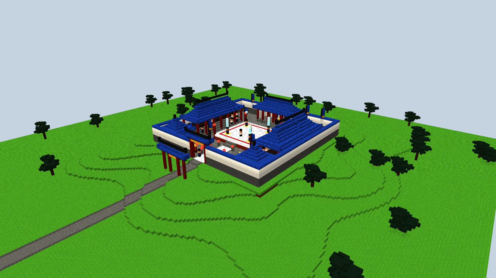
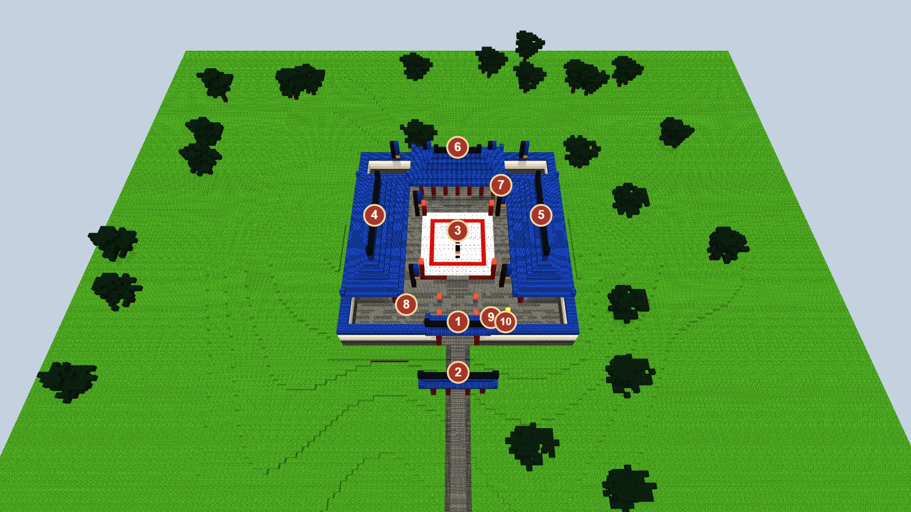
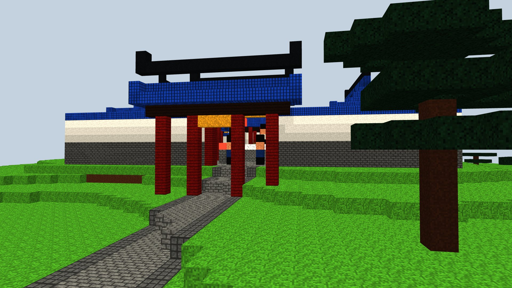
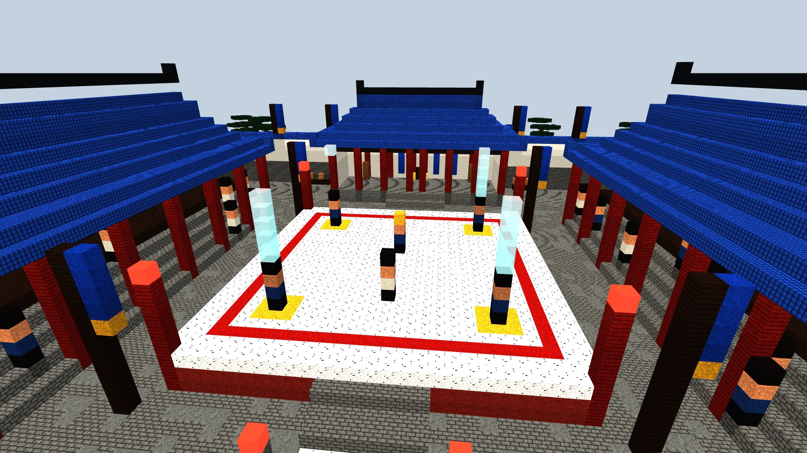
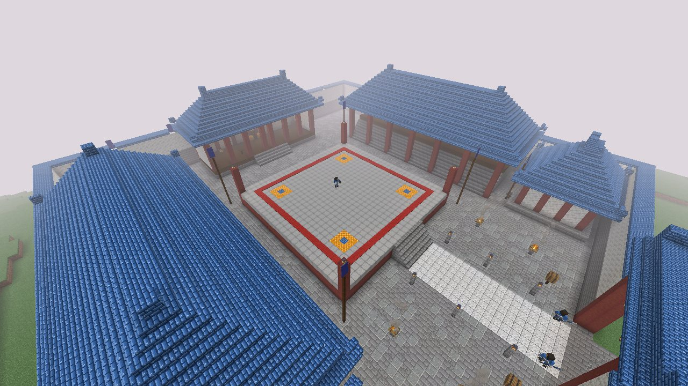
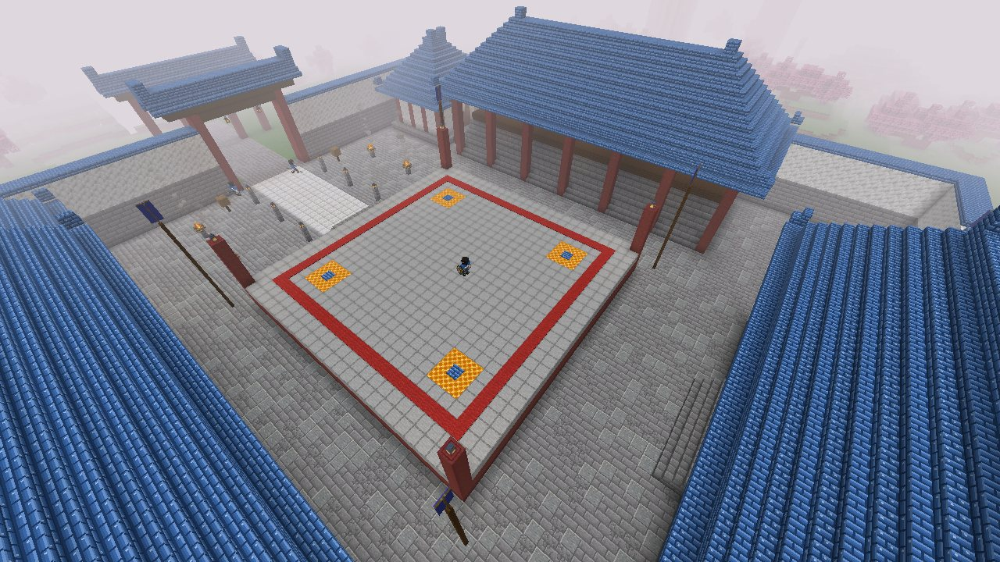
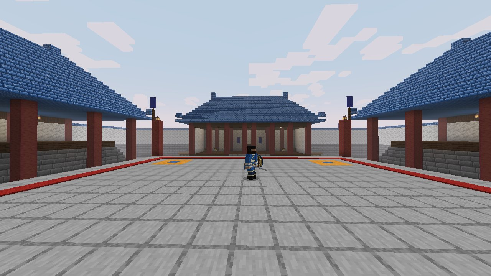

# Arène de l'Alliance orthodoxe (`alliance_arena`)

> Demandes d'Enzo du 15/10/2026 : « crée une structure pour l'Alliance, une sorte d'arène où il y aura le capitaine
> dedans, une arène dans le style Murim » ; « fais-moi une maquette avant de construire quoi que ce soit » ; « plus
> grande l'arène, le boss pourra invoquer des unités » ; maquette validée (« parfait, ajoute-la ») : le capitaine
> n'apparaîtra que là, des coffres à piller, une structure peu commune mais pas extrêmement rare, sans qu'il y en ait
> trop, « comme un avant-poste de pillards ».
>
> **Statut : construit en jeu** (sur `test`, en attente de validation d'Enzo), voir [En jeu](#en-jeu). Mêmes couleurs que l'[avant-poste](alliance-outpost.md) :
> tuiles azur, ornements or, colonnes rouges, murs blancs. Le capitaine est le boss de l'Alliance de la session
> « design » (`murimblock:peak_captain`, pas encore sur `test`), qui se bat avec la
> [Lance du Pic Céleste](../combat/styles/celestial-peak-spear.md) ; l'invocation d'unités est à ajouter à son combat.
>
> Maquettes : `node scripts/concepts/render-arena.cjs` (Blockbench isolé, `--port=` ; port 9232 par défaut), scène
> dans `scripts/concepts/arena.js`. 1 voxel = 1 bloc. Les PNG rendus ont été convertis en JPG pour la doc.

## L'idée

Un **leitai** (擂台), l'estrade de combat des romans Murim : une plateforme carrée surélevée où l'on règle les défis
devant tout le monde ; **qui tombe de l'estrade a perdu**. L'Alliance y éprouve ses disciples et y reçoit les défis
des inconnus. Le capitaine attend au centre. Pendant le combat, il **appelle ses unités** : elles surgissent dans une
colonne de Qi sur les quatre sceaux dorés du leitai, et d'autres sortent en renfort des deux salles des troupes.

- **Dimensions** : une cour fermée de **73 × 73 blocs** (murs de 10 de haut) ; le leitai fait **27 × 27**, son plateau
  3 blocs au-dessus de la cour, assez large pour se battre contre le capitaine et quatre unités à la fois. Avec la
  route et l'arche, le site tient dans environ 80 × 100 blocs.
- **Où** : comme l'avant-poste, dans n'importe quel biome Murim mais **seulement au centre de la carte ou près
  d'une frontière entre régions** (les terres de l'Alliance). Plus rare que l'avant-poste.

## Le plan

| N° | Lieu | Ce que c'est | Qui y est |
|---|---|---|---|
| 1 | Porte | Poteaux rouges de 11 blocs, linteau sombre à bandeau or, toit azur, lanternes | Deux gardes à la lance |
| 2 | Arche (paifang) sur la route | Annonce l'arène à 14 blocs de la porte | — |
| 3 | **Le leitai** | 27 × 27, jupe rouge entre poteaux rouges, plateau de pierre claire, cercle de combat tracé en rouge, une lanterne sur chaque poteau d'angle, marches côté porte | **Le capitaine**, au centre, face à la porte |
| 4 | Tribune ouest | Quatre gradins de pierre, une galerie derrière, colonnes rouges, grand toit azur | Disciples spectateurs |
| 5 | Tribune est | Pareille | Disciples spectateurs |
| 6 | Pavillon des juges | Plancher surélevé ouvert sur le leitai, murs blancs, siège du capitaine entre deux blocs d'or, bannières de l'Alliance, deux grandes cloches, la cache du site | — |
| 7 | **Sceaux d'invocation** (4) | Cercles d'or sur le leitai : les unités du capitaine y apparaissent dans une colonne de Qi | Unités invoquées |
| 8 | Salle des troupes ouest | Grande porte tournée vers le leitai : d'autres renforts en sortent | Unités invoquées |
| 9 | Salle des troupes est | Pareille | Unités invoquées |
| 10 | Mâts à bannières | Quatre mâts aux angles du leitai | — |
| 11 | Braseros | Quatre feux sur socles de pierre dans l'allée | — |
| 12 | Tambours de guerre | Deux tambours près de la porte ; contre le mur nord, des râteliers d'armes | — |

## Vues

**Depuis la route** : l'arche, la porte, les gardes.

**Le leitai pendant le combat** : le capitaine (coiffe dorée) face à un challenger, ses quatre unités qui surgissent
sur les sceaux, les tribunes pleines, le pavillon des juges au fond.

## En jeu

- **Structure** `murimblock:alliance_arena` (`AllianceArena`), construite en code bloc par bloc d'après la maquette,
  trouvée par `/locate structure murimblock:alliance_arena`.
- **Fréquence** : peu commune, à peu près comme un avant-poste de pillards. Une tentative par carré de 40 chunks
  (640 blocs) de côté, au moins 16 chunks entre deux, refusée si le terrain ne convient pas (plus de 8 blocs de
  dénivelé, de l'eau) ou si l'endroit n'est ni au centre ni près d'une frontière de régions. Sur la graine de test, la
  première est à 1 105 blocs du départ.
- **Coffres** (table `chests/alliance_arena`) : un dans chaque salle des troupes, un dans le pavillon des juges. Chacun
  tient 3 à 6 lots : taels d'argent, fer, or, pain, bœuf, flèches, émeraudes, parfois un diamant ; une fois sur trois
  une pilule de rassemblement du Qi ; 15 % de chances d'une arme de l'Alliance (lance, bouclier de rotin, jian de la
  prune des neiges) ; 12 % du rouleau du Poing Long. Le pavillon garde aussi la cache des sites (tonneau).
- **Le capitaine n'apparaît que là**, au centre du leitai. Tant que son entité (`murimblock:peak_captain`, session
  « design ») n'est pas sur `test`, un **sergent de l'Alliance** tient sa place : `AllianceArena.captain` est le seul
  endroit à changer.
- **Vérifié** : GameTest `allianceArenaIsWholeAndCarried` (561 vérifications, 28 772 blocs, identique d'un coup ou
  chunk par chunk, habitants à leur place puis remis dans un site vidé), visite en vrai client (`runSiteTour`). Pas
  encore vu par Enzo en jeu.
- **Matériaux** : briques de pierre et calcite pour les murs, tuiles azur pour les toits, manglier écorcé
  (rouge) pour les colonnes et la jupe du leitai, pierre lisse pour le plateau, tapis rouge pour le cercle, bloc de
  rayon de miel pour l'or des sceaux et des bandeaux, chêne noir pour les poutres et les mâts, cloches, feux de camp,
  tonneaux.
- **Habitants** : le capitaine au centre du leitai ; deux gardes à la lance à la porte ; deux disciples à l'épée dans
  les galeries des tribunes.
- **L'invocation** fait partie du combat du capitaine (session « design ») ; l'arène fournit les points d'apparition :
  les quatre sceaux et les portes des deux salles des troupes.

## Questions pour Enzo

- Quelles unités le capitaine invoque-t-il (gardes à la lance, disciples à l'épée, archers sur les tribunes ?), combien
  à la fois, et à quel moment (à chaque tiers de sa vie ? toutes les 30 secondes ?) ?
- Le capitaine attaque-t-il dès qu'on monte sur le leitai, ou faut-il le défier (clic droit, comme Sensei Yun) ?
- Tomber du leitai fait-il perdre le duel (le capitaine reprend sa place, le joueur doit remonter) ?
- Les disciples des tribunes se battent-ils aussi, ou regardent-ils seulement ?
- Combien d'arènes : une seule par monde (près du centre), ou quelques-unes comme les avant-postes ?
