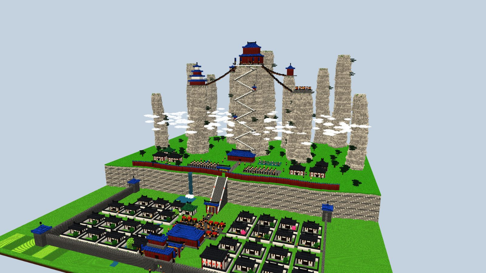
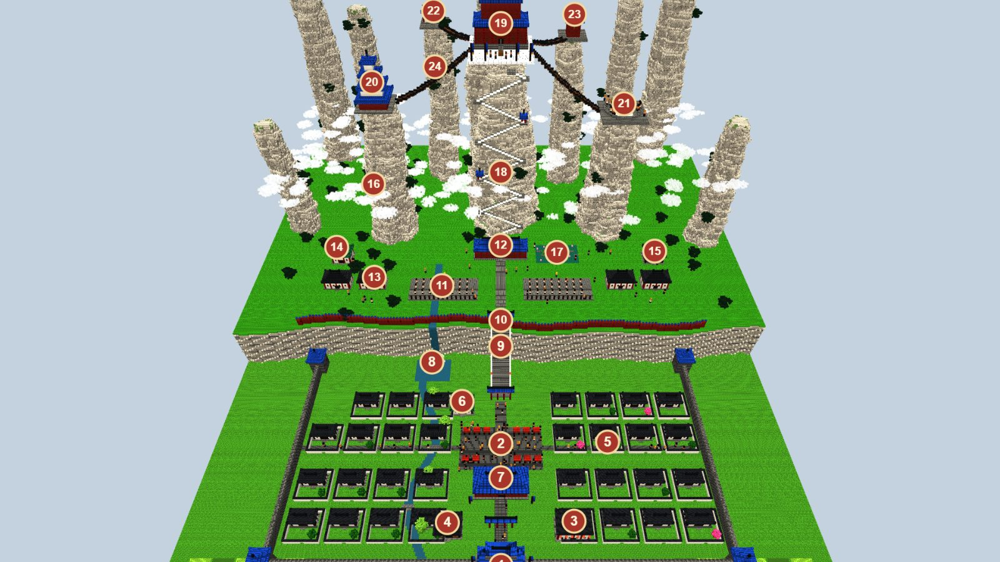
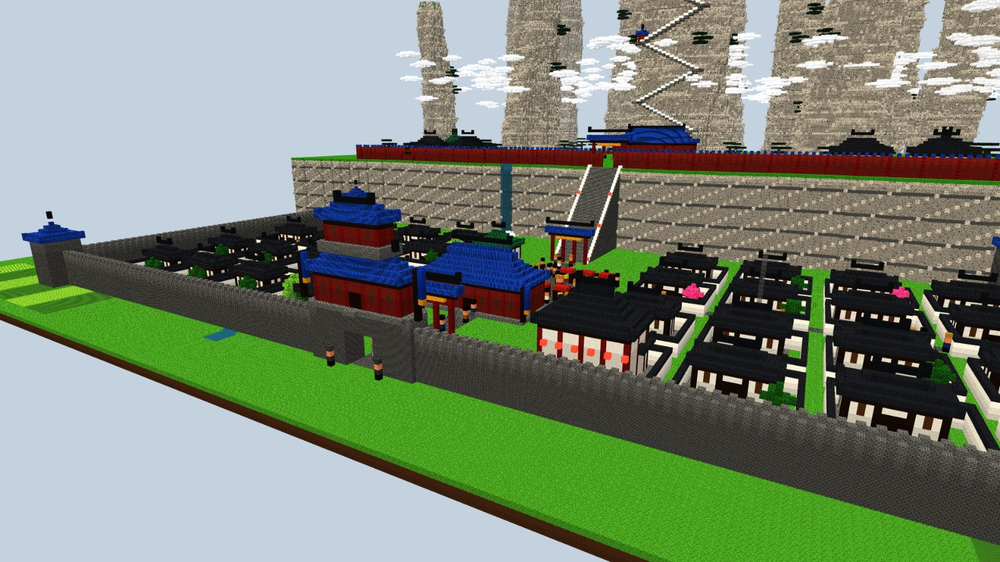
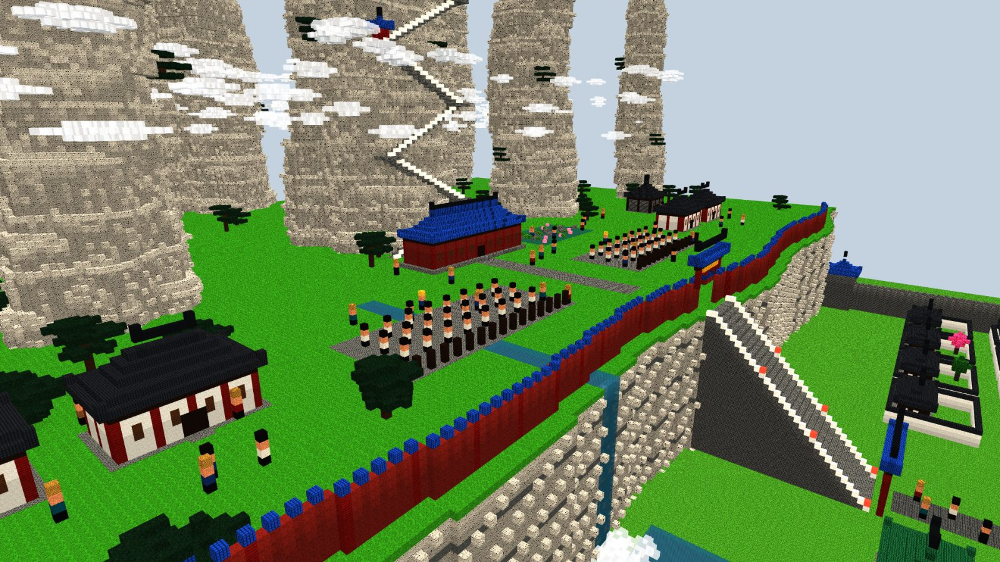
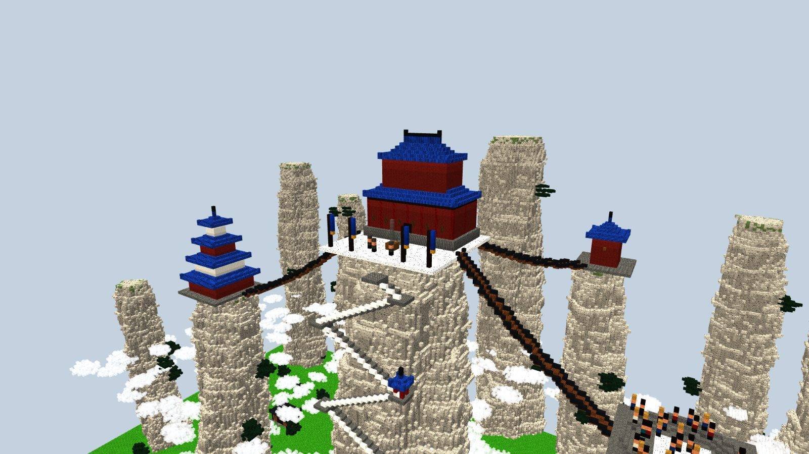
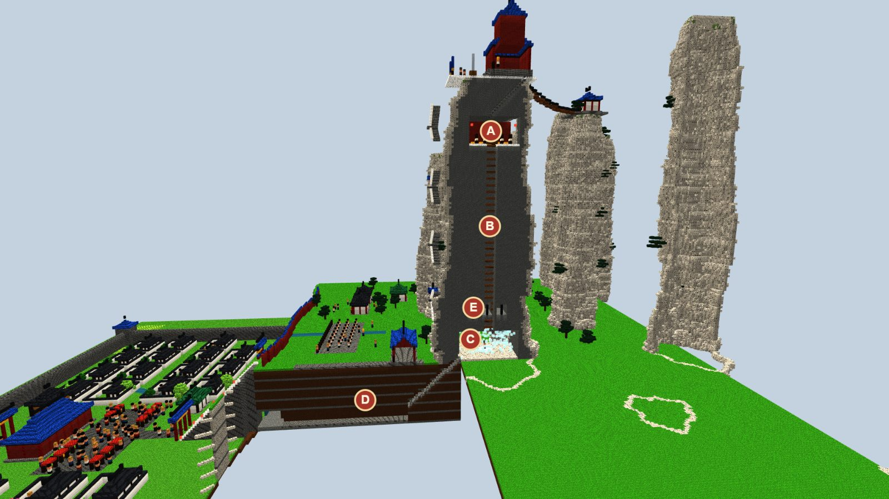

# Capitale de l'Alliance orthodoxe — maquettes (proposition à valider par Enzo)

> Demande d'Enzo du 15/10/2026 : « fais-moi des maquettes de la capitale de l'Alliance. Ça doit être immense, il doit y
> avoir des secrets, et savoir ce qu'on met dedans : des villageois, etc. »
>
> **Statut : maquettes voxel, rien n'est construit en jeu.** Le nom de la capitale, des lieux et des personnages reste
> à choisir par Enzo ; ce document les désigne par leur fonction. Il ne reprend rien de la bible du monde au-delà de
> l'introduction (l'Alliance siège au centre, sur les montagnes sacrées).
>
> Maquettes : `node scripts/concepts/render-capital.cjs` (Blockbench isolé sur le port 9232), scène dans
> `scripts/concepts/capital.js`. 1 voxel = 1 bloc.

## L'idée

Une capitale sur **trois niveaux**, que l'on découvre en montant :

1. **La ville basse**, dans la vallée : une vraie ville habitée, avec ses villageois, son marché et ses artisans. Tout le monde peut y entrer.
2. **La cité intérieure**, sur un plateau au-dessus d'une falaise de 30 blocs : le domaine des disciples de l'Alliance. On y monte par un grand escalier.
3. **Les pics**, cinq aiguilles de granite qui sortent de la mer de nuages : la Grande Salle au sommet de la plus haute (164 blocs), reliée aux autres par des ponts de chaînes.

**Dimensions.** Environ **340 × 360 blocs** au sol, jusqu'à **y + 164** : de loin dans les Pics de la mer de nuages (centre de la carte), on la voit avant tout le reste. Il faut plusieurs minutes pour la traverser de la porte sud à la Grande Salle.

**Couleurs.** Celles du drapeau de l'Alliance : tuiles azur et ornements or, colonnes rouges, murs blancs, granite pâle.

## Le plan

| N° | Lieu | Ce qu'on y fait | Qui y vit |
|---|---|---|---|
| **La ville basse** | | | |
| 1 | Grande porte sud (tour à trois étages) | Entrée de la ville ; on y est contrôlé | Gardes de la ville |
| 2 | Marché | Acheter et vendre : vivres, matériaux, remèdes, armes simples | Marchands, villageois, enfants |
| 3 | Auberge | Se reposer (lit, point de réapparition), écouter les rumeurs | Aubergiste, voyageurs |
| 4 | Maison de thé, au bord du ruisseau | Rumeurs, petites quêtes de villageois | Tenancière, habitués |
| 5 | Forge | Réparer et forger les armes de l'Alliance | Forgeron et apprentis |
| 6 | Herboriste | Herbes, pilules, soins | Herboriste |
| 7 | Hall de recrutement | **Rejoindre l'Alliance** : l'épreuve d'entrée commence ici | Officier recruteur |
| 8 | Cascade et bassin | Le ruisseau qui traverse la ville tombe du plateau ; **secret D** derrière | — |
| — | Maisons à cour (32), rizières hors les murs | La vie de la ville | Familles de villageois, paysans |
| **La cité intérieure** (réservée aux membres, ou sur invitation) | | | |
| 9 | Grand escalier (30 blocs de falaise) et ses lanternes | La montée vers la cité | — |
| 10 | Porte intérieure | Contrôle : on n'entre qu'en membre de l'Alliance | Gardes de l'Alliance |
| 11 | Deux cours d'entraînement | Disciples à l'exercice ; duels d'entraînement | Disciples, instructeurs |
| 12 | Salle du Mérite | **Les quêtes de l'Alliance**, le rang, la réputation | Intendant de l'Alliance |
| 13 | Halls des disciples | Dortoirs ; votre coffre de membre | Disciples |
| 14 | Infirmerie | Soins, élixirs | Médecin |
| 15 | Arsenal | Équipement de l'Alliance selon le rang | Armurier |
| 16 | Cuisines | Nourriture | Cuisiniers |
| 17 | Bassin aux lotus et pont en zigzag | Lieu calme, méditation | — |
| **Les pics** | | | |
| 18 | Sentier en zigzag sur la face sud, pavillons de repos | Monter à la Grande Salle | — |
| 19 | **Grande Salle de l'Alliance** (double toit azur) | Le chef de l'Alliance : épreuve finale ou boss ; **secret A** dessous | Chef de l'Alliance, gardes d'élite |
| 20 | Tour-bibliothèque (quatre étages) | **Apprendre les arts de l'Alliance** selon le rang | Bibliothécaire, maîtres d'arts |
| 21 | Arène (gradins en cercle) | Duels classés, tournois entre joueurs | Arbitre, spectateurs |
| 22 | Résidences des anciens | Quêtes de haut rang, leçons des maîtres | Anciens |
| 23 | Tour de la cloche et des signaux | Sonne l'alerte en cas d'attaque | Veilleur |
| 24 | Ponts de chaînes | Relient le sommet aux autres pics | — |

## Vues

**La ville basse** : le marché sur l'avenue, les maisons à cour, l'auberge aux lanternes, la porte sud.

**La cité intérieure** : la muraille rouge au bord de la falaise, le grand escalier, les cours d'entraînement, la Salle du Mérite.

**Le sommet** : la Grande Salle, la tour-bibliothèque, la tour de la cloche, l'arène, les ponts de chaînes.

## Les secrets

Le pic de la Grande Salle coupé en deux (sa moitié est retirée) :

| | Secret | Comment on le trouve | Ce qu'il y a |
|---|---|---|---|
| **A** | Le caveau scellé, sous la Grande Salle | Un escalier caché derrière le siège du chef | Coffres, étagères de manuels interdits ; une porte de bronze scellée (clé, épreuve ou boss à décider) |
| **B** | Le puits | Depuis le caveau, une échelle descend au cœur du pic | Relie le sommet à la base du pic sans le sentier |
| **C** | La chambre de la veine du dragon | Au pied du puits, sous le pic | Le Qi sort de la roche : la méditation y est la plus rapide de la carte (comme les lieux de pouvoir actuels, en plus fort) |
| **D** | Le passage sous le plateau | De la chambre C vers le sud, jusqu'à une grotte **derrière la cascade** de la ville basse (8) | Une entrée secrète de la cité, dans les deux sens : un raccourci, ou une infiltration pour un joueur qui n'est pas de l'Alliance |
| **E** | Les cellules | Taillées dans le roc, à mi-hauteur du puits | Cachots fermés de chaînes ; on y trouvera peut-être quelqu'un (à décider) |

D'autres secrets possibles, plus petits : un coffre derrière une tablette de la bibliothèque, une dalle qui sonne creux dans l'arène, un pavillon de repos du sentier d'où l'on voit une corniche inaccessible.

## Qui vit dans la capitale

- **Les villageois de la ville basse** (une soixantaine sur les maquettes) : marchands, artisans, paysans, enfants, voyageurs. Ils vivent, marchent, commercent, dorment la nuit. Ils ne se battent pas ; certains donnent de petites quêtes.
- **Les gardes** : à la porte sud, à la porte intérieure et au sommet. Ils protègent les villageois, arrêtent les bagarres dans la ville et attaquent les ennemis de l'Alliance.
- **Les disciples** : à l'entraînement, dans les halls, sur les sentiers. Ce sont les membres de l'Alliance qui ne sont pas des joueurs.
- **Les maîtres et les fonctions** : instructeurs, bibliothécaire, intendant de la Salle du Mérite, médecin, armurier, officier recruteur, anciens.
- **Le chef de l'Alliance**, dans la Grande Salle : boss de la bêta.

Ces personnages correspondent aux mobs de faction prévus pour atteindre les 20 mobs de la bêta (disciple, garde, etc.).

## À décider avec Enzo

1. **Les noms** : la capitale, ses lieux, le chef de l'Alliance.
2. **La taille** : 340 × 360 blocs, ça te va, ou plus grand encore ?
3. **Qui entre où** : la ville basse ouverte à tous et la cité intérieure aux seuls membres ?
4. **Les secrets** : que garde le caveau A, qui est dans les cellules E ?
5. **La construction** : comme le sanctuaire, une seule capitale par monde, construite au premier démarrage dans les Pics de la mer de nuages du centre de la carte.
