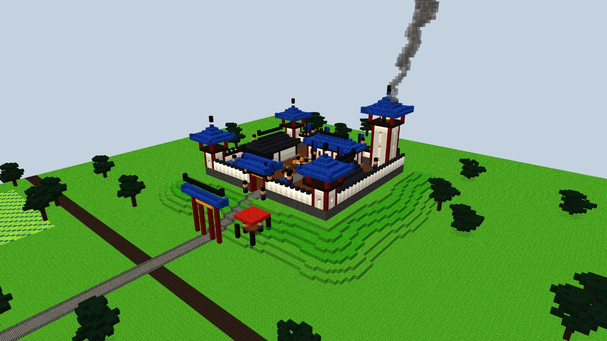
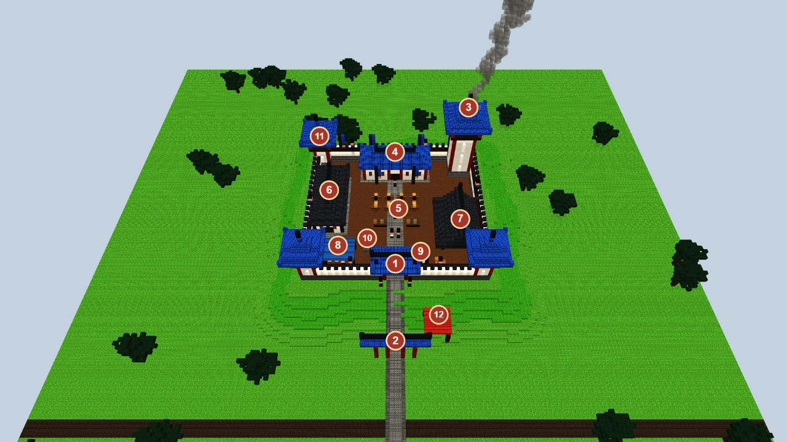
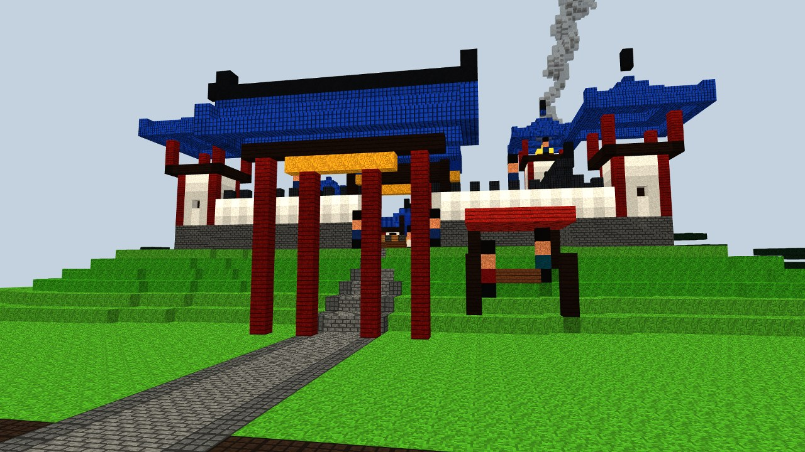
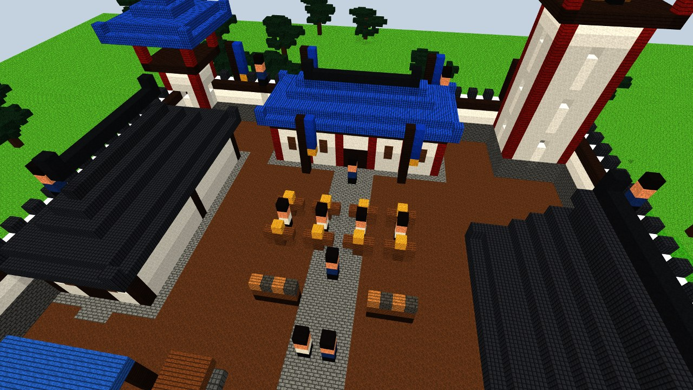
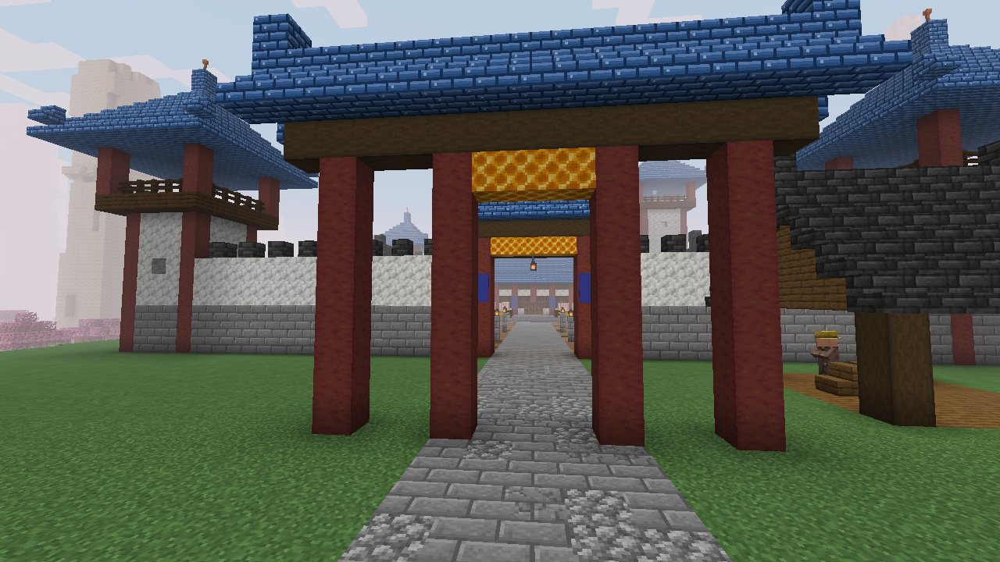
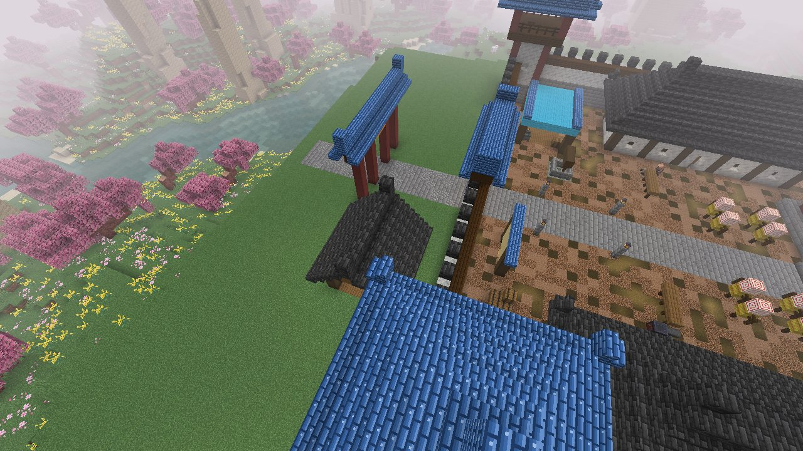
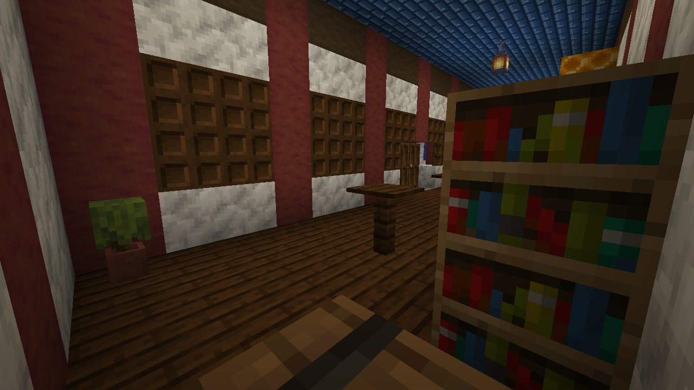

# Avant-poste de l'Alliance orthodoxe (`alliance_outpost`)

> Demande d'Enzo du 15/10/2026 : « fais-moi une maquette d'un avant-poste pour l'Alliance ».
>
> 15/10/2026, demande suivante : « décompose tout bloc par bloc et fais-moi la structure, rajoute-la ; elle ne peut
> apparaître qu'au centre et à la frontière des autres zones ».
>
> **Statut : construit en jeu** (sur `test`, en attente de validation d'Enzo), voir [En jeu](#en-jeu) et
> [Bloc par bloc](#bloc-par-bloc). Les noms restent à choisir par Enzo. Ce document ne
> reprend rien de la bible du monde au-delà de l'introduction. Mêmes couleurs que la [capitale](alliance-capital.md) :
> tuiles azur et ornements or, colonnes rouges, murs blancs.
>
> Maquettes : `node scripts/concepts/render-outpost.cjs` (Blockbench isolé, port 9232 par défaut, `--port=` pour un
> autre), scène dans `scripts/concepts/outpost.js`. 1 voxel = 1 bloc.

## L'idée

Un **fort de garnison** sur une butte au bord d'une route : ce que l'Alliance pose là où elle veut tenir un passage,
une frontière ou une région loin de la capitale. Il sert de relais. On peut s'y reposer, y prendre les missions de
l'Alliance, et sa tour de guet allume un feu de signal qui transmet les nouvelles de poste en poste jusqu'à la
capitale.

- **Dimensions** : environ **53 × 47 blocs** à l'intérieur des murs, sur une butte nivelée à 6 blocs au-dessus de la route ;
  la tour de guet monte à **26 blocs** au-dessus de la cour, plus sa fumée. Tout le site tient dans 110 × 110 blocs avec la
  route et ses abords.
- **Réutilisable** : un même plan peut se poser en plusieurs endroits de la carte (passes de montagne, gués, frontière du
  désert face au Culte), avec quelques variantes : sable et grès au Hexi, neige au nord.

## Le plan

| N° | Lieu | Ce qu'on y fait | Qui y est |
|---|---|---|---|
| 1 | Porte et corps de garde | Entrée ; on y est contrôlé | Deux gardes de l'Alliance |
| 2 | Arche (paifang) au pied de la butte | Marque l'entrée du territoire de l'Alliance sur la route | — |
| 3 | Tour de guet et feu de signal | Le feu relaie les nouvelles vers la capitale ; on voit la région de là-haut | Un guetteur |
| 4 | Salle du commandement | **Les missions de l'avant-poste**, les rapports, le rang | Le commandant |
| 5 | Cour d'entraînement | Mannequins, râteliers ; duels d'entraînement | Disciples, un instructeur |
| 6 | Caserne | Lits, coffres ; point de réapparition pour les membres | Disciples au repos |
| 7 | Écuries | Chevaux de l'Alliance (dans la maquette, des chameaux font office de chevaux) | Palefrenier |
| 8 | Tente d'infirmerie | Soins, élixirs simples | Un médecin |
| 9 | Tableau des avis | **Avis de recherche et petites quêtes** pour tous, membres ou non | Voyageurs |
| 10 | Puits et réserves | Eau, vivres, une charrette | — |
| 11 | Murs, chemin de ronde et tours d'angle | Défense ; gardes sur les murs | Gardes |
| 12 | Salon de thé hors les murs | Halte des voyageurs ; rumeurs de la route | Tenancier, voyageurs |

## Vues

**Depuis la route** : l'arche au pied de la butte, le salon de thé, la porte, les tours d'angle, la fumée du signal.

**La cour** : la salle du commandement au fond, les mannequins et les disciples, la caserne à gauche, les écuries à
droite, la tour de guet.

## En jeu

- **Structure** `murimblock:alliance_outpost` (`AllianceOutpost`, plan `alliance_outpost`), comme les autres sites
  ([README](README.md)) : construite en code, chunk par chunk, l'entrée tournée vers le terrain le plus bas.
  `/locate structure murimblock:alliance_outpost` la trouve.
- **Où** : dans n'importe quel biome Murim, mais **seulement au centre de la carte, ou à moins de 1 500 blocs d'une
  frontière entre deux régions** (centre/nord, centre/ouest, nord/est...) : `MurimMap.centreOrFrontier`, vérifié avant
  tout le reste (`Site.allowedAt`). Jamais au cœur d'une région ni hors de la bulle Murim.
- **Fréquence** : une tentative par carré de 64 chunks (1 024 blocs) de côté, refusée si le terrain est trop pentu
  (plus de 8 blocs de dénivelé) ou dans l'eau. Sur la graine de test, le premier est à 1 602 blocs du départ.
- **Habitants pour l'instant** : le commandant (cartographe, dans la salle), l'intendant (armurier, à la caserne), le
  médecin (clerc, sous la tente) et le tenancier du salon de thé (fermier) : des villageois avec leurs métiers et leurs
  noms anglais ; deux chevaux aux écuries. Les **soldats de l'Alliance** les rejoindront quand leurs mobs existeront.
- **Butin** : un tonneau de la salle et un des réserves tiennent la cache des sites (`SiteLoot.CACHE`).
- **Nouveaux blocs** : les **tuiles azur** de l'Alliance (Azure Roof Tiles, en marches et en dalles, onglet Murimblock),
  dessinées par `scripts/worldgen/generate-building.cjs`. Elles servent aussi à la future capitale.
- **Vérifié** : GameTest `allianceOutpostIsWholeAndCarried` (507 vérifications, 11 920 blocs, identique construit d'un
  coup ou chunk par chunk, habitants à leur place puis remis dans un site vidé), test unitaire de la règle de placement
  (`MurimMapTest`), visite en vrai client (`runSiteTour`). Pas encore vu par Enzo en jeu.

## Bloc par bloc

Coordonnées locales : x vers l'est, z vers l'entrée (le sud avant rotation), y au-dessus de la cour (g). Le site tient
dans x -30..30, z -26..46, 42 blocs de haut.

| Partie | Où | Blocs |
|---|---|---|
| Terrain | tout le site | nivelé à g, herbe et terre dessous jusqu'au sol naturel ; ni fleurs ni herbes sur les sites |
| Cour | x -24..24, z -20..22 | terre brute, boue tassée, chemin de terre ; allée de briques de pierre (x -2..2) de la porte à la salle ; 4 lanternes sur murets |
| Murs | x -26..26, z -22..24, 2 d'épaisseur | briques de pierre sur 4 rangs, calcite au-dessus (7 de haut) ; chemin de ronde en planches de chêne noir ; créneaux de tuiles d'ardoise un bloc sur deux ; 4 bannières bleues au nord ; escalier de briques jusqu'au chemin de ronde (x -9..-4) |
| Tours d'angle (3) | nord-ouest, sud-ouest, sud-est | 5 × 5, 9 de haut : briques puis calcite, poteaux d'angle en manglier écorcé (rouge), meurtrières ; guet en chêne noir d'un bloc en saillie avec garde-corps et poteaux rouges ; toit pyramide en tuiles azur, épi ; porte et échelle intérieure |
| Tour de guet | nord-est (21, -17) | 7 × 7, 18 de haut, même style ; sur le guet, une botte de foin et un **feu de camp de signal** (fumée haute) entouré de murets ; le toit est percé au-dessus pour la fumée |
| Porte et corps de garde | z 23..24, x -2..2 | passage de 5 de large ; poteaux rouges, linteau de chêne noir, bandeau or (bloc de rayon de miel) ; toit à deux pentes en tuiles azur ; bannières bleues et lanterne |
| Paifang | z 36 sur la route | 4 poteaux rouges, poutre de chêne noir, bandeau or, toit azur |
| Route | x -2..2, z 25..46 | briques de pierre, pavés, briques fissurées |
| Salle du commandement | x -10..10, z -18..-12 | soubassement de briques et marches ; colonnes rouges, murs de calcite, sablière de chêne noir, façade à claustras ; plancher de chêne noir ; toit à quatre pans en tuiles azur ; pupitre, 2 tables de cartographe, bibliothèques, bannières, 4 tables, tonneaux, azalées, lanternes ; le commandant |
| Caserne | x -22..-15, z -12..8 | plancher d'épicéa, murs de calcite entre poteaux de chêne noir écorcé, fenêtres à claustras ; toit gris ; 9 lits bleus, tonneaux, coffre, lanternes ; l'intendant |
| Écuries | x 15..22, z 1..13 | sol de terre brute, poteaux, 3 stalles à barrières de chêne noir, foin et chaudrons d'eau ; toit gris ; 2 chevaux |
| Cour d'entraînement | x -7..7, z -6 et -2 | 8 mannequins (piquet, foin, cible, bras en barrière) ; 2 râteliers, meule, enclume, table de forgeron |
| Infirmerie | x -20..-12, z 14..20 | 4 poteaux, auvent de laine bleu clair bordé de dalles azur ; 2 lits blancs, alambic, chaudron, tonneau ; le médecin |
| Tableau des avis | x 5..9, z 19 | 2 poteaux, panneau de bouleau, petit toit de dalles azur, pupitre |
| Puits | (-8, 14) | margelle de briques moussues, eau sur 4 de profondeur, treuil sur deux piquets, chaîne |
| Réserves | x 12..14, z 18..19 | tonneaux et foin, un tonneau de butin |
| Salon de thé | x 10..16, z 28..34, hors les murs | plancher d'épicéa, 4 poteaux, toit gris à deux pentes ; table et tabourets, feu de camp, tonneau, pot ; le tenancier |

## Questions pour Enzo

- Le nom de ces avant-postes, et combien en poser sur la carte (un par région ? sur la route vers le Culte ?).
- Peut-on les attaquer ? Une idée : le Culte en tient un aussi, et les deux peuvent se prendre.
- Les membres de l'Alliance y réapparaissent-ils (lit de caserne) ?
