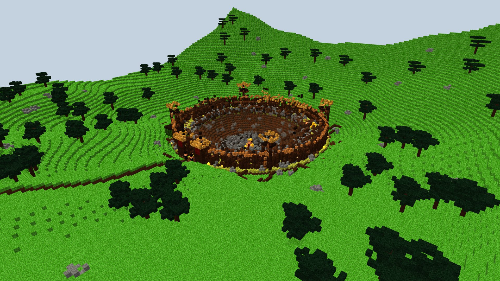
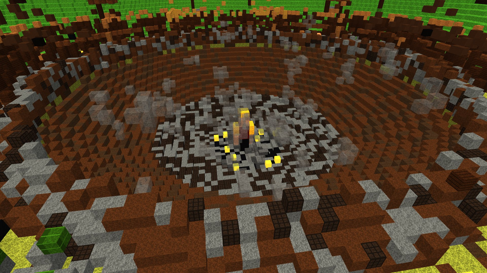
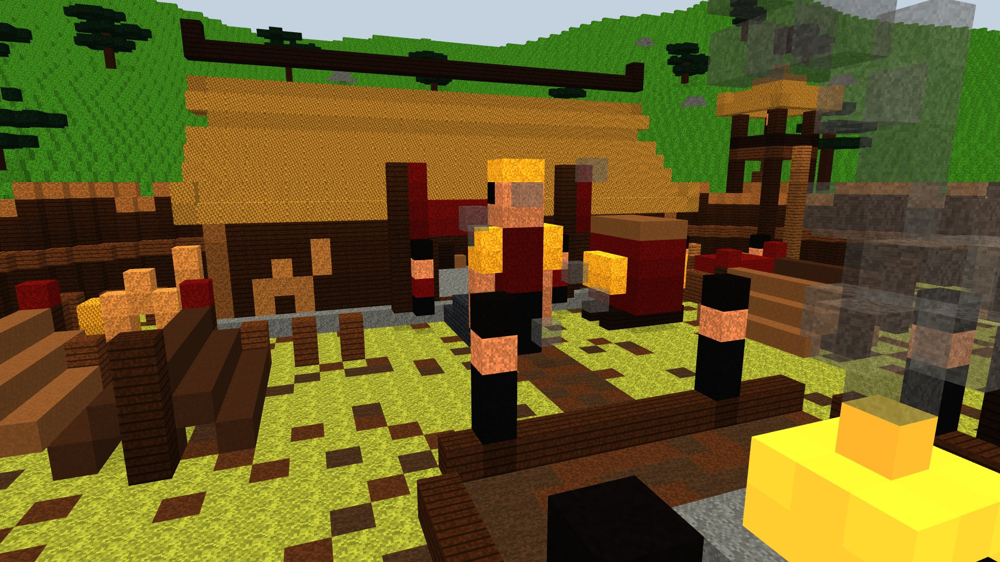
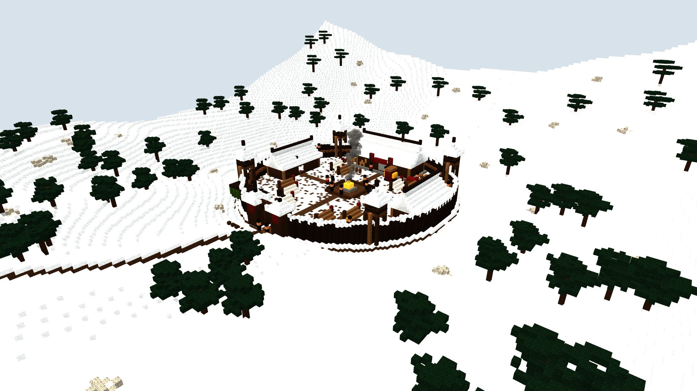
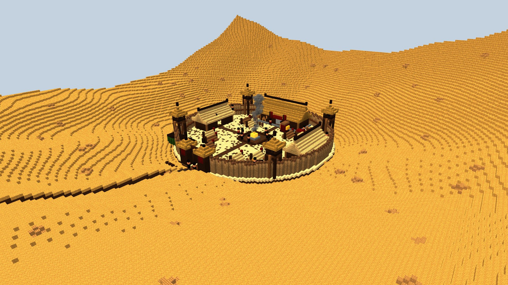
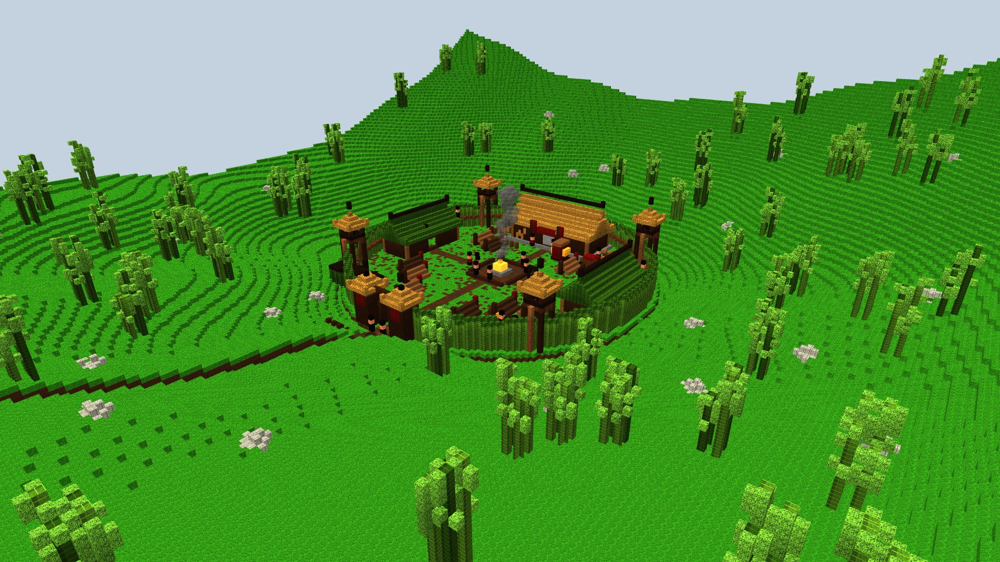
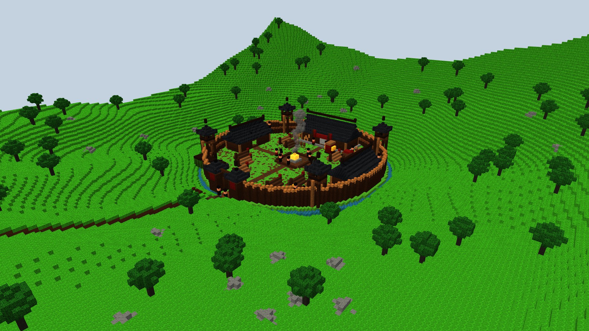
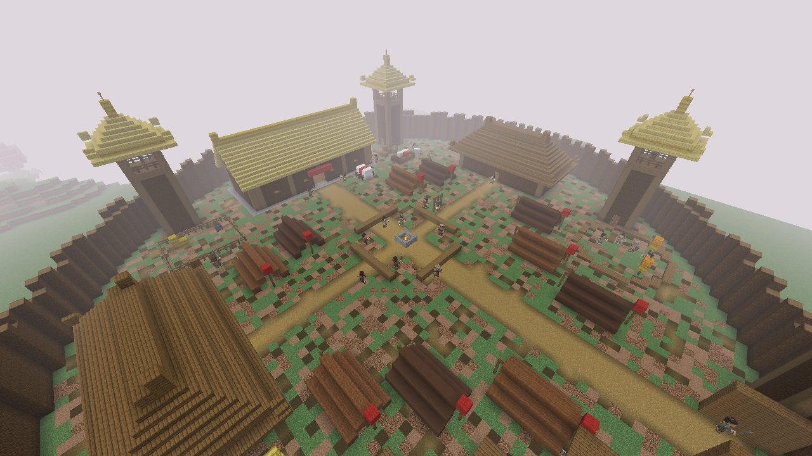
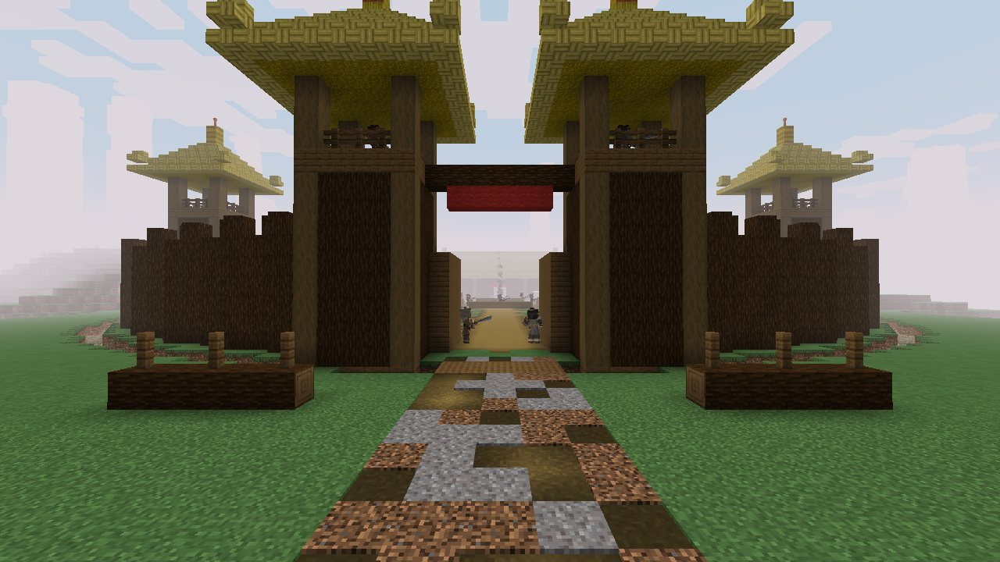

# Grand camp de bandits (`bandit_camp`)

> Demande d'Enzo du 16/10/2026 : « fais-moi une maquette d'un grand camp de bandits pour accueillir 30 mobs hostiles »,
> puis : « l'objectif sera d'y ajouter un boss qui spawn quand on tue tous les mobs, et il devra y avoir un camp dans
> chaque région » ; puis « crée les structures en rajoutant des bandits dedans ; pour l'instant le boss bandit tu laisses
> tomber, mais mets déjà en place la structure ».
>
> **Statut : construit en jeu, sans le boss** (sur `test`, en attente de validation d'Enzo), voir [En jeu](#en-jeu). Maquettes : `node scripts/concepts/render-bandit-camp.cjs`
> (Blockbench isolé, `--port=` ; port 9232 par défaut), scène dans `scripts/concepts/bandit-camp.js`. 1 voxel = 1 bloc.
> Les PNG rendus ont été convertis en JPG pour la doc.

## L'idée

Le repaire d'une grande bande, bien plus gros que le [repaire du Fleuve Jaune](yellow_river_bandit_den.md) : un fort de
rondins dans un creux entre des collines boisées, d'où les bandits descendent sur les routes. On n'y entre pas en
passant : il faut l'assiéger ou s'y glisser, avec **trente bandits** à l'intérieur et leur chef dans sa grande salle.

- **Dimensions** : une palissade **ronde de 85 blocs de diamètre** (rayon 42), un fossé autour, la route qui arrive
  par le sud sur un pont de rondins ; le tout tient dans environ 100 × 130 blocs avec la route.
- **Où** (à décider) : dans les collines et les forêts, loin des capitales ; plutôt rare, comme un manoir des bois.

## Le boss : le camp à nettoyer

1. On arrive devant un camp plein : **trente bandits** à leurs postes et **cinq Bandit Chiefs** (mini-boss, demande
   d'Enzo du 16/10). Le siège du chef, dans la grande salle, est **vide**.
2. Il faut les tuer **tous**, les 35. **En jeu** : dès qu'on entre dans le camp (dans son fossé), une barre rouge
   s'affiche en haut de l'écran comme la vie d'un boss, « Bandit Camp: 12 / 35 slain », et **se remplit à chaque mort**.
   Elle disparaît quand on sort du camp.
3. Au dernier mort, le **tambour de guerre** devant la grande salle résonne trois fois, puis le
   [Seigneur des bandits](../mobs/bandit-warlord.md) **tombe du ciel comme un météore**, enveloppé de feu, une traînée de
   flammes et de fumée derrière lui, droit sur la place ; **une cinématique** le montre.
4. **L'impact change le camp pour de bon** (demande d'Enzo du 16/10 : « une structure qui change ») : voir ci-dessous.
5. Le boss vaincu, le camp est **libéré** : il ne se repeuple plus, et le butin de la grande salle s'ouvre.

*(Ancienne idée, remplacée : le boss sortait de la porte de la grande salle.)*

## La chute et le cratère (maquette du 16/10, à valider)

> Demandes d'Enzo : « son spawn, il tombe du ciel, et ça change le village bandit en cratère pour le PvP ; on prépare une
> structure qui change ; ce serait l'ultime de l'art, il commencerait par ça, un changement du terrain » ; « il tombe du
> ciel comme une météorite avec du feu, et il y aura une cinématique quand il spawn ».

- **La chute** est l'**ultime du [Poing Brise-Montagne](../combat/styles/mountain-shattering-fist.md)** : le boss ouvre
  le combat avec elle. Il atterrit poing en avant, un genou à terre, puis se relève et rugit.
- **La cinématique** (demande d'Enzo) : au dernier bandit mort, **tous les joueurs dans le camp** la voient
  (comme le finish, `FinishCinematic`), environ 8 secondes, sans pouvoir être frappés :
  1. le tambour de guerre en gros plan, trois coups, la caméra tremble ;
  2. la caméra monte vers le ciel : un point rouge grossit, **un météore de feu**, le Seigneur dedans, pieds en avant ;
  3. il traverse le ciel vers la place, la caméra le suit ; un cercle de fissures rougeoyantes s'ouvre au sol ;
  4. **l'impact** : flash blanc (lumière Photon), onde de choc, le camp vole en éclats, le cratère se creuse ;
  5. la poussière retombe, il est au fond, un genou à terre, poing dans la roche ; il se relève et rugit, son nom
     s'écrit en grand (« Bandit Warlord ») et la barre de boss apparaît ; la caméra revient au joueur, le combat commence.
  Un joueur qui arrive après ne la voit pas : le cratère est déjà là.
- **Le cratère** : au point d'impact, un creux d'environ **60 blocs de diamètre et 15 de profondeur**, en cuvette ; au
  fond, de la roche brisée et brûlée, puis du gravier et de la terre en remontant ; un **bourrelet** de terre et de
  débris de deux ou trois blocs tout autour.
- **Le camp en ruine** : tout ce qui était dans le cratère disparaît (place, feu, tentes, une partie des maisons) ;
  autour, plus on est près, plus c'est détruit (toits soufflés, murs tombés) ; la palissade éclate vers l'extérieur,
  des rondins couchés au-delà ; de la fumée et quelques braises.
- **Il reste** : c'est le terrain du combat contre le boss, puis **une arène de PvP pour de bon** : le cratère ne se
  rebouche pas, le camp ne se repeuple pas. La grande salle (avec le coffre du chef) est au bord, abîmée mais debout.

**En jeu (proposition)** : le camp garde son plan ; à l'impact, le serveur creuse le cratère et casse le camp autour,
**réparti sur plusieurs ticks** comme la construction du sanctuaire (pas de gel du serveur ; la cinématique couvre ce
temps), et note le camp comme « cratère » (une sauvegarde, pour ne plus le reconstruire ni le repeupler, et pour que
`SiteResidents` ne lui rende pas ses bandits). Les coffres et la cache de la grande salle sont gardés. Le dessin est un
motif fixe tiré de la position du camp (le même cratère pour tous les joueurs). Fichier de la maquette :
`scripts/concepts/bandit-camp.js` (`crater`, `falling`), vues `fall`, `crater`, `crater_rim`.

Le boss n'existe pas encore : un **nouveau mob** à créer (modèle, attaques, barre de boss), plus fort que le Bandit
Chief ; ou, pour commencer, le Bandit Chief lui-même avec plus de vie. En jeu, le camp compte ses bandits encore en
vie (ceux qui ont été placés à sa construction) et fait apparaître le boss quand il n'en reste aucun.

## Un camp dans chaque région

Un camp par région de la carte Murim, le même plan habillé pour sa terre :

| Région | Le camp |
|---|---|
| **Centre** | Creux entre des collines aux pins, palissade de rondins, toits de chaume, tentes de peaux |
| **Nord** | Dans les neiges : palissade de bois sombre aux pointes enneigées, toits couverts de neige, tentes blanches |
| **Ouest** | Dans le désert et le lœss : murs de terre damée, chaume, tentes de peau et de grès, sans arbres |
| **Sud** | Dans la mer de bambous : palissade de bambou, dortoirs de bambou, bosquets tout autour |
| **Est** | Pays des eaux : palissade de rondins, toits de tuiles sombres, un fossé rempli d'eau |

## Le plan

| N° | Lieu | Ce que c'est | Bandits |
|---|---|---|---|
| 1 | **Porte** | Deux tours de rondins à toit de chaume, bannières rouges, battants ouverts, linteau | 2 devant, 2 sur les tours |
| 2 | **Tours de guet** (4) | Sur pilotis de rondins, plateforme à garde-corps, toit de chaume, échelle | 1 archer dans chacune |
| 3 | **Grande salle du chef** | Longue maison de rondins sur socle de pierre, toit de chaume, bannière rouge, siège vide du boss, **tambour de guerre** devant | 2 lieutenants à la porte ; le boss, à la fin |
| 4 | **Place du grand feu** | Feu de camp entouré de pierres, bancs de rondins, marmite sur trépied, fumée | 6 bandits et 2 lieutenants |
| 5 | **Dortoirs** (2) | Longues maisons de rondins à toit de peaux, à l'ouest et à l'est | Leurs lits (8 chacun) |
| 6 | **Tentes** (10) | Tentes de peaux en A sur perches, chiffon rouge au sommet | 3 couchages chacune |
| 7 | **Butin** | Caisses empilées, tas d'or et d'argent volés, charrette chargée de soie | 2 gardiens |
| 8 | **Cages** (3) | Cages de bambou pour les prisonniers (un prisonnier à délivrer ?) | 2 gardiens |
| 9 | **Enclos** | Clôture, foin, montures | — |
| 10 | **Cercle d'entraînement** | Anneau de rondins, mannequins de paille | 4 bandits qui s'entraînent |
| 11 | **Barricades** | Chevaux de frise en rondins taillés devant la porte | — |
| 12 | **Chemin de ronde** | Planches derrière la palissade, sous les pointes | 4 sentinelles |

**Les trente** : 4 lieutenants, 4 archers, 4 gardes de la porte, 6 autour du feu, 4 à l'entraînement,
2 au butin, 2 aux cages, 4 sur le chemin de ronde. Les couchages (2 × 8 + 10 × 3 = 46) dépassent trente : il en
reste pour ceux qui patrouillent dehors.

## Vues

**Depuis la route** : les barricades, le pont, la porte et ses gardes, les tours, la fumée du grand feu.

**La place du grand feu** : les bandits autour du feu, les bancs, la grande salle du chef et ses lieutenants, les
tentes et les dortoirs.

## En jeu

- **Structure** `murimblock:bandit_camp` (`BanditCamp`), construite en code bloc par bloc d'après la maquette,
  trouvée par `/locate structure murimblock:bandit_camp`.
- **Dans chaque région** : n'importe quel biome Murim de la bulle ; une tentative tous les 128 chunks (environ
  2 000 blocs), au moins 48 chunks entre deux camps, refusée si le terrain varie de plus de 10 blocs ou est dans
  l'eau. Chaque région en compte donc beaucoup (elles font des dizaines de milliers de blocs). Le camp s'habille selon
  la région de son centre (`BanditCamp.theme`) :

| Région | Palissade | Toits | Tentes | Sol | Tenues des bandits |
|---|---|---|---|---|---|
| Centre | Rondins d'épicéa | Chaume (dalles de bambou, foin) ; dortoirs en épicéa | Laine marron, terre cuite brune | Herbe, terre, chemins | Cendre, écharpe pourpre, peau de loup |
| Nord | Rondins de chêne noir, neige sur les pointes | Épicéa | Laine blanche et grise | Neige, podzol | Surtout peau de loup |
| Ouest | Boue tassée (terre damée) | Chaume ; dortoirs en briques de boue | Laine marron, terre cuite orange | Sable, terre | Surtout pillards des dunes |
| Sud | Blocs de bambou | Chaume ; dortoirs en bambou | Laine marron et verte | Herbe, mousse | Mélangées |
| Est | Rondins d'épicéa, **fossé rempli d'eau** | Tuiles grises | Laine marron, terre cuite brune | Herbe, terre | Mélangées |

- **Les trente** : 30 Mountain Bandits à leurs postes (`BanditCamp.POSTS`) : 4 lieutenants en écharpe pourpre (2 à la
  porte de la grande salle, 2 au feu), 4 archers sur les tours de guet (ce sont des bandits au dao pour l'instant), 2 sur
  les tours de la porte et 2 devant, 6 autour du feu, 4 au cercle d'entraînement, 2 au butin, 2 aux cages, 4 sentinelles.
  Ils ne se repeuplent pas : un camp tué reste vide. (Les camps des mondes plus anciens reçoivent leurs bandits à la
  première visite, comme les autres sites.)
- **Butin** : un tonneau de la cache des sites et un coffre dans la grande salle, deux coffres au butin
  (`chests/bandit_camp` : taels d'argent, or, fer, soie, nourriture, cuir, émeraudes, rarement un diamant ; 12 % un dao
  de bandit, 10 % le rouleau du Poing Long).
- **Cinq Bandit Chiefs** (16/10, demande d'Enzo, en plus des 30) : deux de part et d'autre du siège vide dans la grande
  salle, un devant la salle, un au milieu du cercle d'entraînement, un dans la porte. Leur barre de boss ne s'affiche
  qu'une fois qu'ils se battent (une cible ou une blessure), pour ne pas couvrir l'écran de cinq barres ; c'est vrai aussi
  du chef du repaire.
- **Le compte** (16/10, `BanditCampCount`) : chacun des 35 porte la marque de son camp et compte une fois à sa mort, où
  qu'il meure (un bandit sorti du camp aussi) ; les bandits errants ne comptent pas. Sauvegardé par monde. Un camp placé
  avant le compte : à la première visite, ceux qui sont encore là sont marqués, les absents comptés morts. Au 35e mort, la
  barre disparaît et un message s'affiche (« The camp falls silent… ») : **c'est là que le Seigneur des bandits tombera**,
  quand il existera ; pour l'instant le siège reste vide.
- **Vérifié** (16/10) : GameTests `banditCampIsWholeAndCarried` (centre) et un camp au cœur de chaque autre région (`theNorthsBanditCampIsDarkWoodUnderSnow`, `theWestsBanditCampIsRammedEarth`, `theSouthsBanditCampIsBamboo`, `theEastsBanditCampHasAMoat`) : 415 vérifications chacun, identique d'un coup ou chunk par chunk, 30 bandits à leur place puis remis dans un camp vidé, palissade de la bonne matière, neige au nord, eau dans le fossé à l'est. Visite en vrai client (`runSiteTour`, graine 20261012) : un camp cherché depuis le cœur de chaque région, chacun dans sa région (Tianshan, lœss, collines aux camphriers, Jiangnan), sans défaut, 30 bandits, remis après avoir été vidés. La visite a montré qu'un camp pouvait se poser sur un autre site (le Jardin des Lotus à l'est) : c'est réglé par la règle d'espacement de 100 blocs entre structures (`SiteSpacing`, session « hud »).

## Prévu, avant de construire

- **Habitants** : les Mountain Bandits existants (leurs cinq tenues), avec des lieutenants et des archers ; le boss à
  la fin. Les **archers et les lieutenants n'existent pas encore** : il faudrait les créer (un
  bandit à l'arc, un bandit plus fort) ou les remplacer par des bandits ordinaires.
- **Butin** : coffres du butin volé (taels d'argent, or, soie, armes des bandits), la cache des sites.
- **Matériaux prévus** : rondins de chêne noir et d'épicéa (palissade, tours, maisons), chaume en balles de foin et
  dalles d'épicéa, peaux en laine marron et terre cuite, fossé et chemins de boue, feu de camp, chaudron, bambou.

## Questions pour Enzo

- Le cratère : la taille proposée (60 blocs de large, 15 de profondeur) convient-elle ? La grande salle et le coffre du
  chef restent-ils debout au bord ?
- La cinématique : 8 secondes, vue par tous les joueurs du camp ; trop longue ? Peut-on la passer ?
- Dans l'arène de PvP, un joueur mis à terre (K.O.) y est-il traité comme ailleurs, ou faut-il des règles d'arène ?

- Un seul camp par région (cinq dans le monde), ou un par région tous les quelques milliers de blocs ?
- Le boss : un nouveau mob à créer (nom, arme, attaques), ou le Bandit Chief renforcé pour commencer ? Que lâche-t-il ?
- Les bandits qui sortent du camp (poursuite) comptent-ils encore ? S'ils s'éloignent trop, reviennent-ils ?
- Les archers et les lieutenants : les créer comme nouveaux mobs, ou seulement des bandits ordinaires ?
- Un prisonnier à délivrer dans les cages, avec une récompense ?
