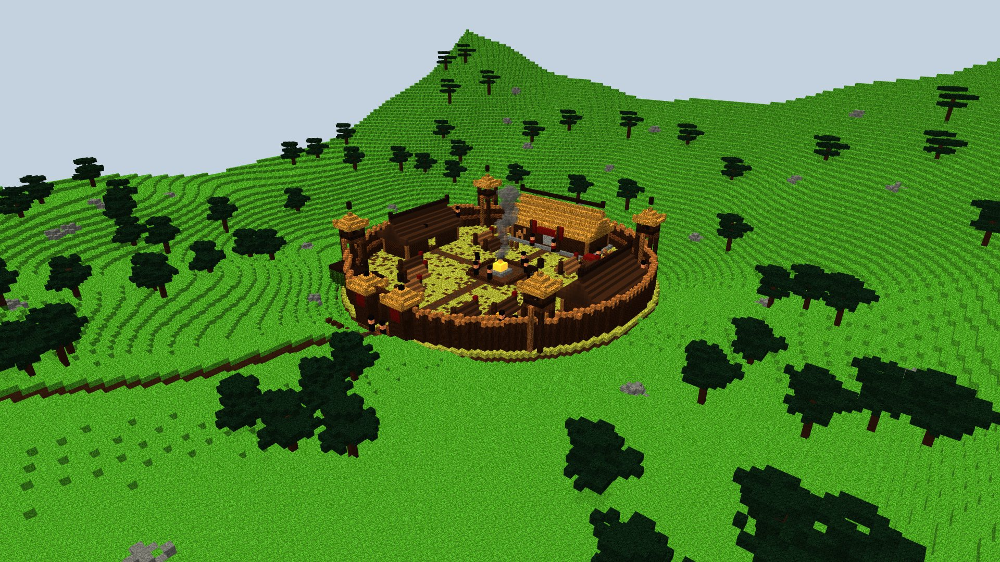
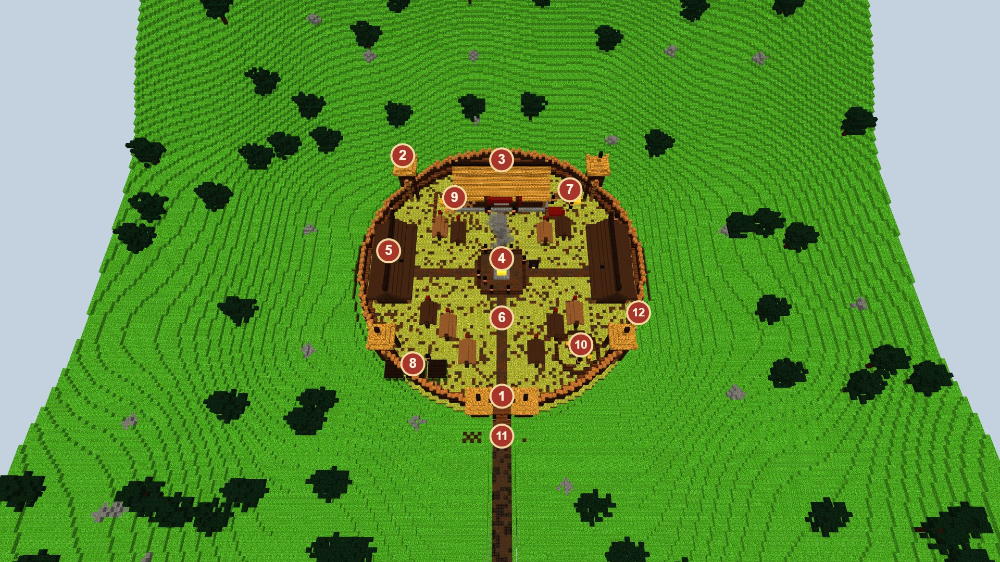
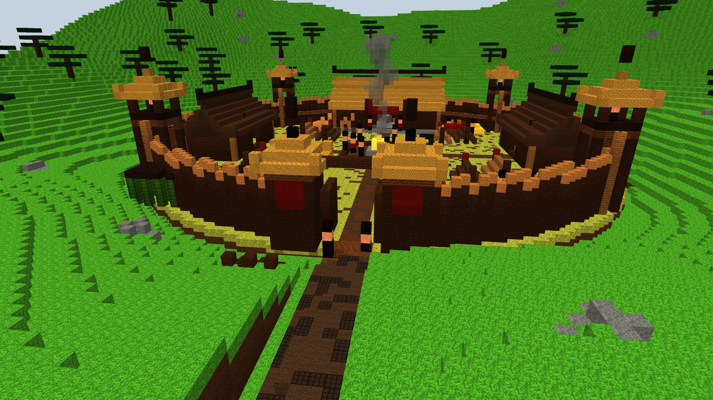
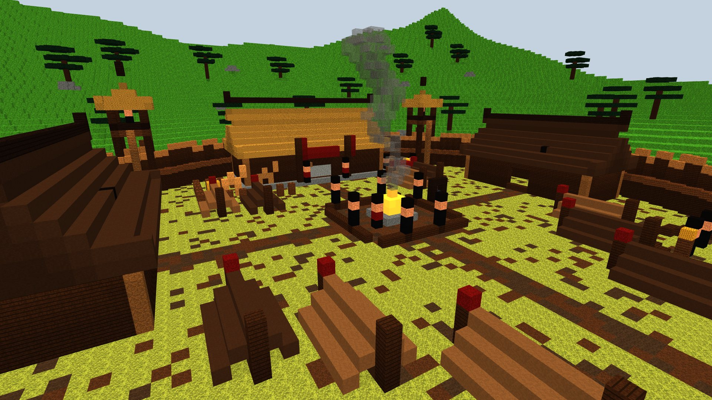

# Grand camp de bandits — maquettes (proposition à valider par Enzo)

> Demande d'Enzo du 16/10/2026 : « fais-moi une maquette d'un grand camp de bandits pour accueillir 30 mobs hostiles ».
>
> **Statut : maquettes voxel, rien n'est construit en jeu.** Maquettes : `node scripts/concepts/render-bandit-camp.cjs`
> (Blockbench isolé, `--port=` ; port 9232 par défaut), scène dans `scripts/concepts/bandit-camp.js`. 1 voxel = 1 bloc.
> Les PNG rendus ont été convertis en JPG pour la doc.

## L'idée

Le repaire d'une grande bande, bien plus gros que le [repaire du Fleuve Jaune](yellow_river_bandit_den.md) : un fort de
rondins dans un creux entre des collines boisées, d'où les bandits descendent sur les routes. On n'y entre pas en
passant : il faut l'assiéger ou s'y glisser, avec **trente bandits** à l'intérieur et leur chef dans sa grande salle.

- **Dimensions** : une palissade **ronde de 85 blocs de diamètre** (rayon 42), un fossé autour, la route qui arrive
  par le sud sur un pont de rondins ; le tout tient dans environ 100 × 130 blocs avec la route.
- **Où** (à décider) : dans les collines et les forêts, loin des capitales ; plutôt rare, comme un manoir des bois.

## Le plan

| N° | Lieu | Ce que c'est | Bandits |
|---|---|---|---|
| 1 | **Porte** | Deux tours de rondins à toit de chaume, bannières rouges, battants ouverts, linteau | 2 devant, 2 sur les tours |
| 2 | **Tours de guet** (4) | Sur pilotis de rondins, plateforme à garde-corps, toit de chaume, échelle | 1 archer dans chacune |
| 3 | **Grande salle du chef** | Longue maison de rondins sur socle de pierre, toit de chaume, bannière rouge, siège du chef | Le chef ; 2 lieutenants à la porte |
| 4 | **Place du grand feu** | Feu de camp entouré de pierres, bancs de rondins, marmite sur trépied, fumée | 6 bandits et 1 lieutenant |
| 5 | **Dortoirs** (2) | Longues maisons de rondins à toit de peaux, à l'ouest et à l'est | Leurs lits (8 chacun) |
| 6 | **Tentes** (10) | Tentes de peaux en A sur perches, chiffon rouge au sommet | 3 couchages chacune |
| 7 | **Butin** | Caisses empilées, tas d'or et d'argent volés, charrette chargée de soie | 2 gardiens |
| 8 | **Cages** (3) | Cages de bambou pour les prisonniers (un prisonnier à délivrer ?) | 2 gardiens |
| 9 | **Enclos** | Clôture, foin, montures | — |
| 10 | **Cercle d'entraînement** | Anneau de rondins, mannequins de paille | 4 bandits qui s'entraînent |
| 11 | **Barricades** | Chevaux de frise en rondins taillés devant la porte | — |
| 12 | **Chemin de ronde** | Planches derrière la palissade, sous les pointes | 4 sentinelles |

**Les trente** : 1 chef, 3 lieutenants, 4 archers, 4 gardes de la porte, 6 autour du feu, 4 à l'entraînement,
2 au butin, 2 aux cages, 4 sur le chemin de ronde. Les couchages (2 × 8 + 10 × 3 = 46) dépassent trente : il en
reste pour ceux qui patrouillent dehors.

## Vues

**Depuis la route** : les barricades, le pont, la porte et ses gardes, les tours, la fumée du grand feu.

**La place du grand feu** : les bandits autour du feu, les bancs, la grande salle du chef et ses lieutenants, les
tentes et les dortoirs.

## En jeu, une fois validé

- Un site comme les autres, construit en code bloc par bloc, trouvé par `/locate`.
- **Habitants** : les Mountain Bandits existants (leurs cinq tenues), un **Bandit Chief** dans la salle, avec ses
  lieutenants et des archers. Les **archers et les lieutenants n'existent pas encore** : il faudrait les créer (un
  bandit à l'arc, un bandit plus fort) ou les remplacer par des bandits ordinaires.
- **Butin** : coffres du butin volé (taels d'argent, or, soie, armes des bandits), la cache des sites.
- **Matériaux prévus** : rondins de chêne noir et d'épicéa (palissade, tours, maisons), chaume en balles de foin et
  dalles d'épicéa, peaux en laine marron et terre cuite, fossé et chemins de boue, feu de camp, chaudron, bambou.

## Questions pour Enzo

- Où le poser (collines, forêts, plateau de lœss du nord comme le repaire actuel) et à quelle fréquence ?
- Les archers et les lieutenants : les créer comme nouveaux mobs, ou seulement des bandits ordinaires ?
- Les bandits tués réapparaissent-ils (un camp qu'on « nettoie » une fois pour toutes, ou qui se repeuple) ?
- Un prisonnier à délivrer dans les cages, avec une récompense ?
