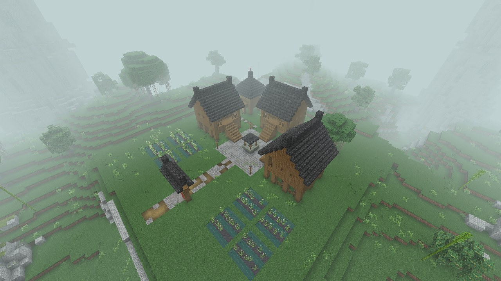
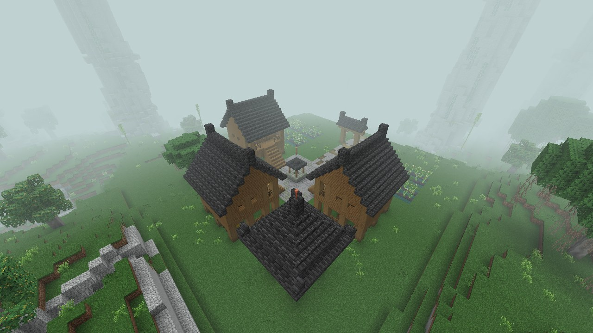
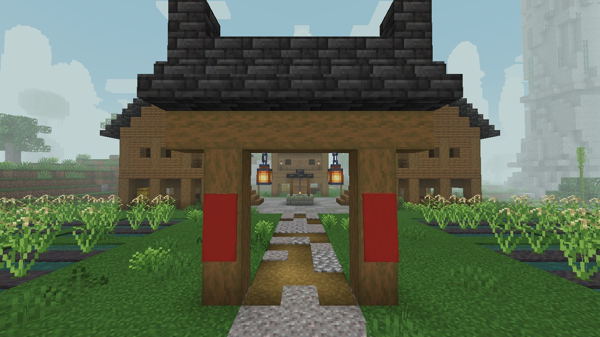

# Village sur pilotis de la rivière de Jade

| Fiche | |
|---|---|
| Nom en jeu (id) | Jade River Stilt Village (`murimblock:jade_river_stilt_village`) |
| Biome | Forêt des pics de jade (`jade_karst_forest`) |
| Inspiration | Hameaux zhuang et yao à maisons sur pilotis (ganlan) de Ping'an et Longji, au pied des tours karstiques |
| Emprise | 43 × 48 blocs (avec la route devant la porte) ; faîtage le plus haut à 14 blocs au-dessus du sol |
| Fréquence | Une tentative par carré de 24 × 24 chunks (384 blocs), à 8 chunks au moins d'une autre ; seulement si le terrain convient |
| Terrain accepté | Dénivelé de 7 blocs au plus sur la zone, aucune eau ; le site entier dans le biome |
| Trouver | `/locate structure murimblock:jade_river_stilt_village` |
| Code | [StiltVillage.java](../../src/main/java/com/murimblock/world/structure/site/StiltVillage.java) |

## Plan

Le village fait face au côté le plus bas du terrain (la porte du sud dans le plan ci-dessous).

- **La place** (13 × 13) : dalles de pierre anciennes (pierre taillée, moussue, fissurée, andésite), une lanterne sur poteau à chaque coin.
- **Le puits** au centre : margelle de pierre moussue, eau sur 4 blocs, petit toit de tuiles sur quatre poteaux, lanterne suspendue à une chaîne.
- **Trois maisons ganlan** au nord, à l'ouest et à l'est, tournées vers la place :
  - 9 × 7 sur 3 blocs de pilotis en épicéa écorcé, posés sur des dés de pierre ;
  - sous la maison, un enclos fermé de barrières : foin, composteur, tonneau, bois de chauffe ;
  - murs de planches d'épicéa, poteaux apparents, fenêtres en treillis de chêne noir ;
  - un balcon sous l'avant-toit, garde-corps, deux lanternes ;
  - toit à deux pentes en tuiles grises, faîtage aux extrémités relevées ;
  - un escalier de 3 de large descend du balcon jusque sur la place.
- **Intérieurs** (un par maison) : herboristes (alambic, fougère en pot), tisserands (métier à tisser), cuisiniers (fumoir, chaudron) ; lits, tapis, table et chaises, tonneaux, lanterne.
- **Le grenier** (nord-ouest) : réserve fermée 5 × 5 sur pilotis, toit pyramidal, porche et échelle ; foin et tonneaux dedans.
- **Le banian sacré** (nord-est) : grand banian aux racines aériennes, autel de pierre avec bougies devant lui.
- **Les rizières** (sud-ouest et sud-est) : quatre parcelles par côté entre des diguettes d'herbe, rangs de riz sauvage dans la boue entre des rangs d'eau.
- **La porte du sud** : deux poteaux, linteau, petit toit de tuiles, lanternes et bannières rouges.

**Chemins** : place → porte du sud ; échelle du grenier → place ; autel du banian → place. Chaque maison descend directement sur la place. Aucun chemin ne finit dans le vide.

## Vérification (14/10/2026)

- **GameTest** `SiteGameTests` : construit sur un sol de pierre, 4435 blocs posés, 64 vérifications, aucun problème ; identique bloc pour bloc construit chunk par chunk ; structure et structure set enregistrées.
- **Visite en vrai client** (`gradlew -PgameTests runSiteTour`, monde neuf, graine 20261012) :
  - `/locate structure murimblock:jade_river_stilt_village` répond en 573 ms : `[-2880, ~, 5040]`, à 5804 blocs du point de départ ;
  - le site généré est dans `jade_karst_forest` (origine -2872 70 5048, tourné CLOCKWISE_180, niveau du sol 70) ;
  - 64 vérifications sur le site réellement généré : aucun toit ouvert, rien de naturel dans les pièces, aucun sol ni fondation au-dessus du vide.

## Conseils : ce qu'on devrait y mettre

- **PNJ** : un vieil herboriste (vend des herbes de Qi, achète des fougères et des champignons des grottes), une tisserande, un pêcheur au cormoran sur la rivière voisine.
- **Faction** : le clan de la rivière de Jade, herboristes et empoisonneurs du Sud. Un PNJ maître des poisons pourrait enseigner une technique secrète après une quête.
- **Quêtes** : rapporter des herbes des tours karstiques ; chasser les crabes cuirassés qui pillent les rizières ; escorter un marchand jusqu'au prochain village.
- **Butin** : coffres avec table de butin dans les maisons (riz, poisson séché, herbes, quelques pièces), un manuel mineur caché dans le grenier.
- **Ambiance** : buffles d'eau dans les rizières, poules sous les maisons, son de clapotis ; fumée du foyer des maisons la nuit.
- **Combat** : le village est un lieu sûr (pas d'apparition de monstres sur la place grâce aux lanternes) ; les attaques viennent de la jungle autour.
