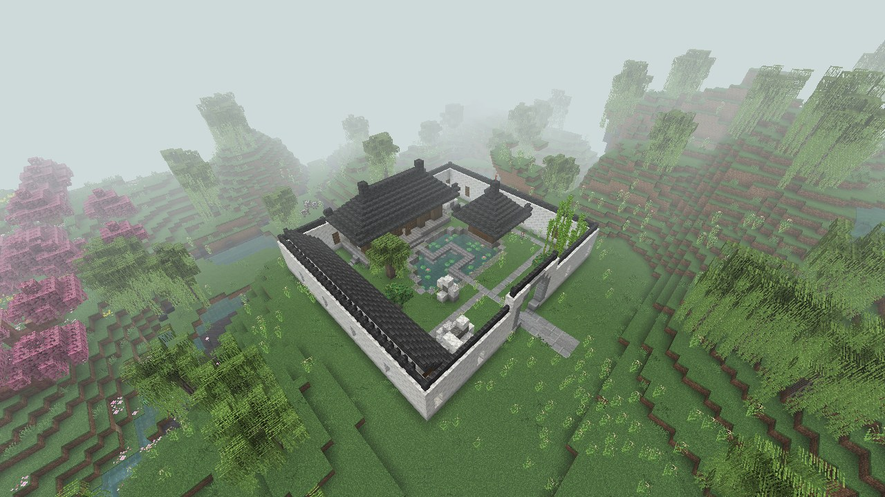
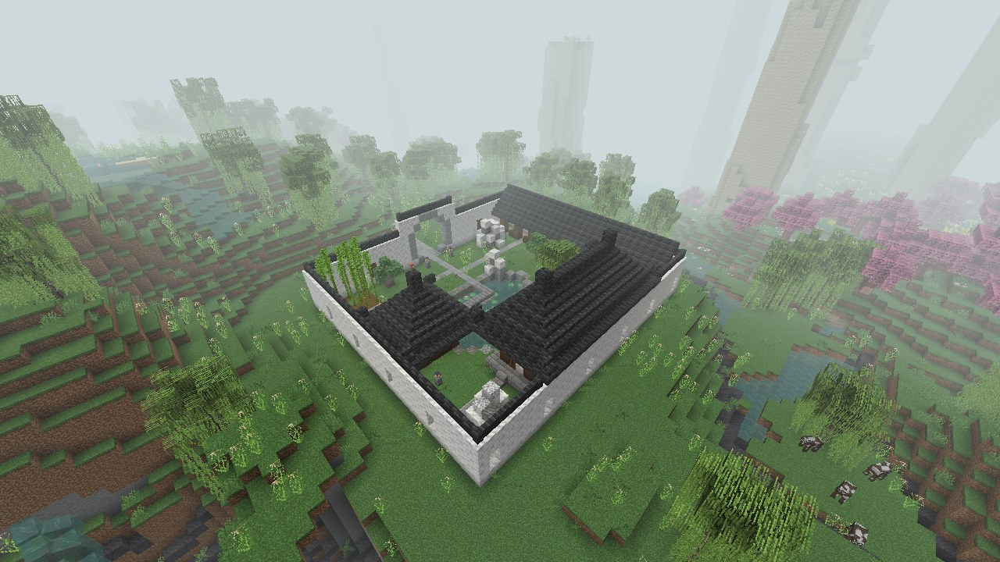
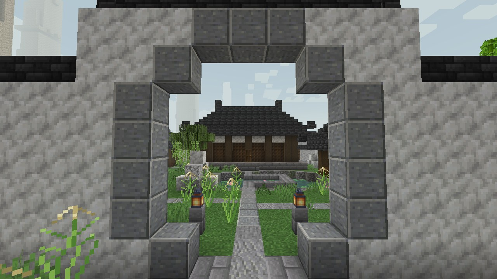

# Jardin de la Lune et des Lotus

| Fiche | |
|---|---|
| Nom en jeu (id) | Lotus Moon Garden (`murimblock:lotus_moon_garden`) |
| Biome | Pays des eaux du Jiangnan (`jiangnan_waterlands`) |
| Inspiration | Les jardins de lettrés de Suzhou (UNESCO) : porte de lune, étang central, pont en zigzag, galerie couverte, rocailles de pierres du lac Tai |
| Emprise | 33 × 29 blocs de mur d'enceinte, plus le débarcadère devant la porte de lune ; toit le plus haut à 12 blocs au-dessus du sol |
| Fréquence | Une tentative par carré de 22 × 22 chunks, à 7 chunks au moins d'une autre ; seulement si le terrain convient |
| Terrain accepté | Peut se poser au bord de l'eau ou dedans (jusqu'à 8 blocs sous le niveau de la mer) ; le jardin est toujours au moins au niveau de la mer, sur ses propres fondations |
| Trouver | `/locate structure murimblock:lotus_moon_garden` |
| Code | [LotusGarden.java](../../src/main/java/com/murimblock/world/structure/site/LotusGarden.java) |

## Plan

- **Le mur** : enduit blanc (calcite), coiffé d'un faîtage de tuiles sombres, percé de fenêtres en treillis tous les 6 blocs ; sa base en pierre descend jusqu'au fond quand le jardin est dans l'eau.
- **La porte de lune** au milieu du mur sud : ouverture ronde cerclée de pierre grise, dans une partie du mur plus haute.
- **L'étang** au centre : ovale aux berges sinueuses, 2 blocs d'eau sur de la vase, berges de pierres moussues et de tuf, feuilles et fleurs de lotus.
- **Le pont en zigzag** : tablier de dalles à fleur des berges, sur des piles de pierre ; il traverse l'étang de la porte jusqu'aux marches de la salle.
- **Le pavillon au bord de l'eau** (est), à moitié au-dessus de l'étang : quatre poteaux, bancs de beauté, toit pyramidal gris, lanterne.
- **La galerie couverte** le long du mur ouest : sol de pierre, poteaux de bois sombre, bancs, toit à une pente sur le mur, lanternes ; on voit le dehors par les fenêtres du mur.
- **La salle de la cithare et de l'épée** (nord) : sur soubassement, murs blancs dans un cadre sombre, façade entièrement en treillis, toit gris à quatre pentes et angles relevés, une porte devant et une sur chaque côté. Dedans, le cabinet d'un lettré-épéiste : bibliothèques, pupitre, cithare (bloc musical) et son siège, table à thé et chaises, meule à affûter, bambou et azalée en pot, tentures.
- **Les plantes** : un saule pleureur au bord de l'eau, deux osmanthus, un bosquet de bambous dans le coin sud-est.
- **Trois rocailles** de pierres du lac Tai, pâles et trouées.

**Chemins** (mosaïque de pierres grises) : porte de lune → pont → salle ; porte → galerie → porte ouest de la salle ; porte → long des bambous → pavillon → porte est de la salle. Tous les chemins font des boucles ; aucun ne finit dans le vide.

## Vérification (14/10/2026)

- **GameTest** `SiteGameTests` : construit sur un sol de pierre, 3384 blocs posés, 290 vérifications, aucun problème ; identique bloc pour bloc construit chunk par chunk ; structure et structure set enregistrées.
- **Visite en vrai client** (`gradlew -PgameTests runSiteTour`, monde neuf, graine 20261012) :
  - `/locate structure murimblock:lotus_moon_garden` répond en 303 ms : `[2272, ~, -1632]`, à 2797 blocs du point de départ ;
  - le site généré est dans `jiangnan_waterlands` (origine 2280 67 -1624, tourné CLOCKWISE_90, niveau du sol 67) ;
  - 290 vérifications sur le site réellement généré : aucun toit ouvert, rien de naturel dans les pièces, aucun sol ni fondation au-dessus du vide.

## Conseils : ce qu'on devrait y mettre

- **PNJ** : le maître du jardin, lettré et épéiste (« clan de la cithare et de l'épée »), une servante qui sert le thé, un élève.
- **Technique** : un art d'épée lié à la musique : jouer la cithare (bloc musical) dans la salle pourrait déclencher une épreuve ou un enseignement.
- **Quête** : un duel courtois sur le pont en zigzag (combat sans mise à mort, lié au K.O. existant) ; retrouver un rouleau volé par les pirates du lac Tai.
- **Butin** : pas de coffre au trésor ici, plutôt des objets rares à acheter ou à gagner : thé Longjing, graines de lotus (soin), éventail.
- **Ambiance** : poissons dans l'étang, canards mandarins, pluie fine du Jiangnan, lanternes allumées la nuit.
