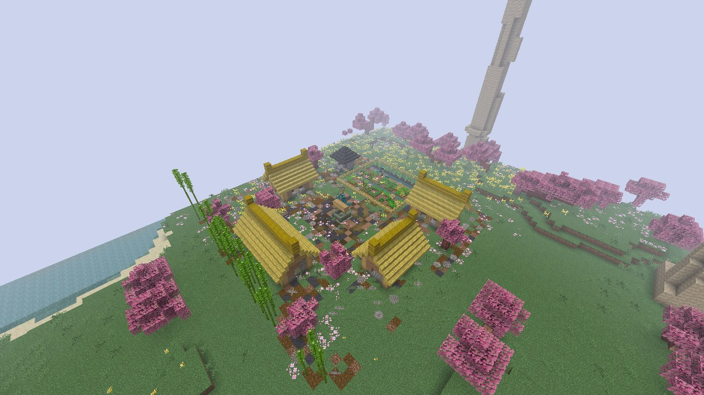
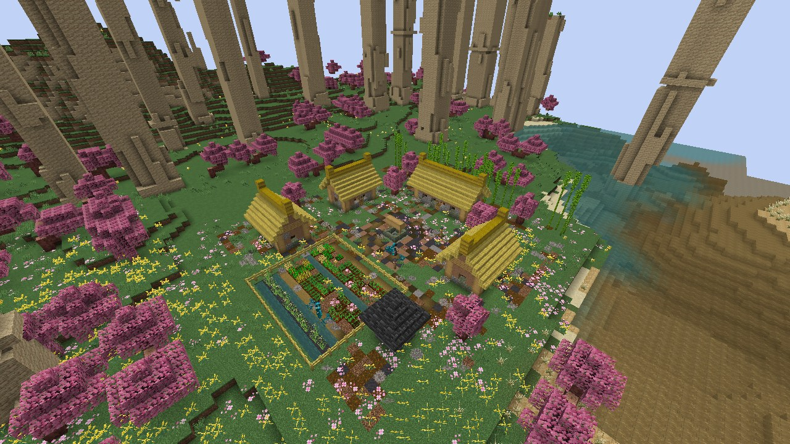
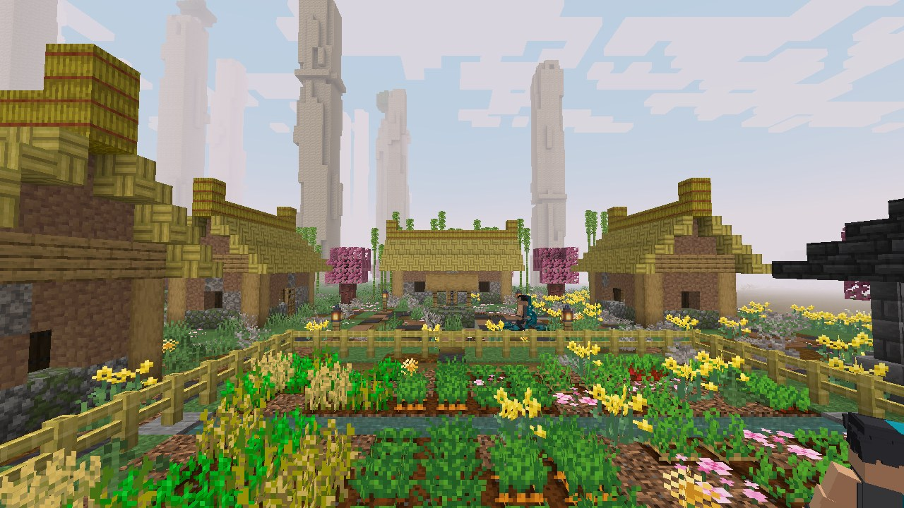
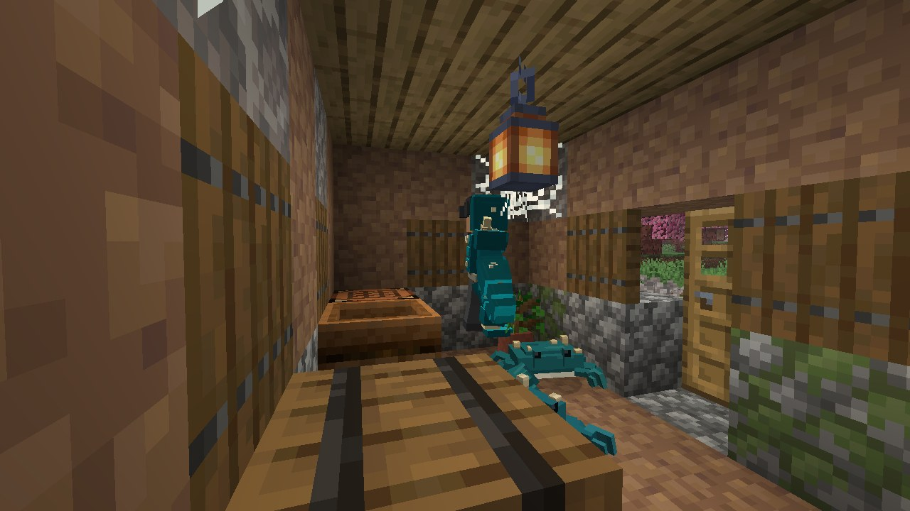

# Hameau de la Source aux Fleurs de Pêcher

| Fiche | |
|---|---|
| Nom en jeu (id) | Peach Spring Hamlet (`murimblock:peach_spring_hamlet`) |
| Biome | Vallée des fleurs de pêcher (`peach_blossom_valley`) |
| Inspiration | *La Source aux fleurs de pêcher* de Tao Yuanming : un village paysan resté hors du temps, sans rang ni richesse |
| Emprise | 41 × 41 blocs ; faîtages à 8 blocs au-dessus du sol, bambous jusqu'à 11 |
| Fréquence | Une tentative par carré de 22 × 22 chunks, à 7 chunks au moins d'une autre ; seulement si le terrain convient |
| Terrain accepté | Dénivelé de 6 blocs au plus sur la zone, aucune eau ; le site entier dans le biome |
| Trouver | `/locate structure murimblock:peach_spring_hamlet` |
| Code | [PeachHamlet.java](../../src/main/java/com/murimblock/world/structure/site/PeachHamlet.java) |

## Plan

- **Le pré du village** (11 × 11) : terre battue, puits à margelle moussue et treuil au centre, quatre lanternes basses.
- **Quatre maisons de terre damée** tournées vers le pré : assise de pierre, murs de terre (boue tassée), poteaux d'angle en chêne écorcé, fenêtres en treillis, **toit de chaume** (mosaïque de bambou, faîtage en bottes de paille aux bouts relevés).
  - **La salle des anciens** (nord, la plus grande, sans aucune peinture) : longue table et bancs, vieux rouleau sur son pupitre, bougies, azalée en fleur.
  - **Trois foyers** : un lit, un tonneau, un four ou un fumoir, un métier à tisser ou un établi, un pot de fleurs, un tapis.
- **Le petit temple du dieu du sol** (tudi miao, sud-est) : niche de pierre sur un socle, jarre d'offrandes, bougies, minuscule toit pyramidal de tuiles.
- **Les champs**, clos d'une haie de bambou avec un portillon :
  - deux bandes de cultures (blé, carottes, pommes de terre, betteraves) de part et d'autre d'un canal d'irrigation (la terre labourée reste humide) ;
  - une bande de rizière au fond, rangs de riz sauvage dans la boue entre des rangs d'eau.
- **Six pêchers en fleur**, des pétales roses tombés dans l'herbe autour d'eux.
- **Un écran de bambous** à l'arrière du hameau.

### Envahi par la maladie (14/10, demande d'Enzo)

La maladie des hommes-crabes a gagné le hameau ; il n'y reste personne.

- **Ses occupants**, apparus avec le hameau et qui ne disparaissent pas : **3 hommes-crabes** (`murimblock:crab_man`),
  chacun avec ses **2 crabes cuirassés** (`murimblock:armored_crab`, eux aussi permanents) : un sur le pré près du
  puits, un dans les champs, un qui attend dans la dernière maison. Ils ne reviennent pas une fois tués. En difficulté
  Paisible, Minecraft les retire comme tous les monstres.
- **La rouille de la maladie** : des excroissances grises (blocs de corail mort) percent les murs de terre (environ un
  bloc sur trois), l'herbe pourrit par plaques (podzol, boue, terre grossière, environ un tiers du hameau), des coraux
  morts poussent sur la terre ferme, la boue gagne le pré, un tiers des cultures est piétiné.
- **L'abandon** : la porte d'une maison est arrachée, des toiles d'araignée pendent dans les coins sous les toits.

**Chemins** (terre battue et gravier) : chaque porte, le temple du dieu du sol et le portillon des champs mènent au pré. Aucun chemin ne finit dans le vide.

## Vérification (14/10/2026)

- **GameTest** `SiteGameTests` : construit sur un sol de pierre, 3319 blocs posés, 20 vérifications, aucun problème ; identique bloc pour bloc construit chunk par chunk ; structure et structure set enregistrées.
- **Visite en vrai client** (`gradlew -PgameTests runSiteTour`, monde neuf, graine 20261012) :
  - `/locate structure murimblock:peach_spring_hamlet` répond en 83 ms : `[1120, ~, 2240]`, à 2504 blocs du point de départ ;
  - le site généré est dans `peach_blossom_valley` (origine 1128 63 2248, tourné NONE, niveau du sol 63) ;
  - 20 vérifications sur le site réellement généré : aucun toit ouvert, rien de naturel dans les pièces, aucun sol ni fondation au-dessus du vide ;
  - en difficulté Normale, les 3 hommes-crabes sont là (un dans une maison avec son crabe, photo ci-dessus).
- Les GameTests vérifient aussi qu'il y a exactement 3 hommes-crabes, construit d'un coup comme chunk par chunk.

## Conseils : ce qu'on devrait y mettre

- **PNJ** : il n'en reste plus (le hameau est envahi) ; un survivant caché, ou un ancien qui raconte comment la maladie est venue, ferait une bonne quête.
- **Nettoyage** : une quête « purifier le hameau » (tuer les hommes-crabes, brûler les excroissances) qui rendrait le hameau à des villageois.
- **Secret** : ce sont les seuls à ne pas réagir au rang de cultivation du joueur. Une quête pourrait révéler pourquoi (une formation qui cache la vallée, un ancien maître retiré).
- **Récolte** : les pêches (été) et une rare **pêche d'immortalité** pour la cultivation ; graines et outils à échanger.
- **Animaux** : poules, cochons, un buffle, canards mandarins sur l'eau.
- **Règle** : aucun combat ni pillage ici sans conséquence (perte de réputation, les villageois partent) ; c'est un refuge.
- **Ambiance** : pétales qui tombent (modèle Blockbench, comme la boule d'eau, plutôt que des particules vanilla), fumée des foyers au crépuscule.
