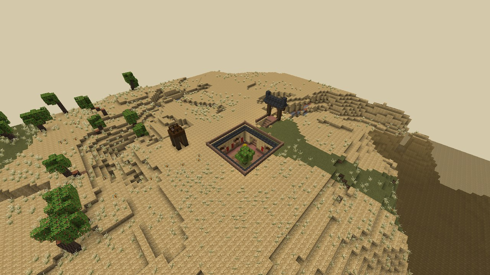
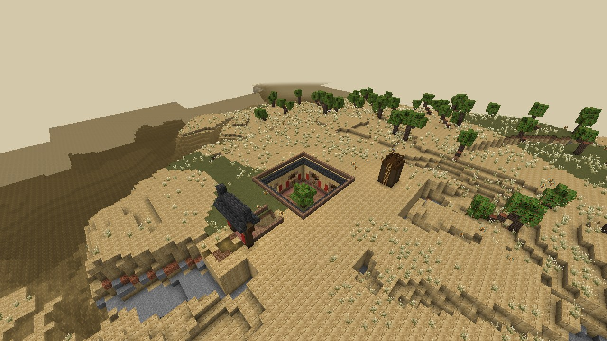
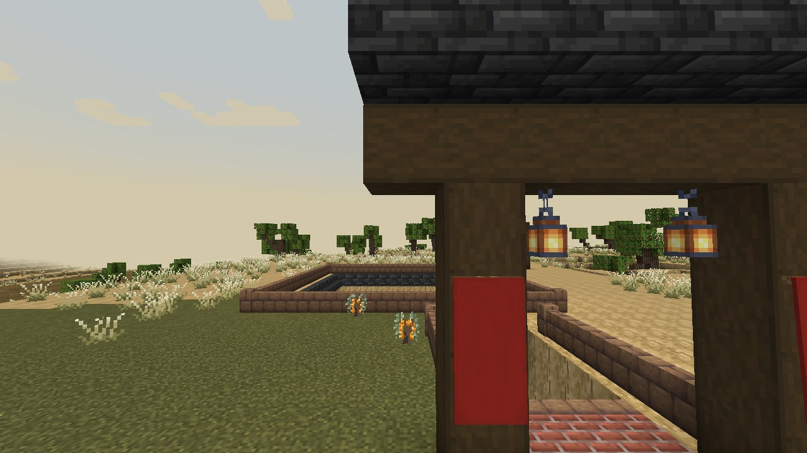

# Repaire des Bandits du Fleuve Jaune

| Fiche | |
|---|---|
| Nom en jeu (id) | Yellow River Bandit Den (`murimblock:yellow_river_bandit_den`) |
| Biome | Plateau de lœss (`loess_plateau`) |
| Inspiration | Cours enfoncées (dikengyuan) de Sanmenxia et habitations troglodytes (yaodong) du plateau de lœss |
| Emprise | 35 × 39 blocs (avec l'abord de la porte) ; la cour est creusée 7 blocs sous le plateau |
| Fréquence | Une tentative par carré de 24 × 24 chunks, à 8 chunks au moins d'une autre ; seulement si le terrain convient |
| Terrain accepté | Dénivelé de 6 blocs au plus sur la zone, aucune eau ; le site entier dans le biome |
| Trouver | `/locate structure murimblock:yellow_river_bandit_den` |
| Code | [BanditDen.java](../../src/main/java/com/murimblock/world/structure/site/BanditDen.java) |

## Plan

De loin, on ne voit qu'un trou carré dans la plaine, bordé d'un muret, et une vigie : c'est la surprise du lieu.

- **Le bloc de lœss** dans lequel tout est creusé : le site pose son propre massif de lœss plein sous le plateau, donc aucune paroi ne donne sur une grotte ou sur le vide.
- **La cour** (13 × 13, 7 de profondeur) : sol de terre battue, allée de briques le long des murs qui dessert toutes les portes, plinthe de briques au pied des parois.
  - Au centre, un jujubier sur son carré d'herbe.
  - Un puits à margelle, une meule, du maïs qui sèche (foin), un abreuvoir, quatre lanternes.
- **Sept grottes voûtées** (3 × 8, voûte en briques crues) derrière des façades de briques et de treillis, porte au milieu, bannières rouges de part et d'autre (les distiques) :
  - **le chef** : ouverte par une haute arche sans porte (3 blocs, pour le Bandit Chief et ses 2,5 blocs), kang de briques avec lit rouge, trône, « peau de tigre » (tapis orange rayé de noir), bannière noire, jarre et tonneau ;
  - **la salle des festins** : longue table, bancs, tonneaux, fumoir, bougies ;
  - **deux dortoirs** : kang à trois lits, tonneaux, établi ;
  - **l'armurerie** : table de forgeron, haut fourneau, enclume, meule, table d'archerie ;
  - **la prison** : façade en barreaux, paille, chaînes, un seau ;
  - **la cuisine** : fumoir, four, chaudron, tonneaux.
- **L'entrée** : une porte couverte sur le plateau (poteaux, linteau, petit toit, lanternes, bannières rouges), une rampe de 7 marches dans une tranchée qui devient tunnel, puis un porche voûté dans la cour.
- **Le bord** : un petit avant-toit de tuiles grises fait le tour de la cour, un muret de briques crues borde le trou et la tranchée.
- **La vigie** sur le plateau : plateforme sur quatre poteaux, garde-corps, échelle, lanterne.

**Chemins** : porte → rampe → cour → allée de briques → toutes les portes. Aucun chemin ne finit dans le vide.

## Vérification (14/10/2026)

- **GameTest** `SiteGameTests` : construit sur un sol de pierre, 10869 blocs posés, 16 vérifications, aucun problème ; identique bloc pour bloc construit chunk par chunk ; structure et structure set enregistrées.
- **Visite en vrai client** (`gradlew -PgameTests runSiteTour`, monde neuf, graine 20261012) :
  - `/locate structure murimblock:yellow_river_bandit_den` répond en 201 ms : `[1296, ~, -2272]`, à 2615 blocs du point de départ ;
  - le site généré est dans `loess_plateau` (origine 1304 71 -2264, tourné NONE, niveau du sol 71) ;
  - 16 vérifications sur le site réellement généré : aucun toit ouvert, rien de naturel dans les pièces, aucun sol ni fondation au-dessus du vide.

## Conseils : ce qu'on devrait y mettre

- **Ennemis** : des Bandits des montagnes (`mountain_bandit`) qui apparaissent dans la cour et les grottes (par `spawn_overrides` de la structure, ou des points d'apparition fixes), un guetteur sur la vigie.
- **Boss** : le **Bandit Chief** (`murimblock:bandit_chief`, le mini-boss à la grande hache) dans sa grotte : c'est exactement le « camp de bandits » que sa fiche annonce. Sa grotte, la rampe, le porche et la porte du plateau lui laissent au moins 3 blocs de hauteur ; seules les autres grottes ont des portes de 2 blocs.
- **Prisonnier** : un PNJ enfermé dans la prison, à libérer (quête) ; il peut être un disciple de la secte du joueur ou un marchand qui récompense.
- **Butin** : coffre du chef (pièces, Bandit Dao rare, carte d'un autre repaire), armurerie (armes, flèches), cuisine (nourriture).
- **Faction** : les « bandits justiciers » du Fleuve Jaune ou une branche de la secte des Mendiants ; selon la réputation, le repaire peut être hostile ou neutre.
- **Événement** : la nuit, les bandits allument des feux dans la cour ; le jour, la vigie sonne l'alerte (cloche) quand un joueur approche.
